# Admin user guide

This guide explains how to build and maintain the map Eyes4U uses to guide people with visual impairments: every page of the web app, what each button does, and the whole job from start to finish.

The pictures show an **example university with made-up data**. The red numbers in each picture match the table below it.

## 1. Getting started

### Signing in

There's no separate admin sign-in: the app takes you to this view based on your account's role. An account that isn't an admin can't use the web app, and is told to use the phone app.

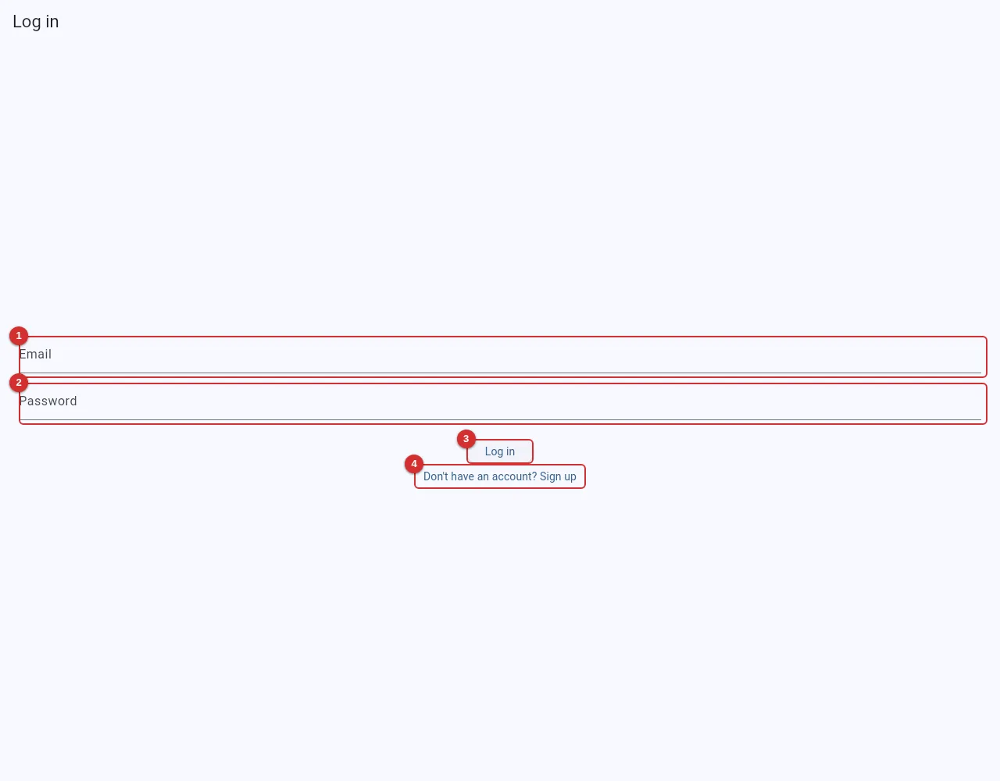

| # | Control | What it does |
|---|---|---|
| 1 | **Email** | Your account's email. |
| 2 | **Password** | Your password. |
| 3 | **Log in** | Enters the app. |
| 4 | **Don't have an account? Sign up** | Creates a new account, which starts as a regular user. Another admin has to make it an admin ([Users](#users)). |

### The menu and the top bar

In a wide window, the menu stays open on the left. In a narrow one, it opens with the ☰ icon.

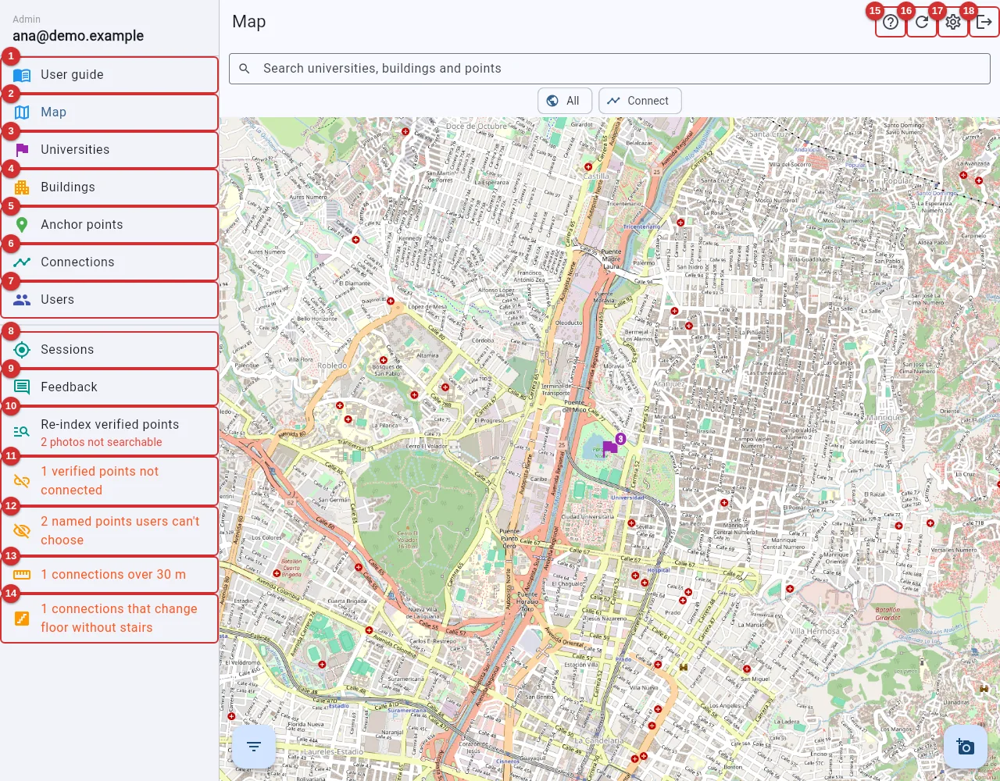

| # | Control | What it does |
|---|---|---|
| 1 | **User guide** | Opens this guide in another tab, to read next to the app. |
| 2 | **Map** | Where the app opens: universities, then their buildings, then their points. See [The points map](#points-map). |
| 3 | **Universities** | The campuses. See [Universities](#universities). |
| 4 | **Buildings** | Each campus's buildings. See [Buildings](#buildings). |
| 5 | **Anchor points** | The places the app learns to recognize. See [Anchor points](#anchor-points). |
| 6 | **Connections** | Where people can walk between points. See [Connections](#connections). |
| 7 | **Users** | The accounts. See [Users](#users). |
| 8 | **Sessions** | The trips made with the app. See [Sessions](#sessions). |
| 9 | **Feedback** | What users wrote after a trip. See [Feedback](#feedback). |
| 10 | **Re-index verified points** | Repairs the photo search. In red, how many photos can't be searched. See [Re-index](#reindex). |
| 11 | **N verified points not connected** | Notice: nobody can reach those points. Opens the filtered list. |
| 12 | **N named points users can't choose** | Notice: a destination saved with an in-between type. |
| 13 | **N connections over 30 m** | Notice: routes don't use them. |
| 14 | **N connections that change floor without stairs** | Notice: routes don't use them. |
| 15 | **Help for this page** (?) | Opens this guide at the section for the page you're on. |
| 16 | **Refresh** | Loads the data from the server again. |
| 17 | **Settings** | Language, font size and more. See [Settings](#settings). |
| 18 | **Log out** | Signs you out right away, without asking. |

The orange notices (11 to 14) only appear when there's something to fix. See [Menu notices](#notices).

## 2. The whole job, start to finish

Each step builds on the one before. If you skip one, the next one's dropdown is empty and tells you what to add first.

1. **Create the [university](#universities)**, one per campus.
2. **Create its [buildings](#buildings)**, with how many floors each has.
3. **Create the [anchor points](#point-form).** First the places people want to go (entrances, classrooms, restrooms, the cafeteria), with a clear name. Then the in-between points (hallways, intersections, stairs), every 6 to 8 m along the paths.
4. **Add [photos](#photos)** to each point, 4 to 8, one per direction. They're how the app recognizes where the user is.
5. **[Verify](#verify) each point** after reviewing its photos. An unverified point doesn't exist for users.
6. **[Connect](#connect-on-map) the points** in a chain along the paths. Routes only follow connections: a point with no connections doesn't appear for users.
7. **Test a route** with [Test as user](#phone-only) on the phone, walking it.
8. **Review the [session](#sessions)** to see how well it worked, and fix what's needed.

**Example.** So that someone can go from the Library door to the restroom: create "Universidad Demo" and the "Biblioteca" building. Create "Entrada principal" (type Entrance), "Baño mujeres" (type Restroom) and a Hallway point every 7 m between them. Upload each one's photos, verify them, and connect them in order in **Connect on map**. Done: "Baño mujeres" can now be chosen as a destination.

## 3. Universities

A university is a campus or site. Everything else belongs to one.

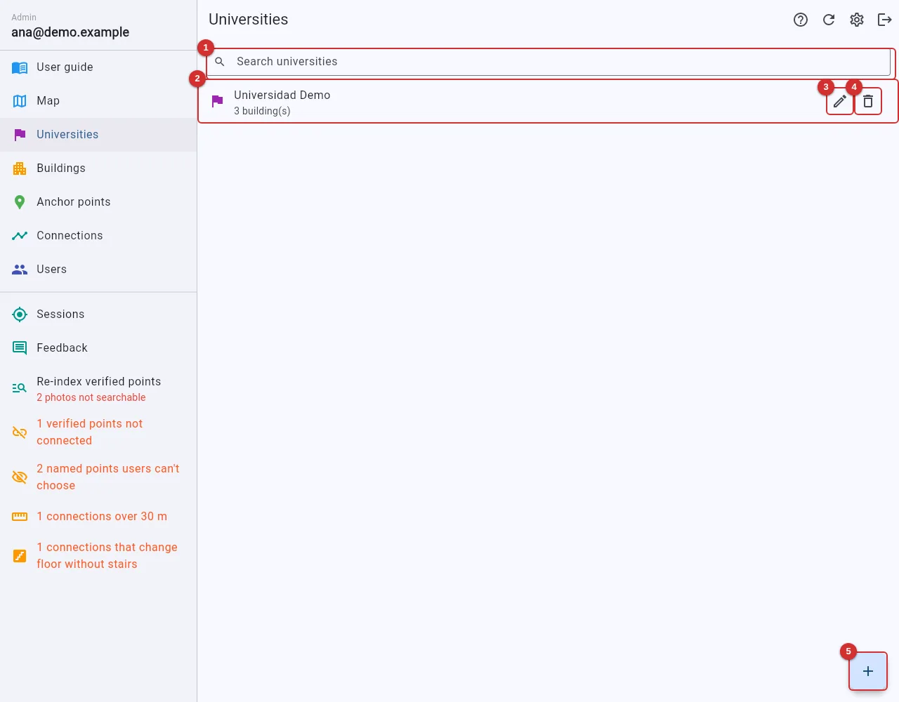

| # | Control | What it does |
|---|---|---|
| 1 | **Search universities** | Filters the list as you type. |
| 2 | University row | Shows its name and how many buildings it has. |
| 3 | **Edit** (pencil) | Changes its details. The code can't be changed. |
| 4 | **Delete** (trash) | Deletes it with everything in it. See [Deleting data](#deleting). |
| 5 | **Add university** (+) | Opens the form below. |

### Adding a university

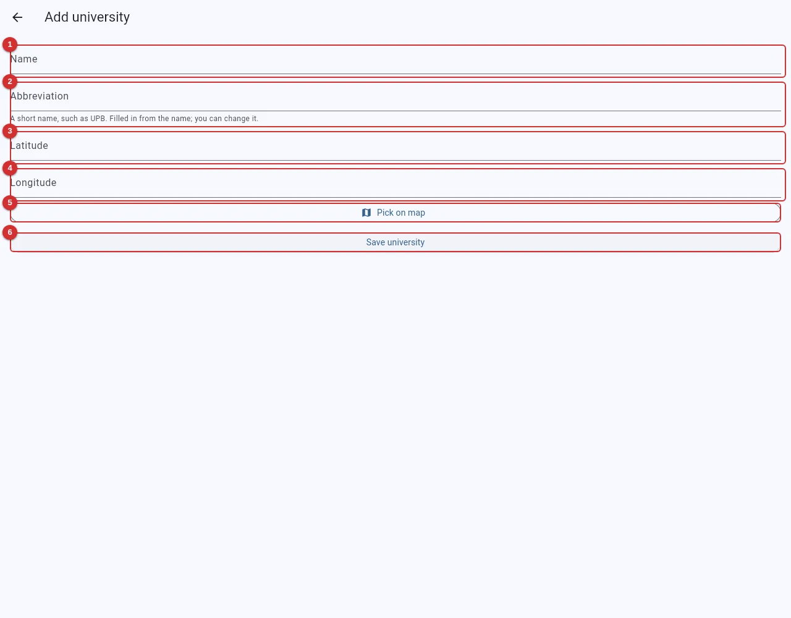

| # | Field | What it means | Example |
|---|---|---|---|
| 1 | **Code** | A short, unique identifier. Required, and can't be changed later. | `ICESI` |
| 2 | **Name** | The full name shown across the app. Required. | `Universidad Icesi` |
| 3 | **Address (optional)** | For reference only. | `Calle 18 #122-135` |
| 4 | **Latitude** | The campus's rough center, in decimal degrees. Required. | `3.3417` |
| 5 | **Longitude** | The same. Required. | `-76.5302` |
| 6 | **Pick on map** | Fills in the two above by tapping a map. | |
| 7 | **Save university** | Creates the university. | |

> **On the web, type rough coordinates first.** The web app doesn't use GPS, so with no coordinates the map opens in the ocean, at 0,0. Copy the location from any online map, then adjust it with **Pick on map**.

Editing also shows a switch to **deactivate** it without deleting: its buildings and points stop being offered to users, and the history is kept.

## 4. Buildings

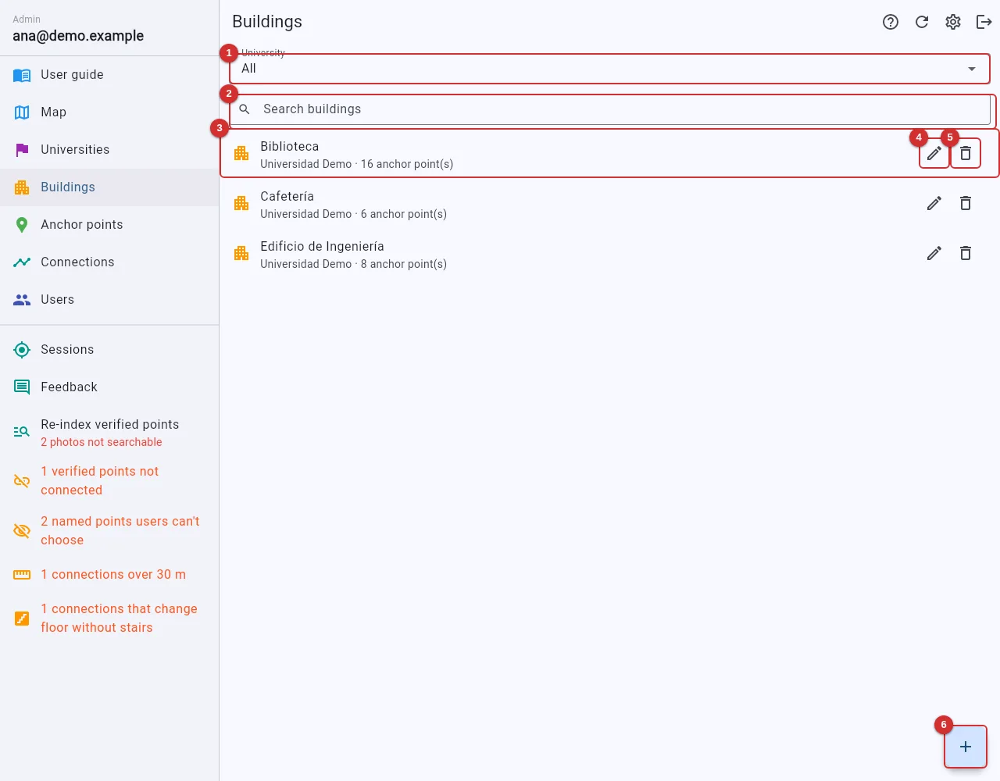

| # | Control | What it does |
|---|---|---|
| 1 | **Search buildings** | Filters the list as you type. |
| 2 | Building row | Shows its university and how many points it has. |
| 3 | **Edit** (pencil) | Changes its details, including which university it belongs to. The code can't be changed. |
| 4 | **Delete** (trash) | Deletes it with everything in it. See [Deleting data](#deleting). |
| 5 | **Add building** (+) | Opens the form below. |

### Adding a building

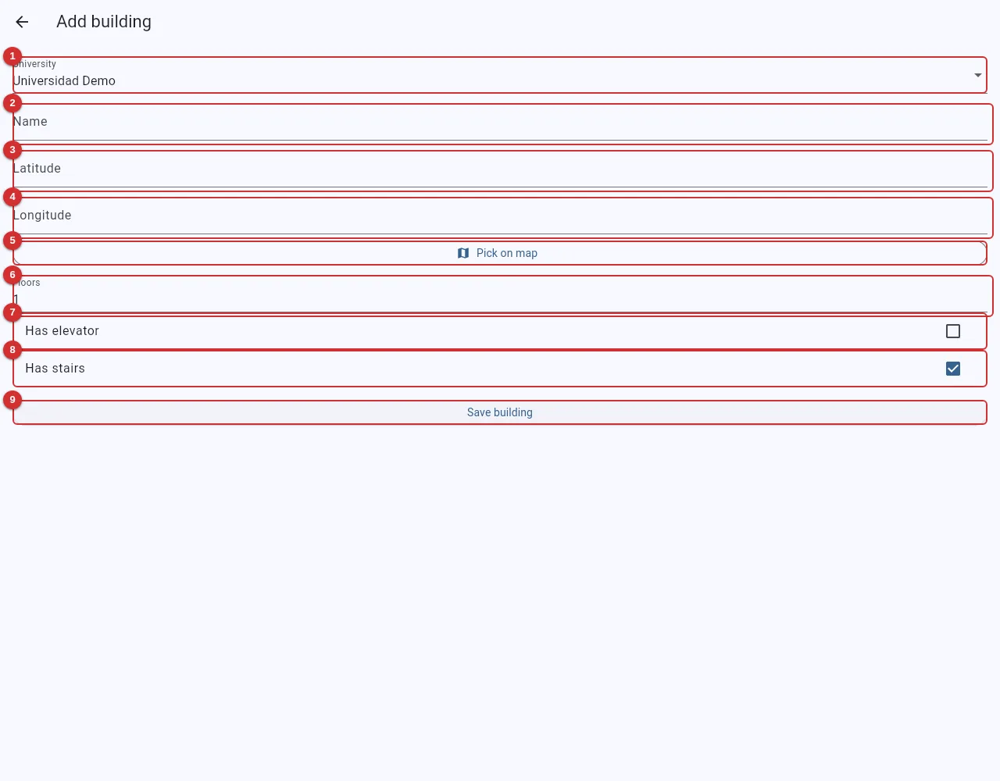

| # | Field | What it means | Example |
|---|---|---|---|
| 1 | **University** | Which one it belongs to. Required. | |
| 2 | **Code** | A short, unique identifier. Required, and can't be changed later. | `BIB` |
| 3 | **Name** | The full name. Users can also say it by voice, so use the name people know it by. Required. | `Edificio C` |
| 4 | **Address (optional)** | For reference only. | |
| 5 | **Latitude** | The building's position. Required. A point over 300 m from it is refused. | |
| 6 | **Longitude** | The same. Required. | |
| 7 | **Pick on map** | Fills in the two above by tapping a map, which opens at the chosen university. | |
| 8 | **Floors** | How many floors it has. Gives its points their floor options. | `3` |
| 9 | **Has elevator** | Accessibility information. | |
| 10 | **Has stairs** | Accessibility information. | |
| 11 | **Save building** | Creates the building. | |

Editing also shows a switch to **deactivate** it without deleting.

## 5. Anchor points

An anchor point is a specific physical place (a door, an intersection, an elevator lobby) that the app learns to recognize from its photos. When the user's camera sees something matching, the app corrects their position. Points are also the stops of a route.

There are two kinds of point, by their **location type**:
- **Destinations** (classroom, restroom, cafeteria…): users choose them. They need a name.
- **In-between points** (hallway, intersection, stairs…): they only join paths. They don't need a name, and users never choose them.

### The list

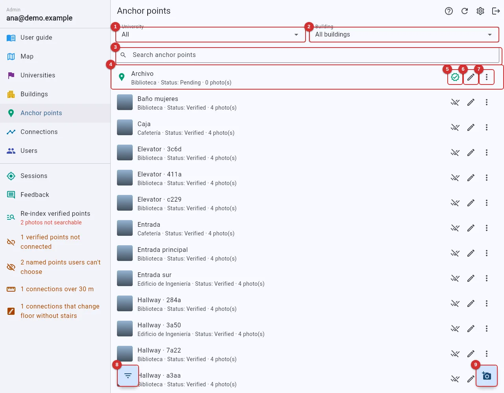

| # | Control | What it does |
|---|---|---|
| 1 | **All / Pending / Verified / Rejected** | Shows only points with that status, and how many there are. |
| 2 | **Filters** | Opens more filters (below). |
| 3 | **Search anchor points** | Searches by name. |
| 4 | Point row | Shows its building, status and photo count. **Tapping it opens the map in Connect mode** with this point already selected. |
| 5 | **Verify** | Verifies the point. On a verified one, this button puts it back to pending. See [Verifying](#verify). |
| 6 | **Edit** (pencil) | Opens [the point's edit page](#point-edit). |
| 7 | **More actions** (⋮) | Opens the menu below. |
| 8 | **New anchor point** (camera) | Opens [the form](#point-form). |

Unnamed points show their type and the start of their id, for example "Hallway · 284a".

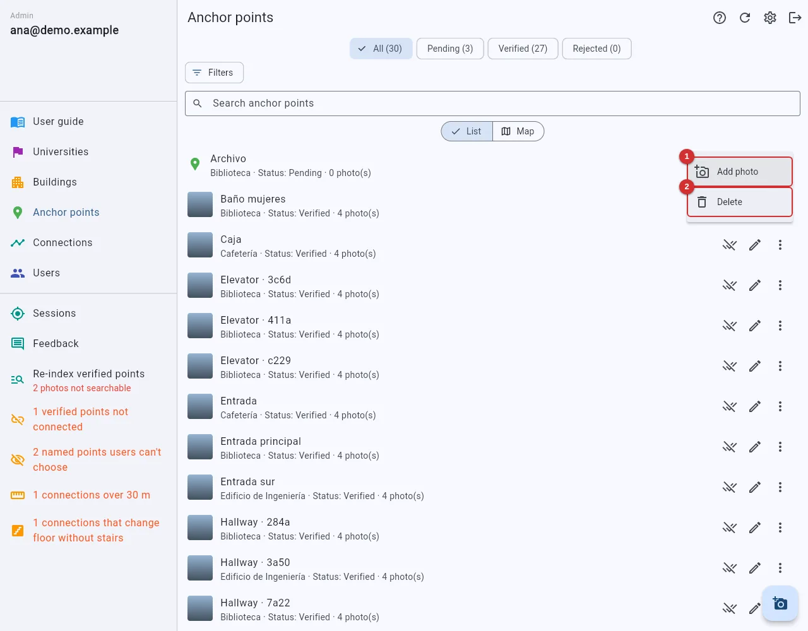

| # | Option | What it does |
|---|---|---|
| 1 | **Add photo** | Opens [the point's photos](#photos). |
| 2 | **Delete** | Deletes the point, its photos and its connections. See [Deleting data](#deleting). |

### Filters

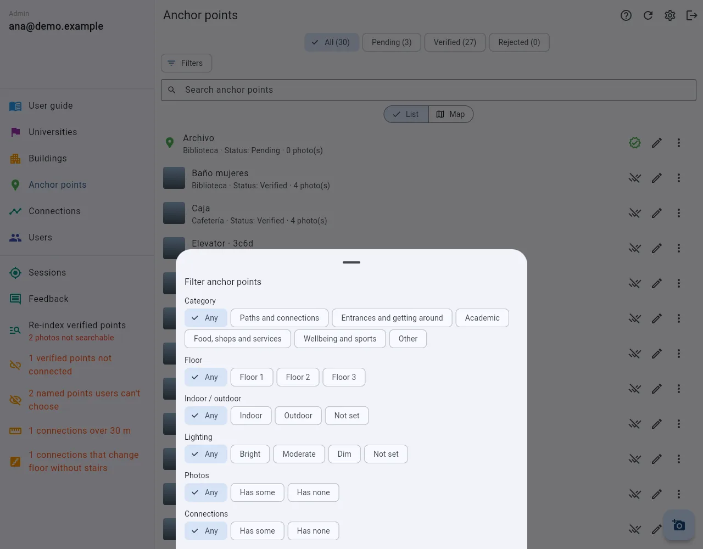

Narrows by **category** and type, **floor**, **indoors or outdoors**, **lighting**, and whether it **has photos** or **connections**. They combine with the status and the search. They help find pending work: for example, Verified + no connections are points nobody can use yet.

### Creating a point

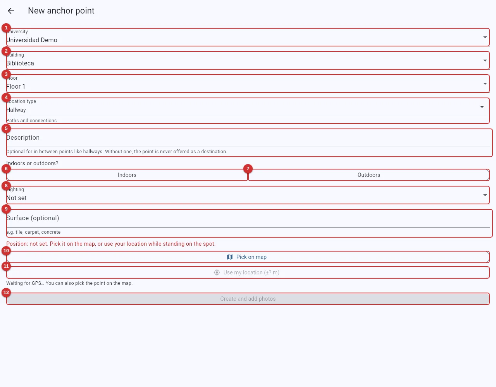

| # | Field | What it means |
|---|---|---|
| 1 | **University** | Filters the building list. |
| 2 | **Building** | Which one the point belongs to. Required. |
| 3 | **Floor** | Which floor it's on. "Floor 1" is the ground floor. The options come from the building's floors. |
| 4 | **Location type** | What kind of place it is. Opens a picker by category, with a search box. Full list in [Quick reference](#reference). |
| 5 | **Description** | The name users choose and hear. Required for destinations. Describe the real place: "South entrance" is much better than "Point 1". **Don't repeat the building**: it's removed on saving, and the app shows it alongside. |
| 6 | **Indoors** | The point is under a roof. You have to choose one of the two each time. |
| 7 | **Outdoors** | The point is in the open. |
| 8 | **Lighting** | Optional: bright, moderate or dim. It helps whoever reviews the photos: a dark photo may simply be a dark hallway. |
| 9 | **Surface (optional)** | Optional: tile, carpet, concrete… |
| 10 | **Pick on map** | Sets the position by tapping a map. It's the most precise. |
| 11 | **Use my location** | Sets the position from GPS, standing right on the point. Phone only, and with an accuracy of ±8 m or better. It stays disabled on the web. |
| 12 | **Create and add photos** | Saves the point and opens its photos. Disabled until you set the position. |

The position is required on purpose: the app doesn't take the GPS by itself, since that saved points in the wrong places.

The app stops you in two cases:
- **Another point under 3 m away**, in the same building and floor. It's almost always the same place saved twice: add photos to the existing one.
- **A name on an in-between type.** Users can only choose destinations, so a "Restroom" saved as a Hallway never appears for them. Tap **Change type**, unless it really is a named waypoint.

The form remembers the university, building, type, floor, lighting and surface of the last point you created.

### Picking the position on the map

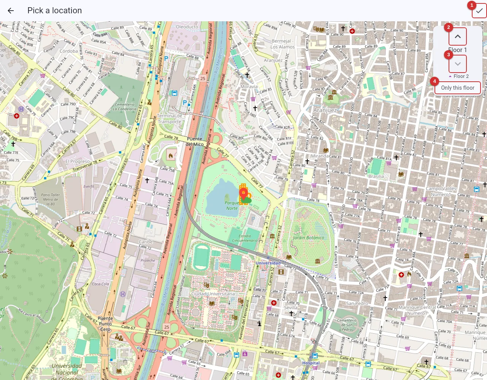

Tap the exact spot: **the tip of the pin** marks where it goes. Existing points are colored by status. The map opens on the form's floor; changing floor here only changes what you see, not the point's floor.

| # | Control | What it does |
|---|---|---|
| 1 | **Confirm location** (✓) | Returns to the form with that position. |
| 2 | **Go up a floor** | Shows the floor above. |
| 3 | **Go down a floor** | Shows the floor below. |
| 4 | **Only this floor** | Hides the points on the neighboring floors. See [Floors](#floors). |

### Editing a point

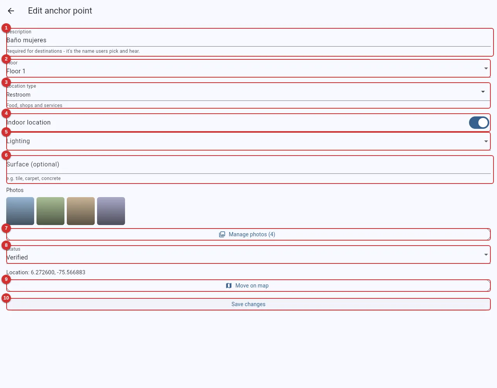

| # | Control | What it does |
|---|---|---|
| 1 | **Description** | The name, as when creating it. |
| 2 | **Floor** | Which floor it's on. |
| 3 | **Location type** | Destination or in-between. |
| 4 | **Indoor location** | Indoors or outdoors. |
| 5 | **Lighting** | As when creating it. |
| 6 | **Surface (optional)** | As when creating it. |
| 7 | **Manage photos (N)** | Opens [the photos](#photos). The thumbnails above it let you review them at a glance. |
| 8 | **Status** | Pending, Verified or Rejected. See [Verifying](#verify). |
| 9 | **Move on map** | Picks another position. |
| 10 | **Save changes** | Saves. |

### Photos

A person can reach a place from any side, so the app needs to see it from each direction. Take **4 to 8 photos standing on the point**, one toward each side (N, S, E, W, adapting to the place; a corner may only have two or three directions worth taking).

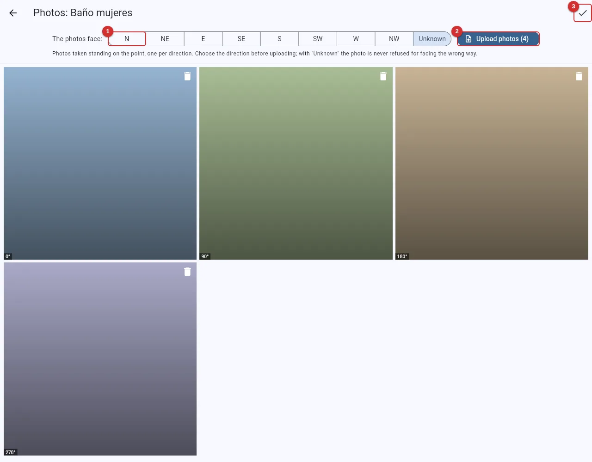

The images above are placeholders; here you'll see your photos, with their direction in the corner.

| # | Control | What it does |
|---|---|---|
| 1 | **The photos face** (N, NE, E…, Unknown) | Which way the photos you're about to upload face. Choose **Unknown** if you're not sure: that photo is never discarded for facing another way. |
| 2 | **Upload photos (N)** | Picks one or more images from your computer. N is how many the point has. |
| 3 | **Done** (✓) | Finishes and goes back. |

Each photo's trash icon deletes it, after asking. To take photos with the camera, see [Phone only](#phone-only).

### Verifying a point

The status decides whether a point exists for users:

| Status | Meaning |
|---|---|
| **Pending** | Captured, not reviewed. Users don't see it, and the app doesn't recognize it. |
| **Verified** | Reviewed. Its photos go into the search, and it can be part of a route. |
| **Rejected** | Reviewed and discarded (bad photos, a duplicate…). It leaves the search, without being deleted. |

Before verifying, look at its photos: are they clear, and do they show the right place? Verify with the row's ✔ button, or with **Status** on the edit page.

With no photos, it can't be verified:

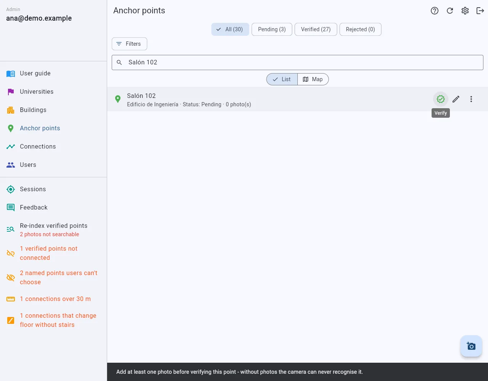

With no connections, the app asks first. You can verify anyway and connect later, but until then users can't reach that point or leave from it:

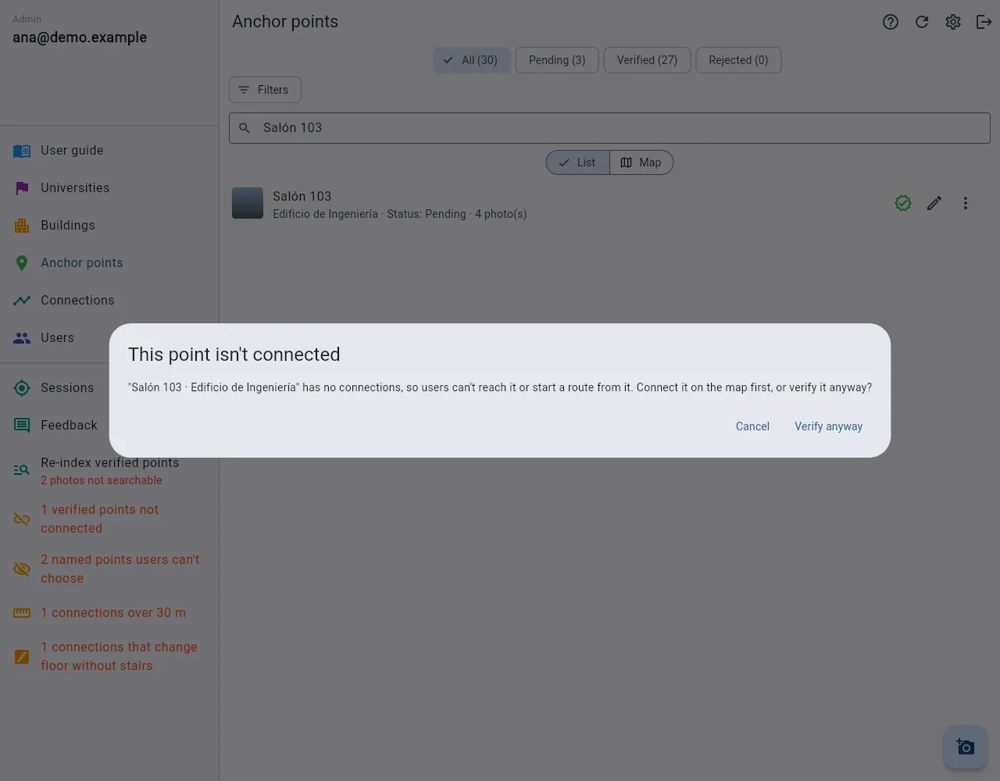

**If an indexing error appears**, the point is verified but the photo search didn't receive it. See [Re-index](#reindex).

### The points map

**Map** shows the same filtered points: green verified, grey pending, red rejected. The lines are their connections.

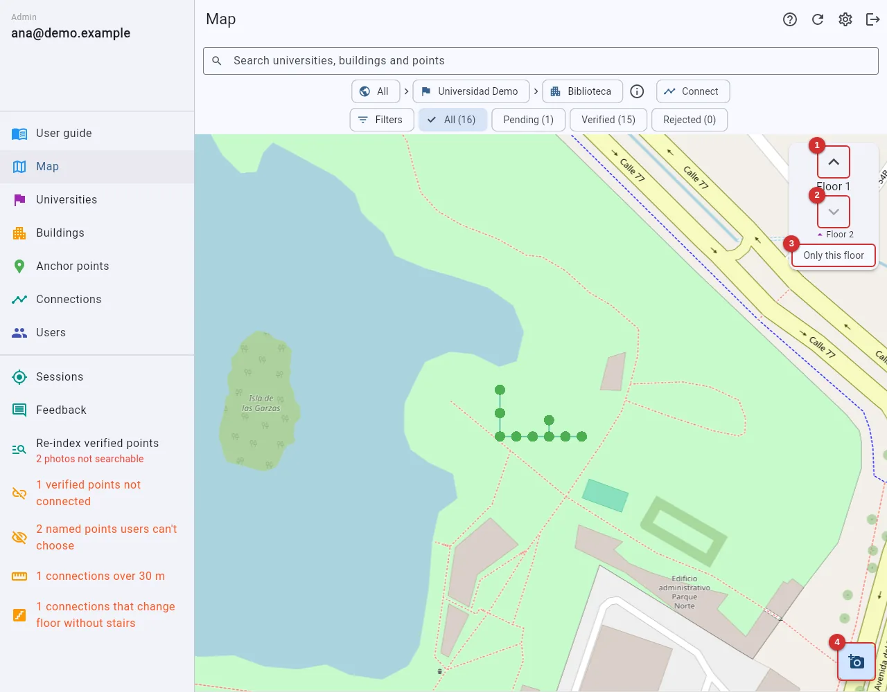

| # | Control | What it does |
|---|---|---|
| 1 | **Go up a floor** | Shows the floor above. |
| 2 | **Go down a floor** | Shows the floor below. |
| 3 | **Only this floor** | Hides the neighboring floors. See [Floors](#floors). |
| 4 | **New anchor point** | Opens [the form](#point-form). |

Tap a point to see its details and actions:

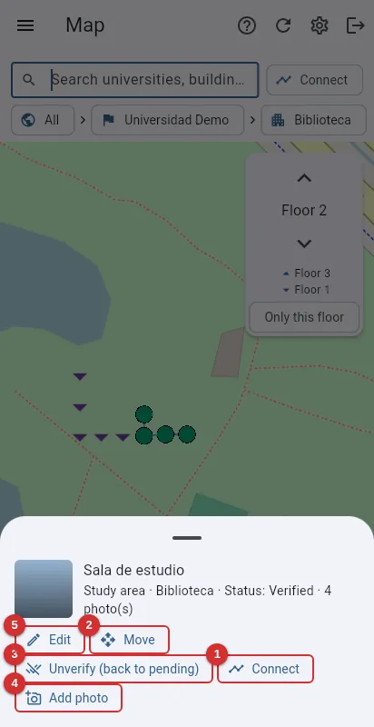

| # | Button | What it does |
|---|---|---|
| 1 | **Connect** | Opens [Connect on map](#connect-on-map) with this point selected. |
| 2 | **Move** | Changes its position (below). |
| 3 | **Verify** / **Unverify** | Changes its status. |
| 4 | **Add photo** | Opens [its photos](#photos). |
| 5 | **Edit** | Opens [its edit page](#point-edit). |

**Moving a point.** Tap **Move**, then the new position: the tip of the pin marks where it goes. **Save new position** saves it, and **Cancel** discards it. The app also updates the photo search and its connections' distances. It won't move a point if that stretches one of its connections past 30 m.

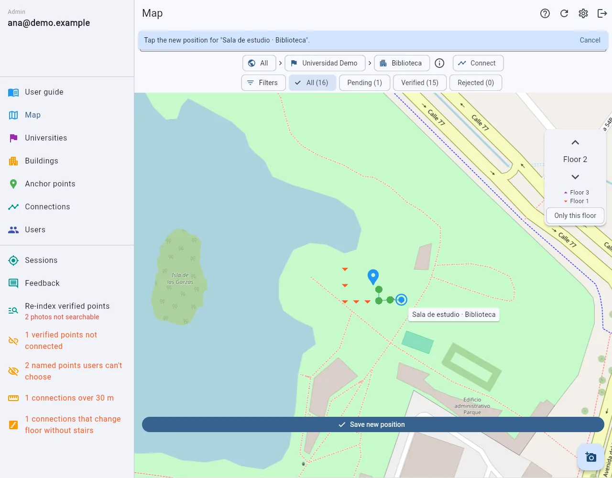

### Floors on the maps

Maps show one floor at a time. You change floor like in an elevator, and the box says which floor you're on. This control appears on every map that shows points, and only when there's more than one floor.

- Points on the **current floor** look normal.
- Those on the **floor above** are purple ▲, and on the **floor below**, orange ▼. Floors further away aren't shown.
- Lines are only drawn if they touch the current floor, and are dashed if they change floor.

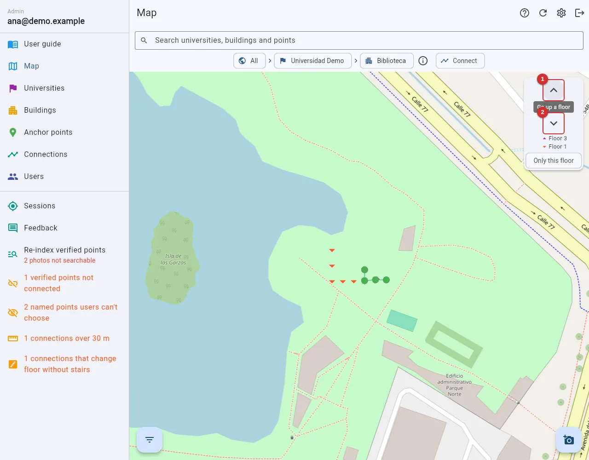

**Only this floor** hides the ▲ and ▼. The app remembers this option in this browser.

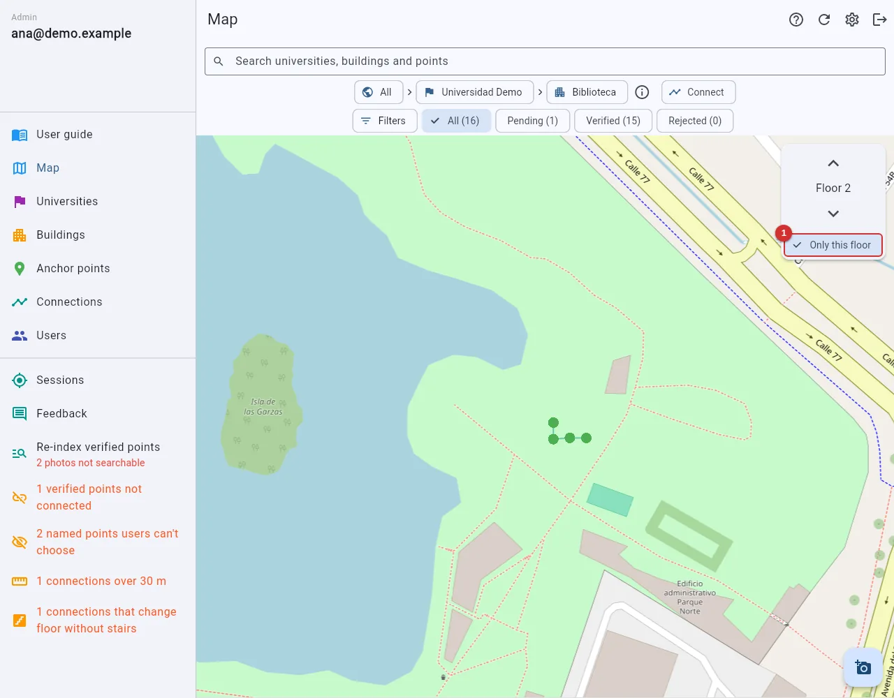

## 6. Connections

A connection says that **a person can walk directly between two points**. Routes only follow connections, and guidance walks a straight line between two connected points.

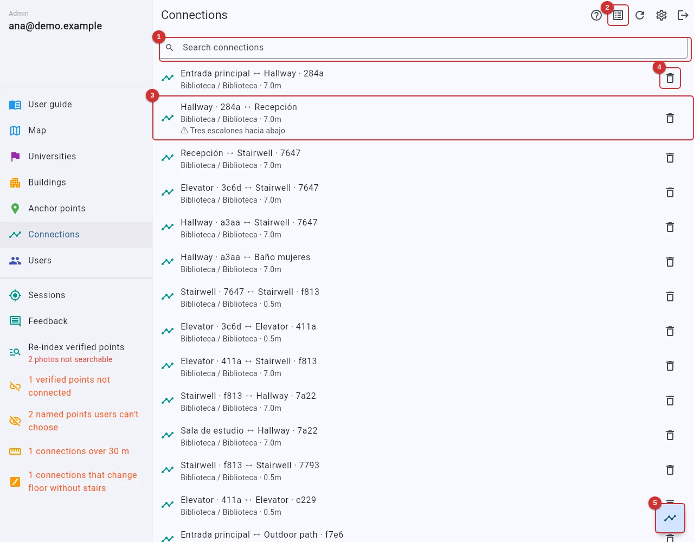

| # | Control | What it does |
|---|---|---|
| 1 | **Search connections** | Searches by its points' names. |
| 2 | **Add connection (form)** | Opens [the form](#connection-form). |
| 3 | Connection row | Shows its two points, their buildings and its distance. **Tapping it** opens its warning for users (below). ⚠ means it has one. |
| 4 | **Delete** (trash) | Deletes the connection, after asking. The points aren't touched. |
| 5 | **Connect on map** | Opens [the map](#connect-on-map). |

### Rules

The app and the server apply these rules:
- **At most 30 m in a straight line.** A 50 m connection between buildings goes through whatever is in between. Capture points every 6 to 8 m and chain-connect them. Above 15 m, the app warns.
- **Floors only change** through a stairwell, elevator or ramp point.
- A distance typed by hand can't be shorter than the straight line.

Old connections that break these rules aren't used for routes: a trip that needed one says there's no route until it's redone. The menu lists them ([Menu notices](#notices)).

### Warnings for users

The app **can't see obstacles**: it only knows what someone wrote down. For a step, a bin or a narrow door, tap the connection and write a short warning. It's said to the user as they start that stretch: "Attention: three steps down".

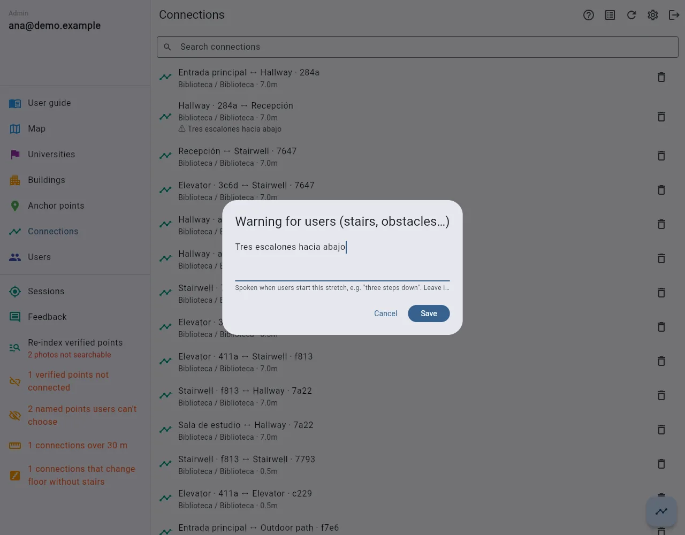

Stairs, elevators and ramps are announced on their own about 8 m before, if the point has that type.

### Connect on map

The fastest way to connect a whole hallway.

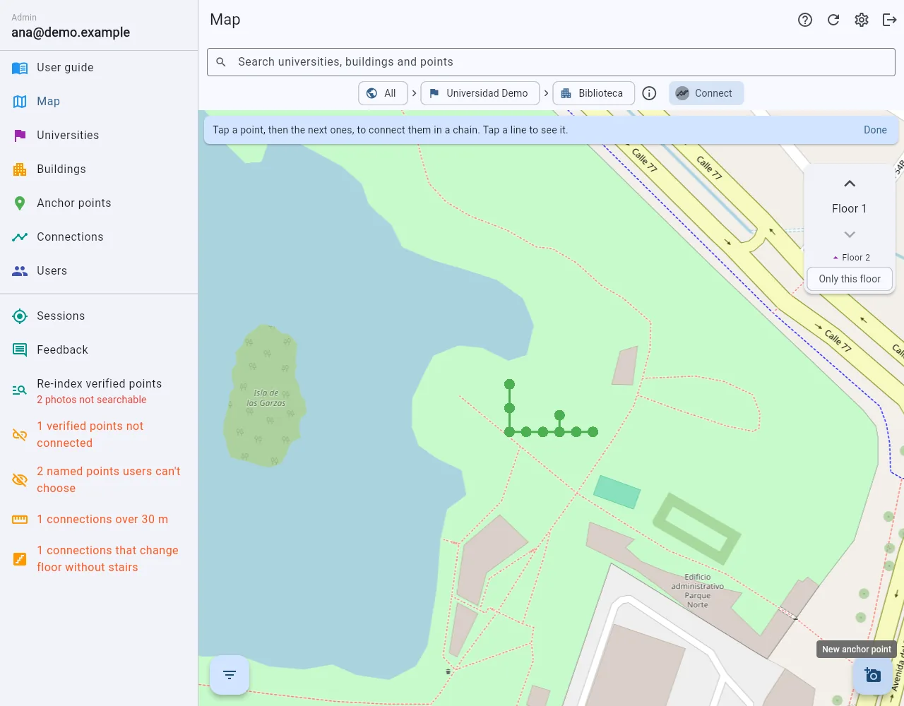

1. Choose the **university** and, to narrow it down, the **building**.
2. Tap a point to select it. A tap near it is enough, and it shows in blue.
3. Tap the next one: the connection is created, and **that point stays selected**, so you can keep tapping along the hallway.
4. Tap the selected point to deselect it.

Connections are green lines. A new one is dotted grey while it saves, and you can keep tapping. To **delete** one, tap the line away from the points and confirm.

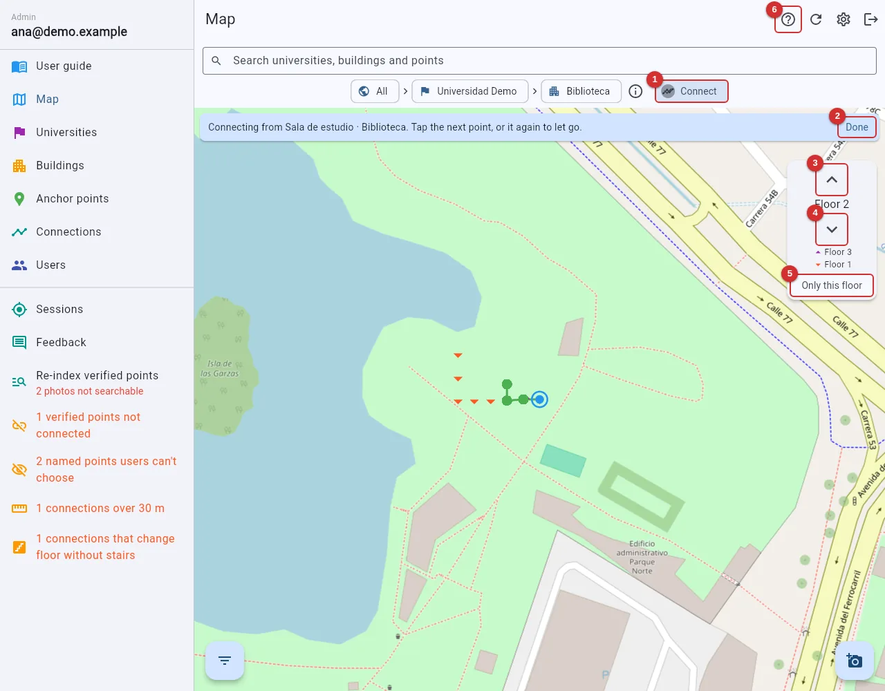

| # | Control | What it does |
|---|---|---|
| 1 | **Connect** | Connect mode: on, a tapped point joins the chain instead of opening. |
| 2 | **Done** | Leaves Connect mode. Back does too, after letting go of the selected point. |
| 3 | **Go up a floor** | Shows the floor above. |
| 4 | **Go down a floor** | Shows the floor below. |
| 5 | **Only this floor** | Hides the neighboring floors. It must be off to connect across floors. |
| 6 | **Help for this page** | Opens this section. |

**Connecting two floors.** Create a stairwell, elevator or ramp point **on each floor**, one above the other. Tap the one on the current floor, then the ▲ or ▼ on the other floor. The line is dashed, and the map moves to that floor so you can keep chaining. **Connect the elevator if there is one**: routes prefer it.

### Connecting with the form

Use it when you need to type the real distance or a warning from the start.

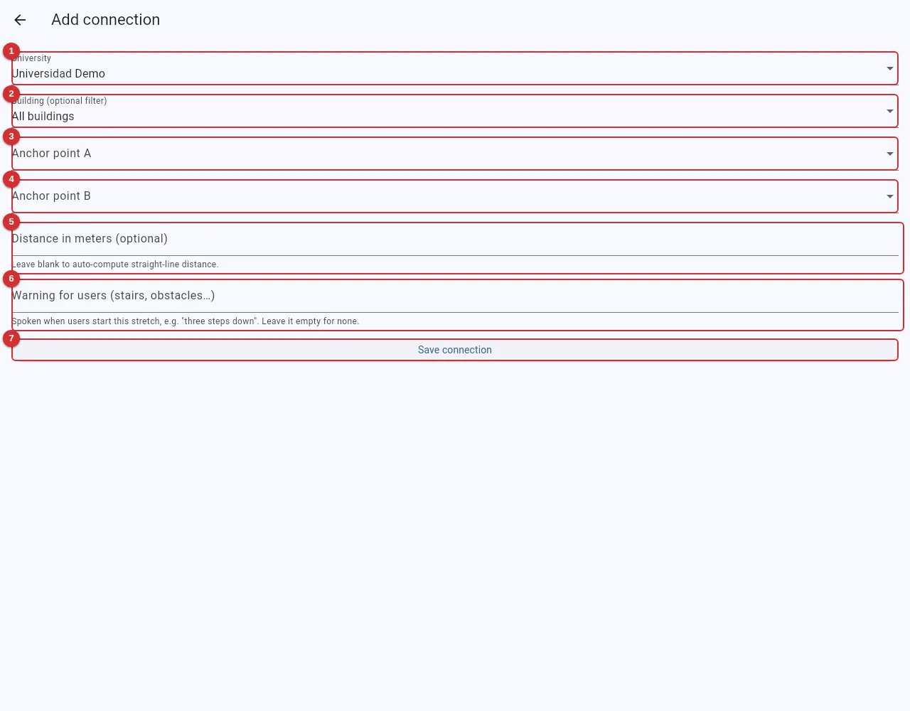

| # | Field | What it means |
|---|---|---|
| 1 | **University** | Filters the point lists. |
| 2 | **Building (optional filter)** | Narrows the lists further. |
| 3 | **Anchor point A** | One end. |
| 4 | **Anchor point B** | The other end. |
| 5 | **Distance in meters (optional)** | How far it really is to walk. Blank uses the straight line. Fill it in if the path bends. |
| 6 | **Warning for users** | What the user is told as they start this stretch. See [Warnings for users](#connection-warning). |
| 7 | **Save connection** | Creates the connection. |

The only thing you can change on a connection later is its warning. To change anything else, delete it and create it again. Saved routes that went through a deleted connection are recalculated on their own.

## 7. What users see

This explains most cases of "it doesn't show up" and "there's no route":

- **They only see verified points with at least one connection.** The rest don't exist for them.
- **They can only choose destinations**, meaning points of a type marked ★ in the [Quick reference](#reference), with a name.
- **The starting point** is the connected point nearest their GPS. If points on several floors are within 15 m, the app asks which floor they're on.
- **They can say a building** ("Edificio C"). The route ends at its entrance closest by walking, so **give each door the Entrance type** and connect it. With no entrance marked, it ends at the closest connected point on its lowest floor.
- **Names don't repeat the building.** "Entrada sur bloque 20" is saved as "Entrada sur". The user can still say "entrada sur bloque 20", and if there are several "Entrada sur" they're offered the nearest.
- **When changing floor**, the app tells them where to go ("Take the elevator to floor 3") and waits for the phone's barometer to detect the change.

## 8. Menu notices

The orange notices show map mistakes that affect users. They're worked out from the loaded data, and disappear when everything is fine.

| Notice | What it means | What to do |
|---|---|---|
| **N verified points not connected** | Nobody can reach them or leave from them. | Open the filtered list; connect them. |
| **N named points users can't choose** | They have a name, but an in-between type. | Tap one and change its type if users go there. Some may be deliberate ("Hallway to rooms 202"). |
| **N connections over 30 m** | Routes don't use them. | Tap one to delete it, and connect that path again through in-between points. |
| **N connections that change floor without stairs** | Routes don't use them. | Tap one to delete it, and connect the floors through a stairwell, elevator or ramp point on each floor. |

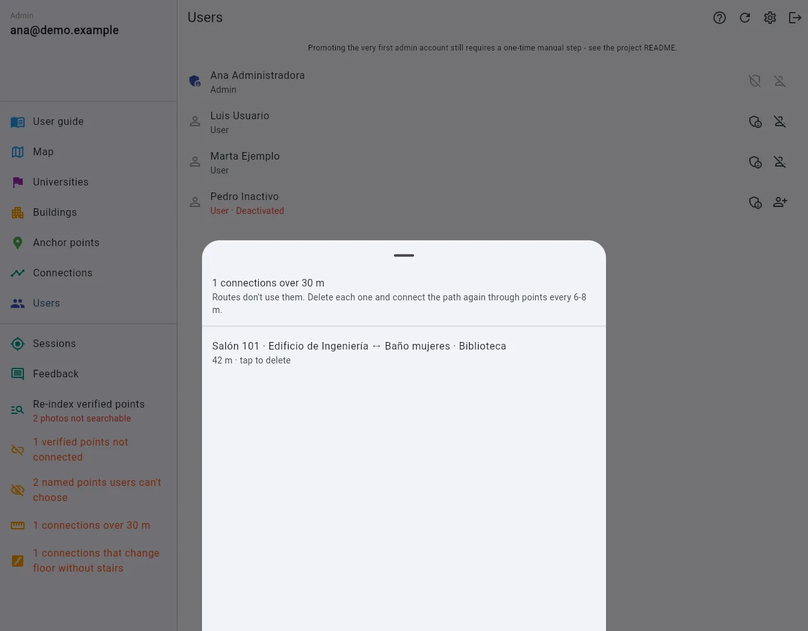

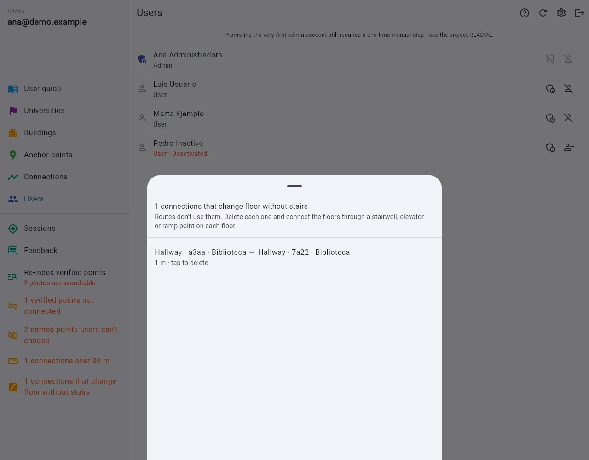

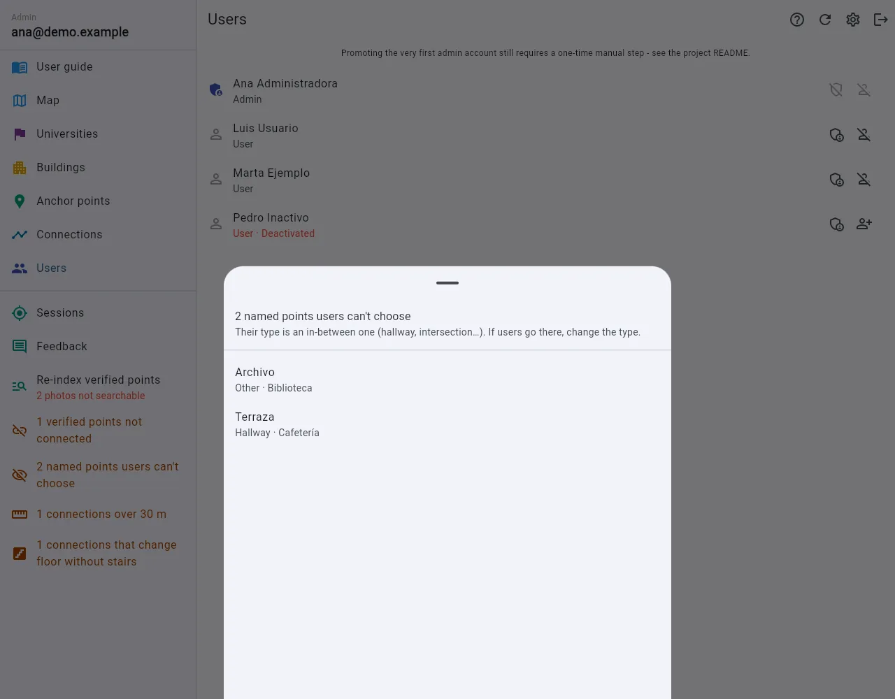

### Re-index verified points

If a verified point's photos didn't reach the search (because of a server problem), the app can't recognize it yet, and the menu says so in red: "N photos not searchable". Once the server is fine, tap **Re-index verified points**. It removes from the search what shouldn't be there, sends the missing points, retries failures, and ends with this summary, which lists any that still failed:

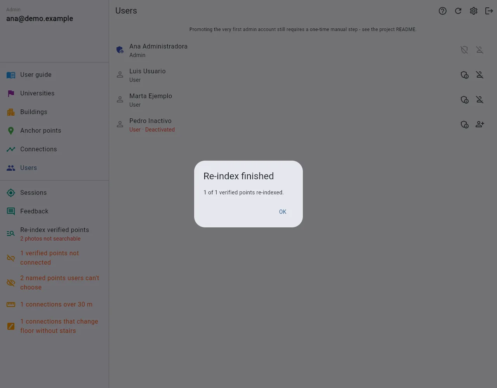

## 9. Users

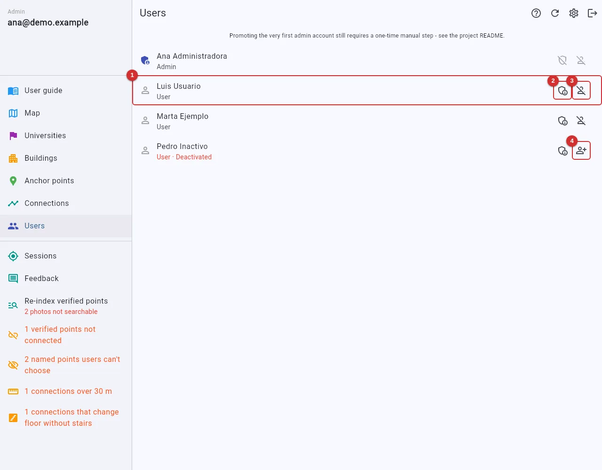

| # | Control | What it does |
|---|---|---|
| 1 | User row | Their name and role. "Deactivated" in red if blocked. |
| 2 | **Promote to admin** (shield) | Gives them admin rights, after asking. On an admin, this button removes them. |
| 3 | **Deactivate account** | Blocks the account without deleting it: it can't use the app or the web. |
| 4 | **Activate account** | Unblocks a deactivated account. |

On your own row these buttons are disabled.

- **Accounts with no profile:** if a sign-up didn't finish, the account appears in a highlighted card at the top, and its button creates the missing profile.
- **The first admin** of an installation is set by hand in the database, as the note above the list says.

**App versions.** The newest version and the one before it work. Anyone on the older one sees "New version available" on opening it. Older ones only show "Update required" until the new APK is installed, which is on the project's GitHub releases page.

## 10. Sessions

A session is a trip made with the app. **Sessions** lists people, with how many sessions they have and how many are active.

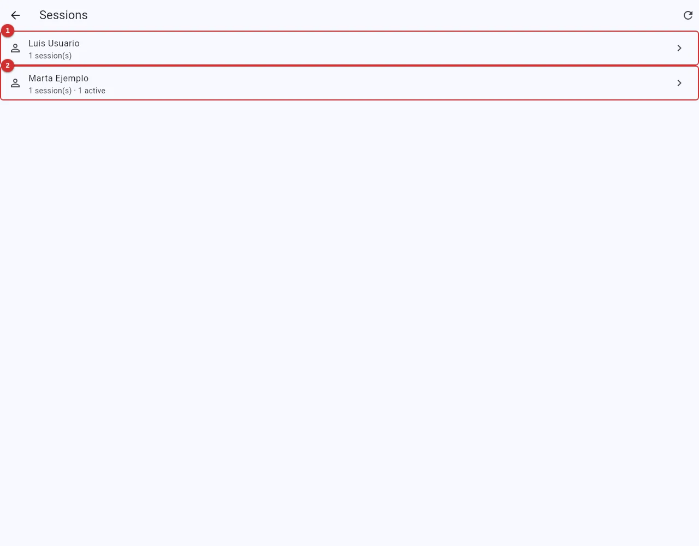

| # | Control | What it does |
|---|---|---|
| 1, 2 | User row | Opens their sessions (below). |

The arrow at the top right (**Refresh**) reloads them.

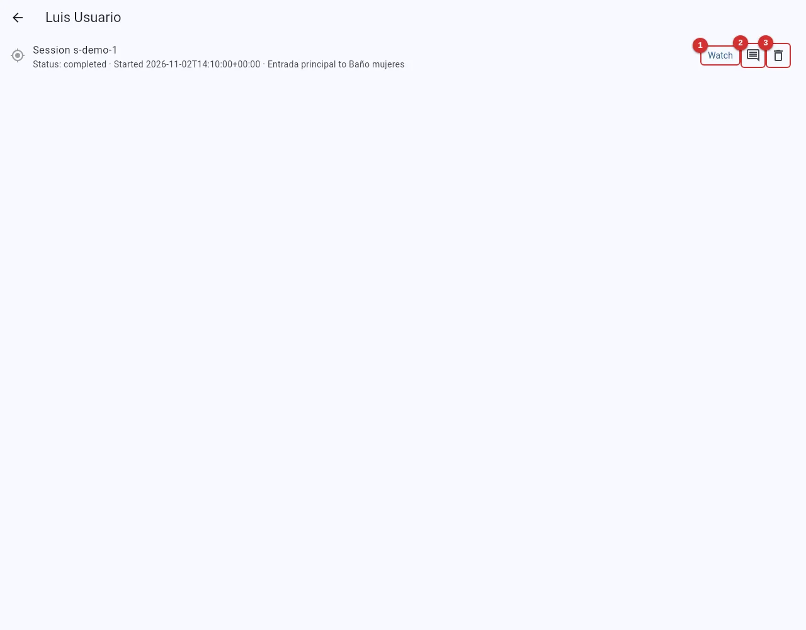

| # | Control | What it does |
|---|---|---|
| 1 | **Watch** | Opens the session's map (below). It updates by itself if the session is still active, to follow a trip live. |
| 2 | **View comment** | Shows what the user wrote at the end, if anything. |
| 3 | **Delete** (trash) | Deletes the session and its logs. |

### A session's map

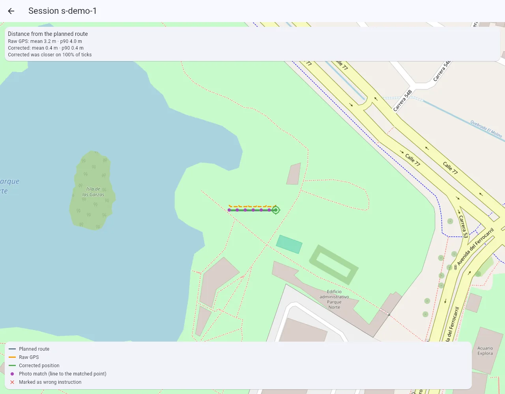

The card at the top sums up how far from the route the uncorrected GPS and the corrected position were. The legend at the bottom says what each thing is:
- **Blue-grey line:** the planned route. If it changes floor, stretches on other floors are faint, and the floor buttons appear.
- **Dashed orange line:** the uncorrected GPS.
- **Green line:** the corrected position.
- **Purple dots:** photo matches, with a thin line to the recognized point. A long line shows where the position was pulled from.
- **Red ✗:** an instruction marked as wrong during a test.

Tap any of them to see what was logged there: the position, what the app said, the heading and more.

## 11. Feedback

What users write after a trip, with their name, the date and how the trip ended. It's read-only.

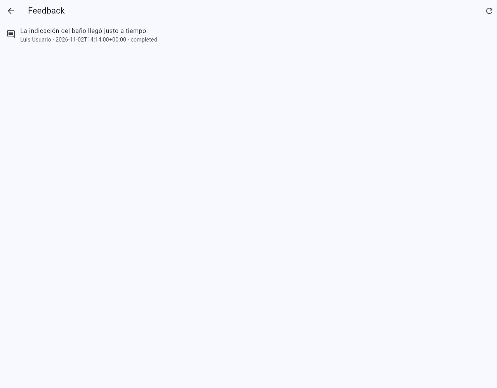

## 12. Settings

These are your own preferences; each user's are separate.

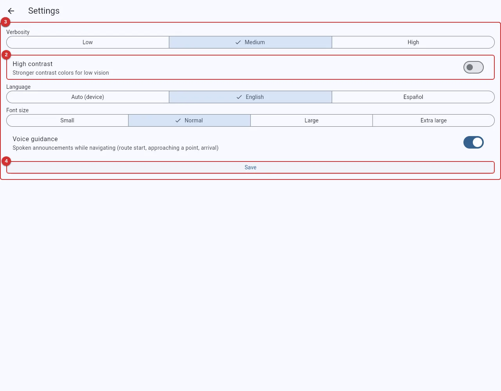

| # | Control | What it does |
|---|---|---|
| 1 | **Verbosity** | How much detail is shown: low, medium or high. |
| 2 | **High contrast** | Higher-contrast colors, for low vision. |
| 3 | **Language** | Automatic (the device's), English or Español. |
| 4 | **Save** | Saves the changes. |

There's also **Font size** (small to extra large) and **Voice guidance**, the spoken announcements during a trip.

## 13. Phone only

In a narrow window or the phone app, the menu opens with ☰. Everything else in this guide works the same.

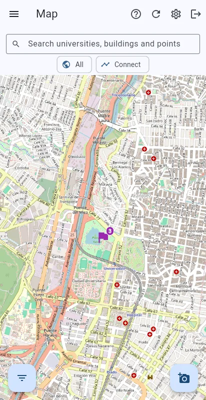

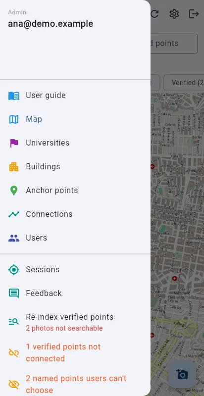

Two things need the phone, because they use the camera and sensors. This guide has no pictures of them.

### Taking photos with the camera

1. Open a point's **Add photo**, or **Create and add photos** when creating it.
2. Stand on the point. The **Facing: N°** badge shows which way the phone points, and is saved with each photo.
3. Tap **Take photo** in each direction. Each photo uploads by itself, and appears below with its heading.
4. Tap a photo's trash icon to delete it, and **Done** (✓) when finished.

### Test as user

**Test as user** (in the phone's menu) lets you make a real trip with your account. You see the map and coordinates, which a regular user doesn't: they only have **Repeat instruction** and **End navigation**.

- **✗ Wrong instruction:** tap it each time the app says something wrong. It saves what was just said and where you were.
- **I'm at…:** to measure accuracy, walk the planned route exactly and tap it standing on each point it names (the start, each corner, the destination). A long press undoes the last one.
- Then review the trip in [Sessions](#sessions).

**How to hold the phone.** Upright in front of the chest, with the back camera facing forward. Explain it this way to testers; the app's tutorial says so too.

## 14. Deleting data

Before deleting, the app says what else goes with it. Read it carefully: **it can't be undone**.

| Deleting | Also deletes |
|---|---|
| **A university** | Its buildings, their points, and those points' photos and connections. |
| **A building** | Its points, their photos and their connections. |
| **A point** | Its photos and its connections. |
| **A connection** | Nothing else. |

Saved routes through a deleted point are deleted with it, and trip history is kept. To stop using something without losing its data, **deactivate** the university or building, or set the point to **Rejected**.

## 15. Common problems

| Problem | Likely cause | What to do |
|---|---|---|
| A place doesn't appear as a destination | It's not verified, has no connections, or its type is in-between. | Check all three, and the [menu notices](#notices). |
| "No route" | A connection is missing on the way, or it uses one over 30 m. | Connect the missing stretch with **Connect on map**. |
| "Your starting point isn't connected" | Only loose points are near the user. | Connect the points in that area. |
| "Edificio C" gives no route | The building has no verified, connected points. | Verify and connect its points, and mark its doors as **Entrance**. |
| I can't connect two points | They're over 30 m apart, or on different floors with no stairs, elevator or ramp. | Add in-between points, or connect through a point of that type. |
| I can't see a point on the map | It's on another floor, or a filter is on. | Use ▲ ▼, turn off **Only this floor**, and clear the filters. |
| **Create and add photos** is disabled | The position is missing, or indoors or outdoors isn't chosen. | Use **Pick on map** and choose one of the two. |
| The map opens in the ocean | The web has no GPS, and it's a new university. | Type rough coordinates first. |
| The app doesn't recognize a place | Its photos aren't in the search. | Use [Re-index](#reindex). |
| "Update required" | The app is too old. | Install the newest APK. |

## 16. Quick reference

### Location types

Types with ★ are **destinations**: they need a name, and users can choose them. The rest are in-between points.

| Category | Types |
|---|---|
| Paths and connections | Hallway, Outdoor path, Intersection, Stairwell, Elevator, Ramp, Crosswalk, Courtyard |
| Entrances and getting around | Entrance ★, Exit / gate ★, Lobby ★, Parking ★, Bike parking ★, Bus stop ★, Waiting area / benches ★ |
| Academic | Classroom ★, Laboratory ★, Library ★, Computer room ★, Study area ★, Auditorium ★, Office ★ |
| Food, shops and services | Cafeteria ★, Stationery shop ★, Copy / print center ★, Store ★, ATM / bank ★, Restroom ★, Drinking fountain ★ |
| Wellbeing and sports | Infirmary / medical service ★, Gym / sports area ★, Chapel ★ |
| Other | Other |

### Lighting

| Option | Meaning |
|---|---|
| Not set | No information. |
| Bright | Well lit, for example by daylight. |
| Moderate | Normal indoor lighting. |
| Dim | Poorly lit, for example an indoor stairwell. |

Maps © [OpenStreetMap](https://www.openstreetmap.org/copyright) contributors.
