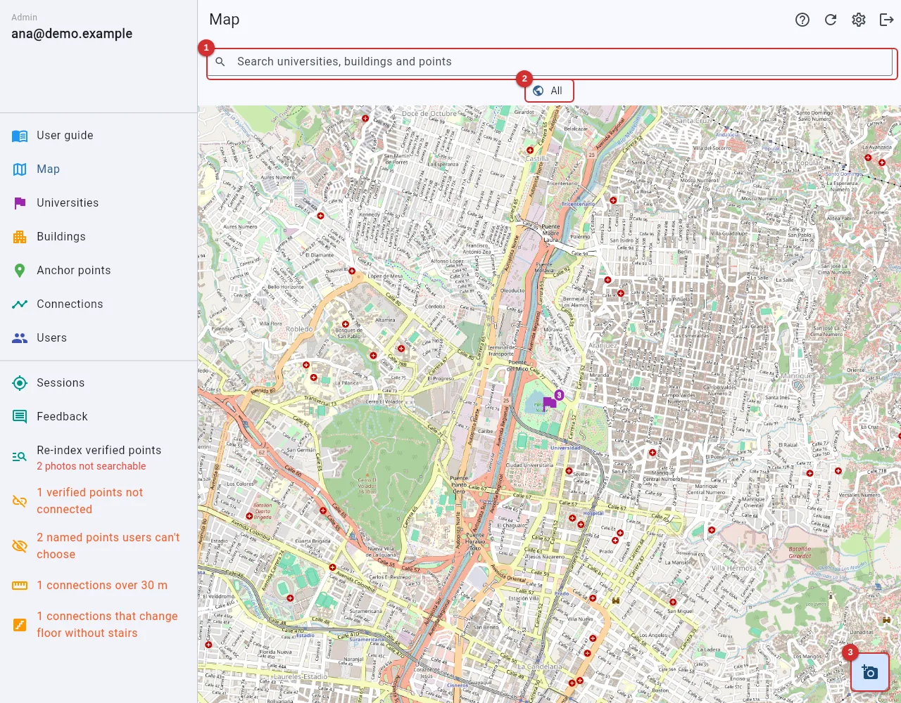
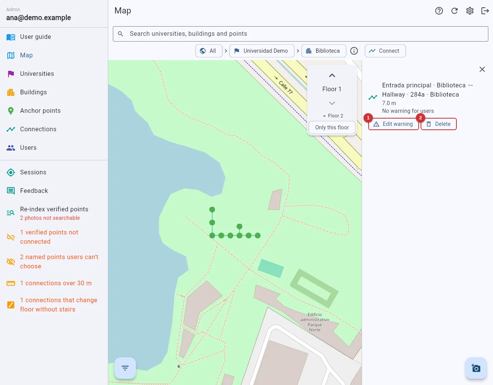
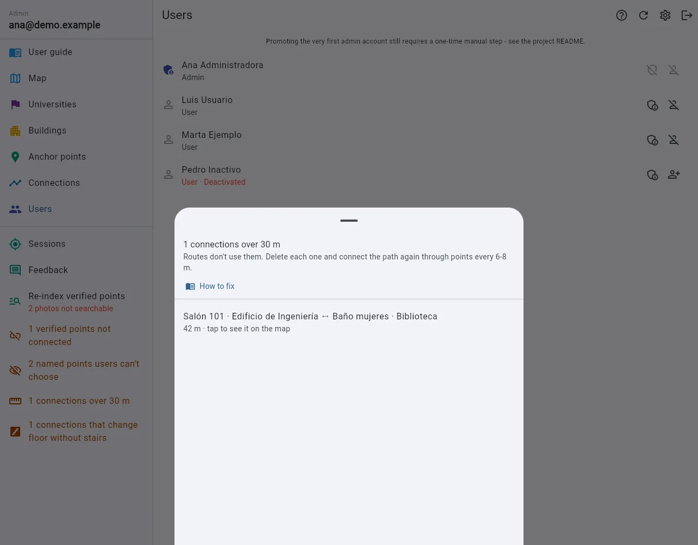

# Admin user guide

How to build and look after the map Eyes4U uses to guide people with visual impairments: first the mistakes that break routes, then the whole job on the map, then each screen in short.

The pictures show an **example university with made-up data**. Red numbers match the table under the picture. Map pictures are at phone size, as you'll use it in the field; the rest are on a computer.

## 1. Mistakes that break routes

Each of these happened in real tests. The menu's orange **notices** catch the first four by themselves, and their **How to fix** link opens the matching section here.

### A destination saved as an in-between type

Users can only choose destinations (★ in the [Quick reference](#reference)), so a "Restroom" saved as a Hallway never appears for them.
**Spot:** the notice **N named points users can't choose**.
**Fix:** open the point and change its **Location type**. Leave the deliberate ones ("Hallway to rooms 202").

### A verified point with no connections

Routes only follow connections, so nobody can reach it or start from it.
**Spot:** the notice **N verified points not connected**, or the filter **Connections: Has none**.
**Fix:** connect it to its neighbours in [Connect mode](#connect-on-map).

### Gaps over 30 m

A connection over 30 m is refused, and old ones aren't used, so users are told the place "isn't connected to any path yet".
**Spot:** that message when testing; the notice **N connections over 30 m**; the Connections filter **Over 15 m**.
**Fix:** delete it, add in-between points **every 6 to 8 m** along the real path, and chain-connect them.

### A floor change without stairs, an elevator or a ramp

Floors may only change through a **Stairwell**, **Elevator** or **Ramp** point, so the app can say "Take the elevator to floor 3".
**Spot:** the notice **N connections that change floor without stairs**.
**Fix:** delete it, create a stairwell or elevator point **on each floor**, and connect those. See [Floors](#floors).

### The same place twice, or on the wrong floor

Duplicates split the photos; a point on the wrong floor is reached by the wrong stairs.
**Spot:** the app asks before saving within 3 m of another point; on the map dots overlap, or a point shows as ▲▼ where you expected a dot.
**Fix:** add photos to the existing point, delete the duplicate, and set the right **Floor** ("Floor 1" is the ground floor).

### Building doors not marked as Entrance

Users can say a building ("Edificio C"), and the route ends at its nearest **Entrance**. With none, it ends at any connected point on its lowest floor.
**Spot:** saying the building in **Test as user** ends somewhere odd.
**Fix:** give each door the **Entrance** type and a name, and connect it.

### Two groups of points that never meet

Every point is connected, but one building's paths never join the next one's.
**Spot:** "isn't connected" between them when testing; on the map, a group of lines with nothing leaving it.
**Fix:** capture the path between them and connect it at both ends.

### Points without photos, or not searchable

The app recognizes a place only from its photos.
**Spot:** verifying is refused; the menu says "N photos not searchable" in red.
**Fix:** take [4 to 8 photos](#photos), one per direction. If they're there but not searchable, use [Re-index](#reindex).

### A rough position

A point metres away from the real place sends people the wrong way.
**Spot:** on the map it sits off its corridor, or its lines cross walls.
**Fix:** [Move](#points-map) it, aiming with **the tip of the pin**. **Use my location** only works with GPS of ±8 m or better.

## 2. Getting started

The app opens the admin view when your account is an admin. New accounts start as regular users: another admin promotes them in [Users](#users). In a narrow window the menu opens with ☰.

| # | Control | What it does |
|---|---|---|
| 1 | **User guide** | Opens this guide in another tab. |
| 2 | **Map** | Where the app opens. The entries below it are lists of the same data. |
| 3 | Orange notices | Things to fix, only when there are some. See [Checking your work](#notices). |
| 4 | **Help for this page** (?) | Opens this guide at the page you're on. |
| 5 | **Refresh** | Reloads the data. Other admins' changes also arrive by themselves within about 30 s. |
| 6 | **Settings** | Your language, text size and contrast. |
| 7 | **Log out** | Signs you out. |

## 3. The whole job, start to finish

1. Create the **[university](#universities)** and its **[buildings](#buildings)**, with their floors.
2. Open the **[Map](#points-map)** and go into the building.
3. Create the **[points](#point-form)** with the camera button: the places people go to first, with a clear name; then in-between points every 6 to 8 m along the paths.
4. Add **[photos](#photos)**, 4 to 8 per point, and **[verify](#verify)** each point.
5. **[Connect](#connect-on-map)** the points in a chain along the paths.
6. Clear the **[notices](#notices)**, walk a route with **[Test as user](#phone-only)**, and look at its **[session](#sessions)**.

**Example.** For the Library door to the restroom: create "Universidad Demo" and "Biblioteca". On the map, create "Entrada principal" (Entrance), "Baño mujeres" (Restroom) and a Hallway every 7 m between them. Add photos, verify, and connect them in order. "Baño mujeres" can now be chosen.

## 4. The map

The map shows universities first, their buildings as you zoom in, and points and connections closer still.

| # | Control | What it does |
|---|---|---|
| 1 | **Search** | Finds universities, buildings and points, and takes the map there, on the right floor. |
| 2 | **All** › university › building | Where you are. Tap a level, or use back, to go up. ⓘ opens its details. |
| 3 | **New anchor point** | Opens [the form](#point-form), set to the building you're in. |

Tap a university to see its buildings, and a building to see its points.

| # | Control | What it does |
|---|---|---|
| 1 | **Go up a floor** | Shows the floor above. |
| 2 | **Go down a floor** | Shows the floor below. |
| 3 | **Only this floor** | Hides the neighbouring floors. |
| 4 | **New anchor point** | Opens [the form](#point-form). |

| Mark | Meaning |
|---|---|
| Green / light grey dot | Verified / pending point |
| Orange ✕ | Rejected point |
| Blue ▲ / purple ▼ | A point on the floor above / below |
| Black ring | The point selected or being moved |
| Blue line | A connection, dashed if it changes floor |
| Purple flag / orange building | A university / building, with how many buildings or points it has |

The colours stay distinct for colour-blind admins, and shape always helps. **Filters** (bottom left) narrows the points by status, type, floor, indoors or outdoors, lighting, photos and connections; its number is how many are on. The [Anchor points](#anchor-points) list shares them.

**Floors.** One floor shows at a time. Points on the floor above show as ▲ and below as ▼, and lines only when they touch the current floor.

### A point's details

Tap a point: its data and actions open beside the map, or from the bottom on a phone.

| # | Button | What it does |
|---|---|---|
| 1 | **Connect** | Starts [Connect mode](#connect-on-map) from here. |
| 2 | **Move** | Tap the new spot (the pin's tip), then **Save new position**. Refused if a connection would pass 30 m. |
| 3 | **Verify** / **Unverify** | See [Verifying](#verify). |
| 4 | **Add photo** | Opens [its photos](#photos). |
| 5 | **Edit** | The fields of [the form](#point-form), plus its status. |

### Connect mode

A connection means **a person can walk straight between two points**; routes only follow connections. Turn on **Connect**, then tap points in order along a path. Each tap connects to the one before, which keeps the chain going down a hallway.

| # | Control | What it does |
|---|---|---|
| 1 | **Connect** | Turns the mode on and off. |
| 2 | **Done** | Leaves it. Back does too, after letting go of the point. |
| 3 | **Help for this page** | Opens this section. |

- Tap the selected point again to let go. A new line is dotted grey while it saves.
- At most **30 m** in a straight line (warning above 15 m), and floors only change through a stairwell, elevator or ramp. A refused tap keeps your place.
- **Across floors:** with **Only this floor** off, select the stairwell here, then its ▲ or ▼ on the other floor; the map follows. Connect the elevator too: routes prefer it.

### A connection's details

Tap a line, in either mode.

| # | Button | What it does |
|---|---|---|
| 1 | **Edit warning** | What users hear as they start this stretch: "Attention: three steps down". The app can't see obstacles. |
| 2 | **Delete** | Deletes it, after asking. Routes through it are recalculated. |

Stairs, elevators and ramps are announced by themselves when the point has that type.

## 5. Universities and buildings

A university is a campus; everything belongs to one. A university's row opens its buildings, and a building's row its points.

| # | Field | What it means |
|---|---|---|
| 1 | **Name** | Shown across the app. |
| 2 | **Abbreviation** | A short name, such as `UPB`. Filled in from the name's initials; you can change it. Can't be changed later. |
| 3 | **Latitude** | The campus's rough centre. |
| 4 | **Longitude** | The same. |
| 5 | **Pick on map** | Fills both by tapping a map. |
| 6 | **Save university** | Creates it. |

> **On the web, type rough coordinates first:** with none, the map opens in the ocean at 0,0.

| # | Field | What it means |
|---|---|---|
| 1 | **University** | Which one it belongs to. |
| 2 | **Name** | The name people use ("Edificio C", "Bloque 20"); users can say it, so write it as they do. |
| 3 | **Latitude** | Its position. Points over 300 m away are refused. |
| 4 | **Longitude** | The same. |
| 5 | **Pick on map** | Fills both, starting at the university. |
| 6 | **Floors** | How many; its points' floor options. |
| 7 | **Has elevator** | Accessibility information. |
| 8 | **Has stairs** | Accessibility information. |
| 9 | **Save building** | Creates it. |

Editing either one shows a switch to **deactivate** it: users stop being offered it, and nothing is deleted.

## 6. Anchor points

An anchor point is a physical place (a door, an intersection, an elevator lobby) that the app recognizes from its photos, and a stop on routes. Its **location type** makes it a **destination** (★: users choose it, so it needs a name) or an **in-between point** (it only joins paths).

| # | Control | What it does |
|---|---|---|
| 1 | **University** | Narrows the list. |
| 2 | **Building** | Narrows it to one building. |
| 3 | **Search anchor points** | By name. |
| 4 | Point row | **Tapping it opens the map in Connect mode** from this point. |
| 5 | **Verify** | Verifies it, or puts a verified one back to pending. |
| 6 | **Edit** (pencil) | Its edit page. |
| 7 | **More actions** (⋮) | **Add photo** and **Delete**. |
| 8 | **Filters** | As on [the map](#points-map). |
| 9 | **New anchor point** | Opens [the form](#point-form). |

### Creating a point

| # | Field | What it means |
|---|---|---|
| 1 | **University** | Narrows the buildings. |
| 2 | **Building** | Where it belongs. |
| 3 | **Floor** | "Floor 1" is the ground floor. |
| 4 | **Location type** | Chosen first, by category, with a search box. It decides whether the point needs a name. |
| 5 | **Name** | Appears once the type is chosen. What users choose and hear; required for destinations. "South entrance", not "Point 1", and **without the building**, which is removed. |
| 6 | **Indoors** | Under a roof. Choose one of the two each time. |
| 7 | **Outdoors** | In the open. |
| 8 | **Lighting** | Optional. Explains dark photos. |
| 9 | **Surface (optional)** | Tile, concrete… |
| 10 | **Pick on map** | The most precise: aim with the pin's tip. |
| 11 | **Use my location** | The phone's GPS, standing on the point, at ±8 m or better. |
| 12 | **Create and add photos** | Saves it and opens its photos. Needs the position. |

The form remembers your last point's university, building, type, floor, lighting and surface. It asks before saving within 3 m of another point, or a name on an in-between type.

### Photos

People reach a place from any side, so take **4 to 8 photos standing on the point**, one toward each side. On the phone, **Take photo** saves the compass direction. On the web you upload them:

| # | Control | What it does |
|---|---|---|
| 1 | **The photos face** | Which way the next upload faces; **Unknown** if unsure. |
| 2 | **Upload photos (N)** | N is how many the point has. |
| 3 | **Done** (✓) | Goes back. |

### Verifying

**Pending** points are invisible to users and not recognized. **Verified** ones go into the photo search and into routes. **Rejected** ones are set aside without deleting them. Check the photos are clear and show the right place first. A point with no photos can't be verified; one with no connections can, but is of no use until [connected](#pitfall-unconnected).

## 7. Connections

Connecting happens in [Connect mode](#connect-on-map); this list is for reviewing.

| # | Control | What it does |
|---|---|---|
| 1 | **University** | Connections with a point there. |
| 2 | **Building** | The same, for one building. |
| 3 | **Search connections** | By its points' names. |
| 4 | **Add connection (form)** | Points A and B, a typed distance (when the walk bends) and a warning. |
| 5 | Connection row | ⚠ if it has a warning. Tap to edit the warning; the map button shows it. |
| 6 | **Delete** (trash) | Deletes it, after asking. |
| 7 | **Filters** | Over 15 m, with a warning, or changing floor. |
| 8 | **Connect on map** | The map in Connect mode. |

Only a connection's warning can be changed; for anything else, delete it and connect again.

## 8. Checking your work

**Notices.** They disappear when everything is fine. Each opens a list: an item opens on the map, and **How to fix** opens its section of this guide.

| Notice | See |
|---|---|
| **N verified points not connected** | [No connections](#pitfall-unconnected) |
| **N named points users can't choose** | [In-between type](#pitfall-type) |
| **N connections over 30 m** | [Gaps over 30 m](#pitfall-gap) |
| **N connections that change floor without stairs** | [Floor change](#pitfall-floor) |

**Re-index verified points.** When the menu says "N photos not searchable" in red, tap it once the server is fine. It sends what's missing and lists anything that still failed.

**Test as user** (phone only) is a real trip with your account. Tap **✗ Wrong instruction** whenever the app says something wrong, and **I'm at…** on each point the route names, to measure accuracy. Hold the phone upright at the chest, back camera forward, as users are told.

**Sessions** lists trips by user. **Watch** opens a trip's map, live while it lasts.

The card says how far from the route the raw and corrected positions were. The legend names each line and mark: planned route, raw GPS, corrected position, photo matches and wrong instructions. Tap any of them for what was logged there. **Feedback** shows what users wrote after a trip.

## 9. Users, settings and deleting

**Users.** **Promote to admin** (or remove it) and **Deactivate account**, which blocks without deleting; not on your own row. An unfinished sign-up appears in a card at the top with a repair button. The first admin is set in the database.

**App versions.** The newest and the one before work; older ones show "Update required" until the new APK, from the GitHub releases page, is installed.

**Settings** are yours: language, text size, bold text, high contrast and voice guidance.

**Deleting** can't be undone; the app says first what goes with it. A university takes its buildings, a building its points, and a point its photos, connections and saved routes; trip history stays. To stop using something without losing it, **deactivate** the university or building, or set the point to **Rejected**.

**In a narrow window** the menu opens with ☰; the rest works the same.

## 10. Quick reference

### Location types

★ marks **destinations**: they need a name, and users can choose them.

| Category | Types |
|---|---|
| Paths and connections | Hallway, Outdoor path, Intersection, Stairwell, Elevator, Ramp, Crosswalk, Courtyard |
| Entrances and getting around | Entrance ★, Exit / gate ★, Lobby ★, Parking ★, Bike parking ★, Bus stop ★, Waiting area / benches ★ |
| Academic | Classroom ★, Laboratory ★, Library ★, Computer room ★, Study area ★, Auditorium ★, Office ★ |
| Food, shops and services | Cafeteria ★, Stationery shop ★, Copy / print center ★, Store ★, ATM / bank ★, Restroom ★, Drinking fountain ★ |
| Wellbeing and sports | Infirmary / medical service ★, Gym / sports area ★, Chapel ★ |
| Other | Other |

**Lighting:** bright (daylight), moderate (normal indoor), dim (an indoor stairwell).

### Other problems

| Problem | What to do |
|---|---|
| A point isn't on the map | Another floor or a filter: use ▲ ▼, turn off **Only this floor**, clear the filters. |
| **Create and add photos** is disabled | Set the position and choose indoors or outdoors. |
| The map opens in the ocean | Type rough coordinates for the university. |
| "Your starting point isn't connected" | Connect the points around the user. |
| "Update required" | Install the newest APK. |

Maps © [OpenStreetMap](https://www.openstreetmap.org/copyright) contributors.
