# Guía de uso para administradores

Esta guía explica cómo construir y mantener el mapa con el que Eyes4U guía a las personas con discapacidad visual: cada pantalla de la aplicación web, para qué sirve cada botón y el trabajo completo, de principio a fin.

Las imágenes son de una **universidad de ejemplo** con datos inventados. Los números rojos de cada imagen corresponden a la tabla que tiene debajo.

## 1. Primeros pasos

### Entrar

No hay un inicio de sesión aparte para administradores: la aplicación te lleva a esta vista según el rol de tu cuenta. Una cuenta que no es de administrador no puede usar la web, y se le indica usar la aplicación del teléfono.

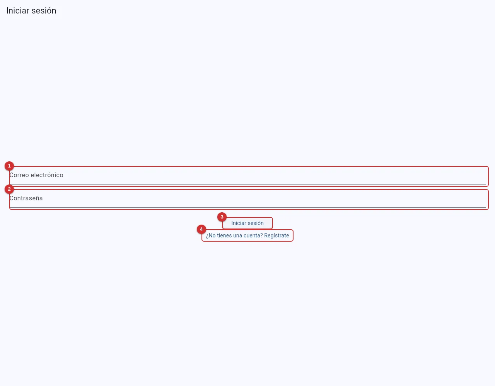

| # | Control | Qué hace |
|---|---|---|
| 1 | **Correo electrónico** | El correo de tu cuenta. |
| 2 | **Contraseña** | Tu contraseña. |
| 3 | **Iniciar sesión** | Entra a la aplicación. |
| 4 | **¿No tienes una cuenta? Regístrate** | Crea una cuenta nueva, que empieza como usuario. Otro administrador debe convertirla en administradora ([Usuarios](#users)). |

### El menú y la barra superior

En una ventana ancha, el menú queda abierto a la izquierda. En una ventana angosta se abre con el ícono ☰.

| # | Control | Qué hace |
|---|---|---|
| 1 | **Guía de uso** | Abre esta guía en otra pestaña, para leerla junto a la aplicación. |
| 2 | **Mapa** | Donde abre la aplicación: universidades, luego sus edificios, luego sus puntos. Ver [El mapa de puntos](#points-map). |
| 3 | **Universidades** | Los campus. Ver [Universidades](#universities). |
| 4 | **Edificios** | Los edificios de cada campus. Ver [Edificios](#buildings). |
| 5 | **Puntos de referencia** | Los lugares que la aplicación aprende a reconocer. Ver [Puntos de referencia](#anchor-points). |
| 6 | **Conexiones** | Por dónde se puede caminar entre puntos. Ver [Conexiones](#connections). |
| 7 | **Usuarios** | Las cuentas. Ver [Usuarios](#users). |
| 8 | **Sesiones** | Los viajes hechos con la aplicación. Ver [Sesiones](#sessions). |
| 9 | **Comentarios** | Lo que escribieron los usuarios al terminar un viaje. Ver [Comentarios](#feedback). |
| 10 | **Reindexar puntos verificados** | Repara la búsqueda por fotos. En rojo, cuántas fotos no se pueden buscar. Ver [Reindexar](#reindex). |
| 11 | **N puntos verificados sin conexión** | Aviso: nadie puede llegar a esos puntos. Abre la lista filtrada. |
| 12 | **N puntos con nombre que los usuarios no pueden elegir** | Aviso: un destino guardado con un tipo intermedio. |
| 13 | **N conexiones de más de 30 m** | Aviso: las rutas no las usan. |
| 14 | **N conexiones que cambian de piso sin escaleras** | Aviso: las rutas no las usan. |
| 15 | **Ayuda de esta página** (?) | Abre esta guía en la sección de la página en la que estás. |
| 16 | **Actualizar** | Vuelve a cargar los datos del servidor. |
| 17 | **Configuración** | Idioma, tamaño del texto y más. Ver [Configuración](#settings). |
| 18 | **Cerrar sesión** | Te desconecta de inmediato, sin preguntar. |

Los avisos naranjas (11 a 14) solo aparecen si hay algo que arreglar. Ver [Avisos del menú](#notices).

## 2. El trabajo completo, de principio a fin

Cada paso se construye sobre el anterior. Si te saltas uno, el menú desplegable del siguiente queda vacío y te dice qué agregar primero.

1. **Crea la [universidad](#universities)**, una por campus.
2. **Crea sus [edificios](#buildings)**, con cuántos pisos tiene cada uno.
3. **Crea los [puntos de referencia](#point-form).** Primero los lugares a los que la gente quiere ir (entradas, salones, baños, la cafetería), con un nombre claro. Luego los puntos intermedios (pasillos, intersecciones, escaleras), cada 6 a 8 m a lo largo de los caminos.
4. **Agrega [fotos](#photos)** a cada punto, de 4 a 8, una por dirección. Con ellas la aplicación reconoce dónde está el usuario.
5. **[Verifica](#verify) cada punto** después de revisar sus fotos. Un punto sin verificar no existe para los usuarios.
6. **[Conecta](#connect-on-map) los puntos** en cadena a lo largo de los caminos. Las rutas solo pasan por conexiones: un punto sin conexiones no aparece para los usuarios.
7. **Prueba una ruta** con [Probar como usuario](#phone-only) en el teléfono, caminándola.
8. **Revisa la [sesión](#sessions)** para ver qué tan bien funcionó, y corrige lo que haga falta.

**Ejemplo.** Para que alguien pueda ir de la puerta de la Biblioteca al baño: crea "Universidad Demo" y el edificio "Biblioteca". Crea "Entrada principal" (tipo Entrada), "Baño mujeres" (tipo Baño) y un punto de tipo Pasillo cada 7 m entre los dos. Sube las fotos de cada uno, verifícalos y conéctalos en orden en **Conectar en el mapa**. Listo: "Baño mujeres" ya se puede elegir como destino.

## 3. Universidades

Una universidad es un campus o sede. Todo lo demás pertenece a una.

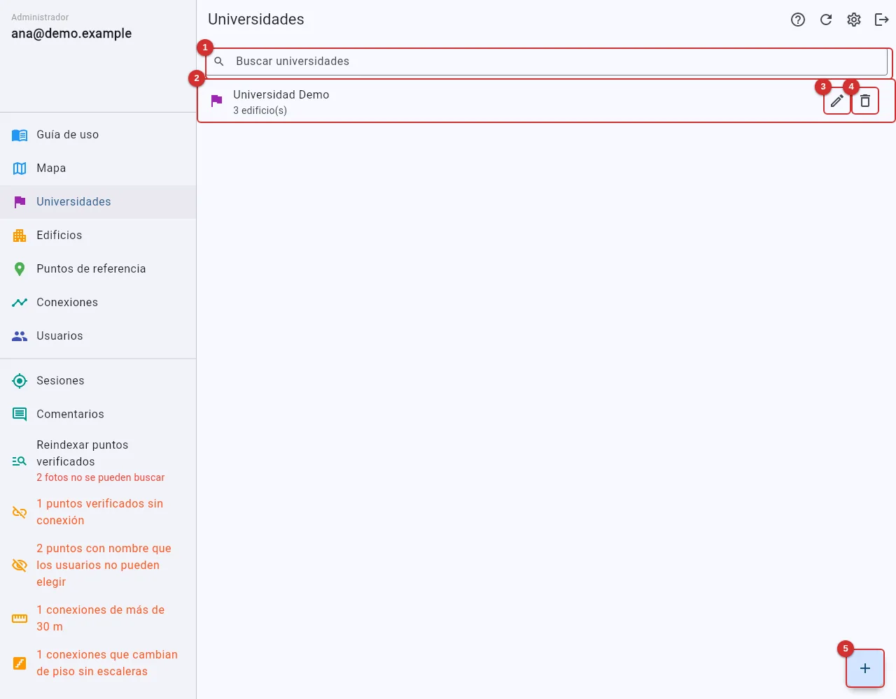

| # | Control | Qué hace |
|---|---|---|
| 1 | **Buscar universidades** | Filtra la lista mientras escribes. |
| 2 | Fila de la universidad | Muestra su nombre y cuántos edificios tiene. |
| 3 | **Editar** (lápiz) | Cambia sus datos. El código no se puede cambiar. |
| 4 | **Eliminar** (basura) | La elimina con todo lo que contiene. Ver [Eliminar datos](#deleting). |
| 5 | **Agregar universidad** (+) | Abre el formulario de abajo. |

### Agregar una universidad

| # | Campo | Qué significa | Ejemplo |
|---|---|---|---|
| 1 | **Código** | Identificador corto y único. Obligatorio, y no se puede cambiar después. | `ICESI` |
| 2 | **Nombre** | El nombre completo que se ve en toda la aplicación. Obligatorio. | `Universidad Icesi` |
| 3 | **Dirección (opcional)** | Solo de referencia. | `Calle 18 #122-135` |
| 4 | **Latitud** | Centro aproximado del campus, en grados decimales. Obligatorio. | `3.3417` |
| 5 | **Longitud** | Lo mismo. Obligatorio. | `-76.5302` |
| 6 | **Elegir en el mapa** | Llena los dos anteriores tocando un mapa. | |
| 7 | **Guardar universidad** | Crea la universidad. | |

> **En la web, escribe primero unas coordenadas aproximadas.** La web no usa el GPS, así que sin coordenadas el mapa se abre en el océano, en 0,0. Copia la ubicación desde cualquier mapa en línea y ajústala luego con **Elegir en el mapa**.

Al editar aparece también un interruptor para **desactivarla** sin eliminarla: sus edificios y puntos dejan de ofrecerse a los usuarios, y se conserva el historial.

## 4. Edificios

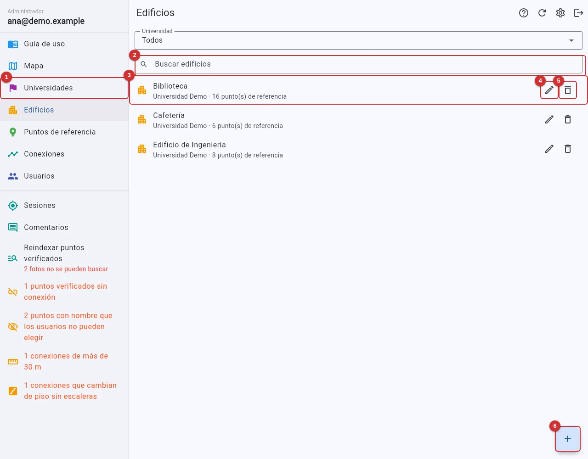

| # | Control | Qué hace |
|---|---|---|
| 1 | **Universidad** | Muestra solo los edificios de esa universidad. Tocar la fila de una universidad la elige. |
| 2 | **Buscar edificios** | Filtra la lista mientras escribes. |
| 3 | Fila del edificio | Muestra su universidad y cuántos puntos tiene. |
| 4 | **Editar** (lápiz) | Cambia sus datos, incluida la universidad a la que pertenece. El código no se puede cambiar. |
| 5 | **Eliminar** (basura) | Lo elimina con todo lo que contiene. Ver [Eliminar datos](#deleting). |
| 6 | **Agregar edificio** (+) | Abre el formulario de abajo. |

### Agregar un edificio

| # | Campo | Qué significa | Ejemplo |
|---|---|---|---|
| 1 | **Universidad** | A cuál pertenece. Obligatorio. | |
| 2 | **Código** | Identificador corto y único. Obligatorio, y no se puede cambiar después. | `BIB` |
| 3 | **Nombre** | El nombre completo. Los usuarios también lo pueden decir por voz, así que usa el nombre con el que la gente lo conoce. Obligatorio. | `Edificio C` |
| 4 | **Dirección (opcional)** | Solo de referencia. | |
| 5 | **Latitud** | La posición del edificio. Obligatorio. Un punto a más de 300 m de ella se rechaza. | |
| 6 | **Longitud** | Lo mismo. Obligatorio. | |
| 7 | **Elegir en el mapa** | Llena los dos anteriores tocando un mapa, que se abre en la universidad elegida. | |
| 8 | **Pisos** | Cuántos pisos tiene. Da las opciones de piso de sus puntos. | `3` |
| 9 | **Tiene ascensor** | Información de accesibilidad. | |
| 10 | **Tiene escaleras** | Información de accesibilidad. | |
| 11 | **Guardar edificio** | Crea el edificio. | |

Al editar aparece también un interruptor para **desactivarlo** sin eliminarlo.

## 5. Puntos de referencia

Un punto de referencia es un lugar físico concreto (una puerta, una intersección, la entrada de un ascensor) que la aplicación aprende a reconocer por sus fotos. Cuando la cámara del usuario ve algo que coincide, la aplicación corrige su posición. Los puntos, además, son las paradas de las rutas.

Hay dos clases de punto, según su **tipo de lugar**:
- **Destinos** (salón, baño, cafetería…): los usuarios los eligen. Necesitan un nombre.
- **Intermedios** (pasillo, intersección, escaleras…): solo sirven para unir caminos. No necesitan nombre, y los usuarios nunca los eligen.

### La lista

| # | Control | Qué hace |
|---|---|---|
| 1 | **Universidad** | Muestra solo los puntos de esa universidad. |
| 2 | **Edificio** | Muestra solo los puntos de ese edificio. Tocar la fila de un edificio elige los dos. |
| 3 | **Buscar puntos de referencia** | Busca por nombre. |
| 4 | Fila del punto | Muestra su edificio, estado y número de fotos. **Tocarla abre el mapa en modo Conectar** con este punto ya seleccionado. |
| 5 | **Verificar** | Verifica el punto. En uno ya verificado, este botón lo devuelve a pendiente. Ver [Verificar](#verify). |
| 6 | **Editar** (lápiz) | Abre [la edición del punto](#point-edit). |
| 7 | **Más acciones** (⋮) | Abre el menú de abajo. |
| 8 | **Filtros** | El estado (Todos / Pendiente / Verificado / Rechazado, con cuántos hay) y más filtros (abajo). El número encima es cuántos hay puestos. |
| 9 | **Nuevo punto de referencia** (cámara) | Abre [el formulario](#point-form). |

Los puntos sin nombre se muestran por su tipo y el inicio de su código, por ejemplo "Pasillo · 284a".

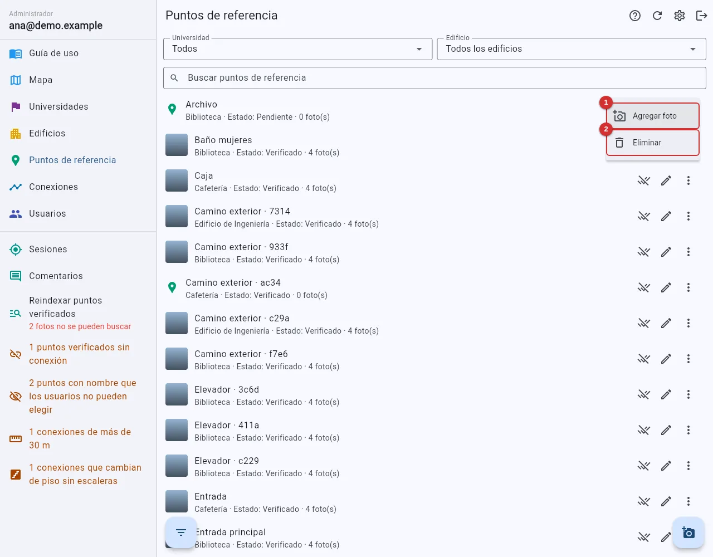

| # | Opción | Qué hace |
|---|---|---|
| 1 | **Agregar foto** | Abre [las fotos del punto](#photos). |
| 2 | **Eliminar** | Elimina el punto, sus fotos y sus conexiones. Ver [Eliminar datos](#deleting). |

### Filtros

Acota por **categoría** y tipo, **piso**, **interior o exterior**, **iluminación** y si **tiene fotos** o **conexiones**. Se combinan con el estado y la búsqueda. Sirven para encontrar trabajo pendiente: por ejemplo, Verificado + sin conexiones son puntos que nadie puede usar todavía.

### Crear un punto

| # | Campo | Qué significa |
|---|---|---|
| 1 | **Universidad** | Filtra la lista de edificios. |
| 2 | **Edificio** | A cuál pertenece el punto. Obligatorio. |
| 3 | **Piso** | En qué piso está. "Piso 1" es la planta baja. Las opciones salen de los pisos del edificio. |
| 4 | **Tipo de lugar** | Qué clase de lugar es. Abre un selector por categorías, con buscador. Lista completa en [Referencia rápida](#reference). |
| 5 | **Descripción** | El nombre que los usuarios eligen y escuchan. Obligatoria para los destinos. Describe el lugar real: "Entrada sur" es mucho mejor que "Punto 1". **No repitas el edificio**: se quita solo al guardar, y la aplicación lo muestra al lado. |
| 6 | **Interior** | El punto está bajo techo. Hay que elegir uno de los dos cada vez. |
| 7 | **Exterior** | El punto está al aire libre. |
| 8 | **Iluminación** | Opcional: brillante, moderada o tenue. Ayuda a quien revisa las fotos: una foto oscura puede ser simplemente un pasillo oscuro. |
| 9 | **Superficie (opcional)** | Opcional: baldosa, alfombra, concreto… |
| 10 | **Elegir en el mapa** | Fija la posición tocando un mapa. Es lo más preciso. |
| 11 | **Usar mi ubicación** | Fija la posición con el GPS, parado justo en el punto. Solo en el teléfono y con una precisión de ±8 m o mejor. En la web queda desactivado. |
| 12 | **Crear y agregar fotos** | Guarda el punto y abre sus fotos. Está desactivado hasta que fijes la posición. |

La posición es obligatoria a propósito: la aplicación no toma el GPS por su cuenta, porque así se guardaban puntos en lugares equivocados.

La aplicación te detiene en dos casos:
- **Otro punto a menos de 3 m**, en el mismo edificio y piso. Casi siempre es el mismo lugar guardado dos veces: agrégale fotos al que ya existe.
- **Un nombre con un tipo intermedio.** Los usuarios solo pueden elegir destinos, así que un "Baño mujeres" guardado como Pasillo nunca les aparece. Toca **Cambiar tipo**, salvo que de verdad sea un punto de paso con nombre.

El formulario recuerda la universidad, el edificio, el tipo, el piso, la iluminación y la superficie del último punto que creaste.

### Elegir la posición en el mapa

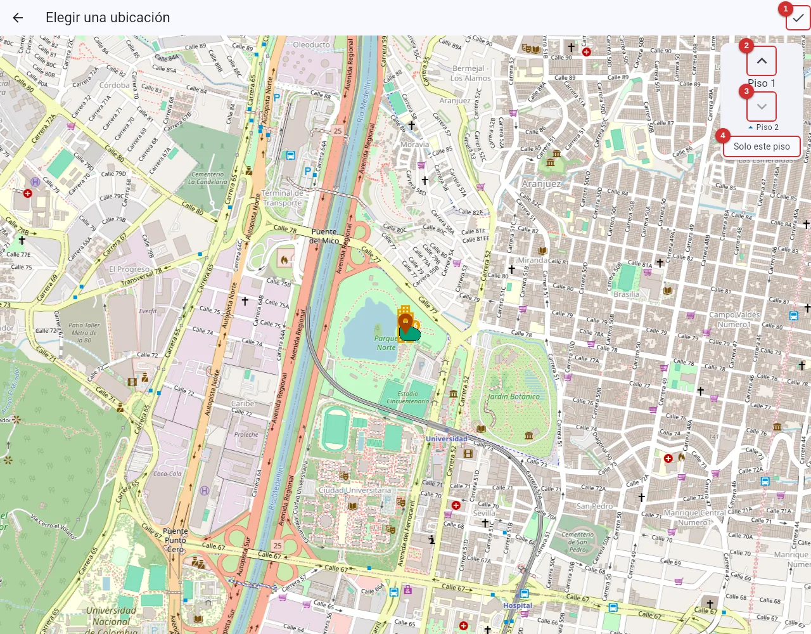

Toca el lugar exacto: **la punta del pin** marca dónde queda. Los puntos que ya existen se ven de color según su estado. El mapa se abre en el piso del formulario; cambiar de piso aquí solo cambia lo que ves, no el piso del punto.

| # | Control | Qué hace |
|---|---|---|
| 1 | **Confirmar ubicación** (✓) | Vuelve al formulario con esa posición. |
| 2 | **Subir un piso** | Muestra el piso de arriba. |
| 3 | **Bajar un piso** | Muestra el piso de abajo. |
| 4 | **Solo este piso** | Oculta los puntos de los pisos vecinos. Ver [Pisos](#floors). |

### Editar un punto

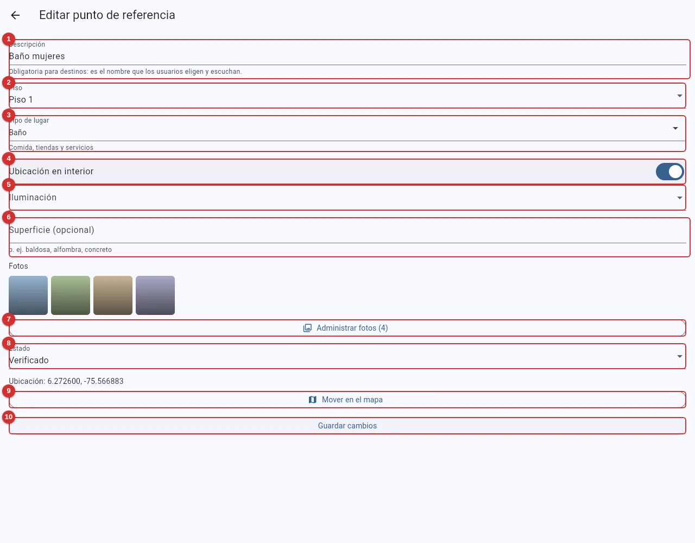

| # | Control | Qué hace |
|---|---|---|
| 1 | **Descripción** | El nombre, como al crearlo. |
| 2 | **Piso** | En qué piso está. |
| 3 | **Tipo de lugar** | Destino o intermedio. |
| 4 | **Ubicación en interior** | Interior o exterior. |
| 5 | **Iluminación** | Como al crearlo. |
| 6 | **Superficie (opcional)** | Como al crearlo. |
| 7 | **Administrar fotos (N)** | Abre [las fotos](#photos). Encima, las miniaturas sirven para revisarlas de un vistazo. |
| 8 | **Estado** | Pendiente, Verificado o Rechazado. Ver [Verificar](#verify). |
| 9 | **Mover en el mapa** | Elige otra posición. |
| 10 | **Guardar cambios** | Guarda. |

### Fotos

Una persona puede llegar a un lugar desde cualquier lado, así que la aplicación necesita verlo desde cada dirección. Toma de **4 a 8 fotos parado en el punto**, una hacia cada lado (N, S, E, O, adaptándote al lugar; en una esquina quizá solo haya dos o tres direcciones que valgan la pena).

Las imágenes de arriba son de relleno; aquí verás tus fotos, con su dirección en la esquina.

| # | Control | Qué hace |
|---|---|---|
| 1 | **Las fotos miran hacia** (N, NE, E…, No sé) | Hacia dónde miran las fotos que vas a subir. Elige **No sé** si no estás seguro: esa foto nunca se descarta por mirar hacia otro lado. |
| 2 | **Subir fotos (N)** | Elige una o más imágenes de tu computador. N es cuántas tiene el punto. |
| 3 | **Listo** (✓) | Termina y vuelve. |

El ícono de basura de cada foto la elimina, después de confirmar. Para tomar fotos con la cámara, ver [Solo en el teléfono](#phone-only).

### Verificar un punto

El estado decide si un punto existe para los usuarios:

| Estado | Significado |
|---|---|
| **Pendiente** | Capturado, sin revisar. Los usuarios no lo ven, y la aplicación no lo reconoce. |
| **Verificado** | Revisado. Sus fotos entran a la búsqueda, y puede ser parte de una ruta. |
| **Rechazado** | Revisado y descartado (malas fotos, duplicado…). Sale de la búsqueda, sin eliminarse. |

Antes de verificar, mira sus fotos: ¿están claras y muestran el lugar correcto? Verifica con el botón ✔ de la fila, o con **Estado** en la edición.

Sin fotos, no se puede verificar:

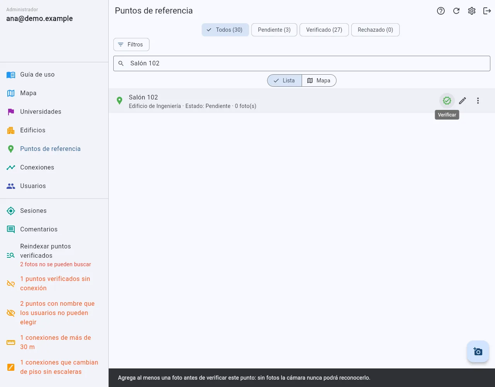

Sin conexiones, la aplicación pregunta primero. Puedes verificar igual y conectar después, pero hasta entonces los usuarios no pueden llegar a ese punto ni salir de él:

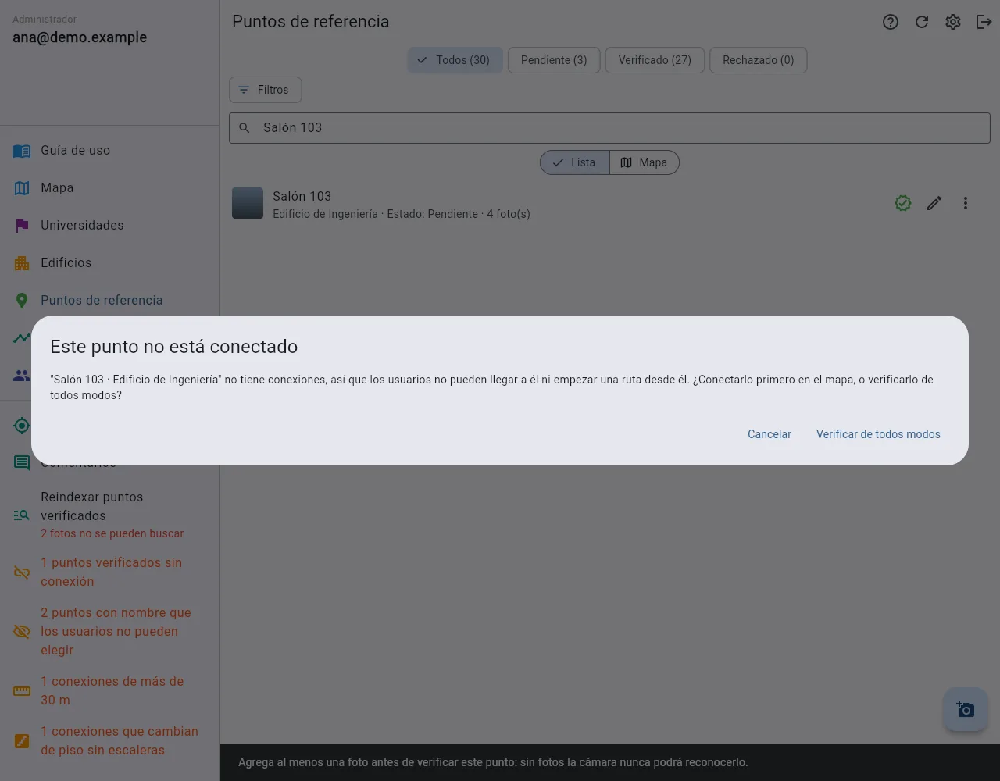

**Si aparece un error de indexación**, el punto queda verificado pero la búsqueda por fotos no lo recibió. Ver [Reindexar](#reindex).

### El mapa de puntos

**Mapa** muestra los mismos puntos filtrados: verde verificado, gris pendiente, rojo rechazado. Las líneas son sus conexiones.

| # | Control | Qué hace |
|---|---|---|
| 1 | **Subir un piso** | Muestra el piso de arriba. |
| 2 | **Bajar un piso** | Muestra el piso de abajo. |
| 3 | **Solo este piso** | Oculta los pisos vecinos. Ver [Pisos](#floors). |
| 4 | **Nuevo punto de referencia** | Abre [el formulario](#point-form). |

Toca un punto para ver sus datos y sus acciones:

| # | Botón | Qué hace |
|---|---|---|
| 1 | **Conectar** | Abre [Conectar en el mapa](#connect-on-map) con este punto seleccionado. |
| 2 | **Mover** | Cambia su posición (abajo). |
| 3 | **Verificar** / **Quitar verificación** | Cambia su estado. |
| 4 | **Agregar foto** | Abre [sus fotos](#photos). |
| 5 | **Editar** | Abre [su edición](#point-edit). |

**Mover un punto.** Toca **Mover** y luego la nueva posición: la punta del pin marca dónde queda. **Guardar nueva posición** la guarda, y **Cancelar** la descarta. La aplicación actualiza también la búsqueda por fotos y las distancias de sus conexiones. No deja mover un punto si eso estira una de sus conexiones a más de 30 m.

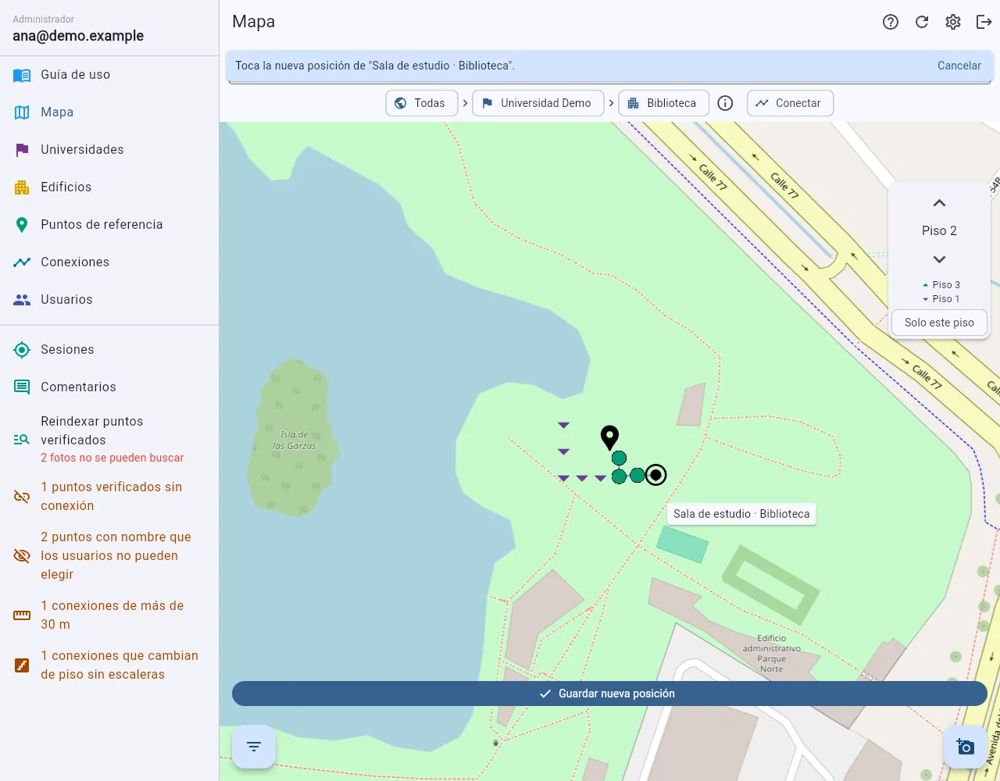

### Pisos en los mapas

Los mapas muestran un piso a la vez. Se cambia como en un ascensor, y el recuadro indica en qué piso estás. Este control aparece en todos los mapas que muestran puntos, y solo si hay más de un piso.

- Los puntos del **piso actual** se ven normales.
- Los del **piso de arriba** son ▲ morados, y los del **piso de abajo**, ▼ naranjas. Los pisos más lejanos no se ven.
- Las líneas solo se dibujan si tocan el piso actual, y son punteadas si cambian de piso.

**Solo este piso** oculta los ▲ y ▼. La aplicación recuerda esta opción en este navegador.

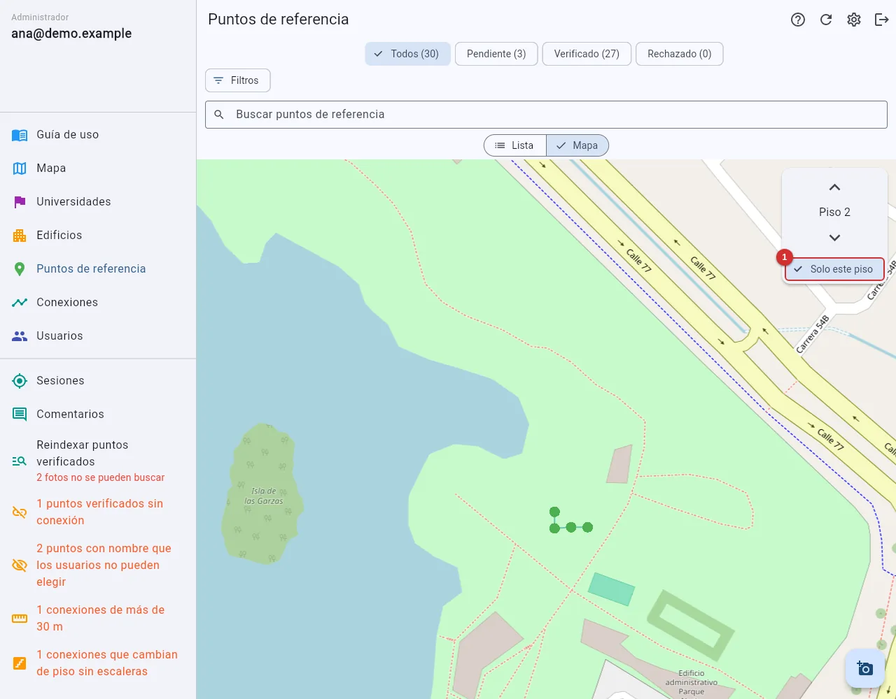

## 6. Conexiones

Una conexión dice que **una persona puede caminar directamente entre dos puntos**. Las rutas solo pasan por conexiones, y la guía hace caminar en línea recta entre dos puntos conectados.

| # | Control | Qué hace |
|---|---|---|
| 1 | **Universidad** | Muestra solo las conexiones con un punto en esa universidad. |
| 2 | **Edificio** | Muestra solo las conexiones con un punto en ese edificio. |
| 3 | **Buscar conexiones** | Busca por el nombre de sus puntos. |
| 4 | **Agregar conexión (formulario)** | Abre [el formulario](#connection-form). |
| 5 | Fila de la conexión | Muestra sus dos puntos, sus edificios y su distancia. **Tocarla** abre su aviso para usuarios (abajo). ⚠ indica que tiene uno. El botón del mapa la muestra en el mapa. |
| 6 | **Eliminar** (basura) | Elimina la conexión, después de confirmar. Los puntos no se tocan. |
| 7 | **Filtros** | Más de 15 m, con aviso para usuarios, o que cambian de piso. |
| 8 | **Conectar en el mapa** | Abre [el mapa](#connect-on-map). |

### Reglas

La aplicación y el servidor aplican estas reglas:
- **Máximo 30 m en línea recta.** Una conexión de 50 m entre edificios atraviesa lo que haya en medio. Captura puntos cada 6 a 8 m y conéctalos en cadena. Por encima de 15 m, la aplicación avisa.
- **Solo se cambia de piso** por un punto de escaleras, ascensor o rampa.
- Una distancia escrita a mano no puede ser menor que la línea recta.

Las conexiones viejas que rompen estas reglas no se usan en las rutas: un viaje que las necesitaba dice que no hay ruta hasta rehacerlas. El menú las lista ([Avisos del menú](#notices)).

### Avisos para usuarios

La aplicación **no ve obstáculos**: solo sabe lo que alguien anotó. Para un escalón, una caneca o una puerta angosta, toca la conexión y escribe un aviso corto. Se le dice al usuario cuando empieza ese tramo: "Atención: tres escalones hacia abajo".

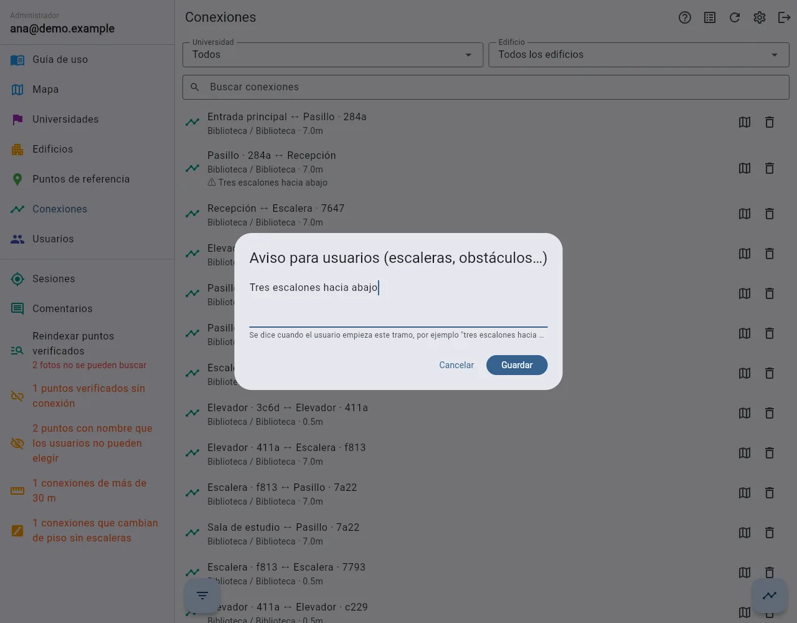

Las escaleras, ascensores y rampas se anuncian solos unos 8 m antes, si el punto tiene ese tipo.

### Conectar en el mapa

Es la forma más rápida de conectar un pasillo entero.

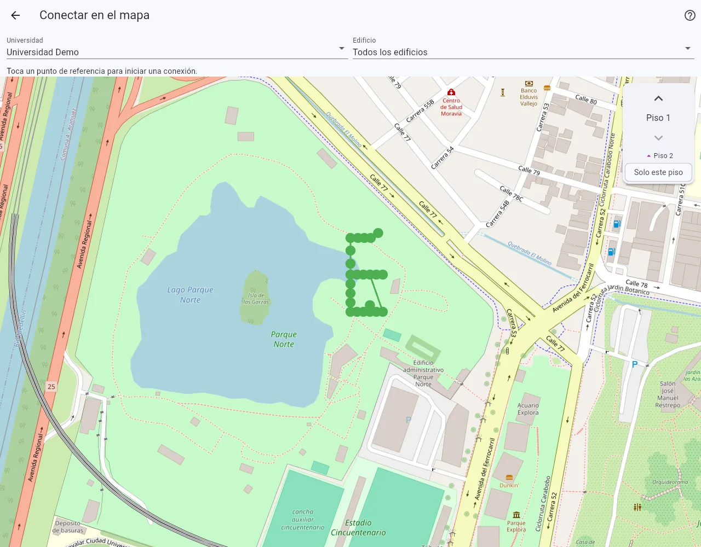

1. Elige la **universidad** y, si quieres acotar, el **edificio**.
2. Toca un punto para seleccionarlo. Basta un toque cerca, y se ve en azul.
3. Toca el siguiente: se crea la conexión, y **ese punto queda seleccionado**, así que puedes seguir tocando a lo largo del pasillo.
4. Toca el punto seleccionado para deseleccionarlo.

Las conexiones son líneas verdes. Una nueva se ve gris punteada mientras se guarda, y puedes seguir tocando. Para **eliminar** una, toca la línea lejos de los puntos y confirma.

| # | Control | Qué hace |
|---|---|---|
| 1 | **Conectar** | Modo Conectar: encendido, un punto tocado se suma a la cadena en vez de abrirse. |
| 2 | **Listo** | Sale del modo Conectar. Atrás también, después de soltar el punto seleccionado. |
| 3 | **Subir un piso** | Muestra el piso de arriba. |
| 4 | **Bajar un piso** | Muestra el piso de abajo. |
| 5 | **Solo este piso** | Oculta los pisos vecinos. Para conectar entre pisos debe estar apagado. |
| 6 | **Ayuda de esta página** | Abre esta sección. |

**Conectar dos pisos.** Crea un punto de escaleras, ascensor o rampa **en cada piso**, uno sobre el otro. Toca el del piso actual, y luego el ▲ o ▼ del otro piso. La línea se ve punteada, y el mapa pasa a ese piso para seguir encadenando. **Conecta el ascensor si existe**: las rutas lo prefieren.

### Conectar con el formulario

Úsalo cuando necesites escribir la distancia real o un aviso desde el principio.

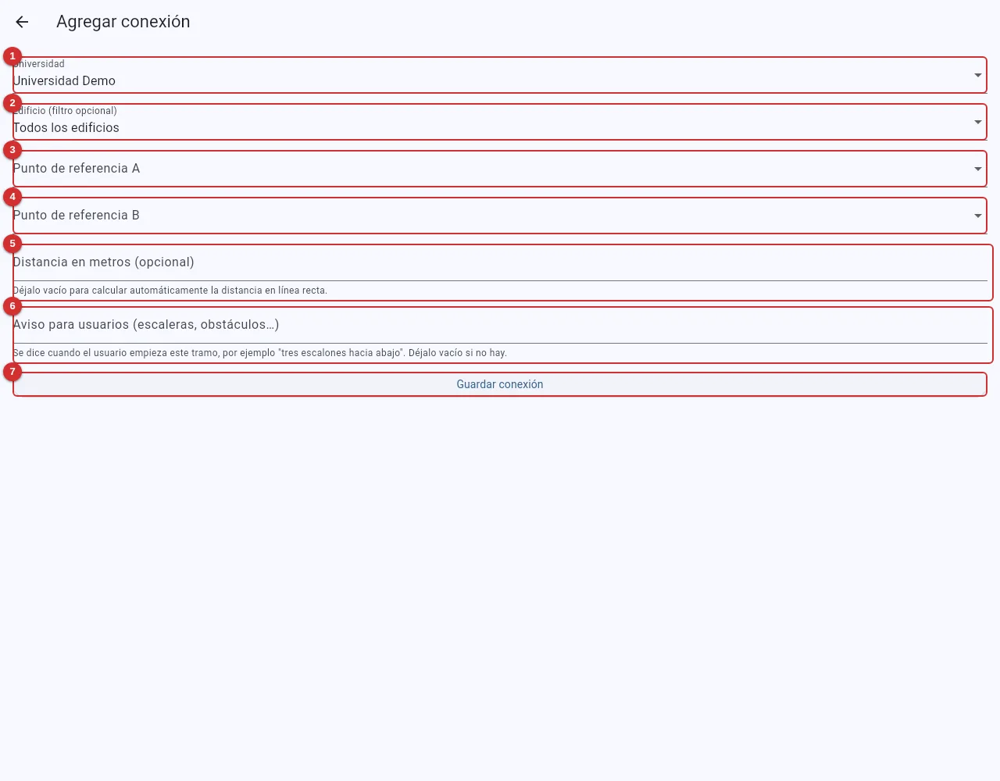

| # | Campo | Qué significa |
|---|---|---|
| 1 | **Universidad** | Filtra las listas de puntos. |
| 2 | **Edificio (filtro opcional)** | Acota más las listas. |
| 3 | **Punto de referencia A** | Un extremo. |
| 4 | **Punto de referencia B** | El otro extremo. |
| 5 | **Distancia en metros (opcional)** | Cuánto se camina de verdad. En blanco, se usa la línea recta. Complétala si el camino da una vuelta. |
| 6 | **Aviso para usuarios** | Lo que se le dice al usuario al empezar este tramo. Ver [Avisos para usuarios](#connection-warning). |
| 7 | **Guardar conexión** | Crea la conexión. |

Lo único que se puede cambiar de una conexión después es su aviso. Para cambiar otra cosa, elimínala y créala de nuevo. Las rutas guardadas que pasaban por una conexión eliminada se recalculan solas.

## 7. Lo que ven los usuarios

Esto explica la mayoría de los "no me aparece" y "no hay ruta":

- **Solo ven puntos verificados con al menos una conexión.** Los demás no existen para ellos.
- **Solo pueden elegir destinos**, es decir, puntos de un tipo marcado con ★ en la [Referencia rápida](#reference), y con nombre.
- **El punto de partida** es el punto conectado más cercano a su GPS. Si hay puntos de varios pisos a menos de 15 m, la aplicación les pregunta en qué piso están.
- **Pueden decir un edificio** ("Edificio C"). La ruta termina en su entrada más cercana caminando, así que **marca cada puerta con el tipo Entrada** y conéctala. Sin entradas marcadas, termina en el punto conectado más cercano de su piso más bajo.
- **Los nombres no repiten el edificio.** "Entrada sur bloque 20" se guarda como "Entrada sur". El usuario puede decir "entrada sur bloque 20" igual, y si hay varias "Entrada sur" se le ofrecen las más cercanas.
- **Al cambiar de piso** la aplicación le dice a dónde ir ("Toma el ascensor hasta el piso 3") y espera a que el barómetro del teléfono detecte el cambio.

## 8. Avisos del menú

Los avisos naranjas muestran errores de mapa que afectan a los usuarios. Se calculan con los datos cargados, y desaparecen cuando todo está bien.

| Aviso | Qué significa | Qué hacer |
|---|---|---|
| **N puntos verificados sin conexión** | Nadie puede llegar a ellos ni salir de ellos. | Abre la lista filtrada; conéctalos. |
| **N puntos con nombre que los usuarios no pueden elegir** | Tienen nombre, pero su tipo es intermedio. | Toca uno y cambia su tipo si los usuarios van allí. Algunos pueden ser a propósito ("Pasillo hacia salas 202"). |
| **N conexiones de más de 30 m** | Las rutas no las usan. | Toca una para borrarla, y vuelve a conectar ese camino con puntos intermedios. |
| **N conexiones que cambian de piso sin escaleras** | Las rutas no las usan. | Toca una para borrarla, y conecta los pisos por un punto de escaleras, ascensor o rampa en cada piso. |

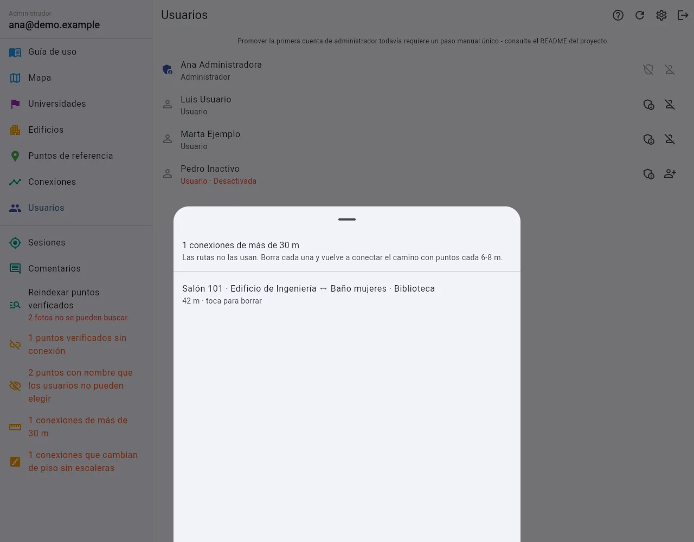

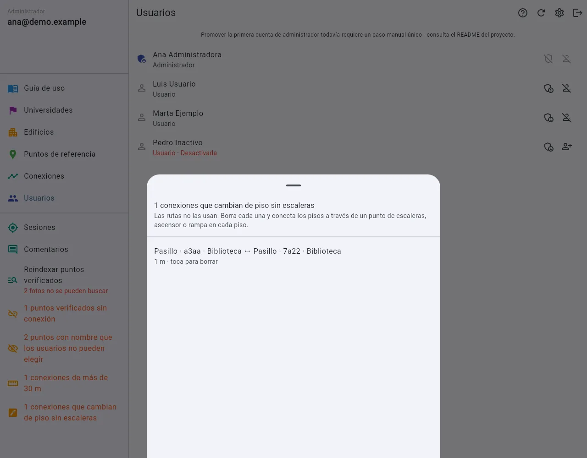

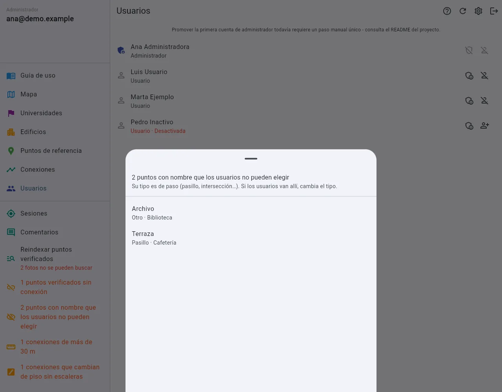

### Reindexar puntos verificados

Si las fotos de un punto verificado no llegaron a la búsqueda (por un problema del servidor), la aplicación todavía no puede reconocerlo, y el menú lo indica en rojo: "N fotos no se pueden buscar". Cuando el servidor esté bien, toca **Reindexar puntos verificados**. Quita de la búsqueda lo que ya no debería estar, envía los puntos que faltan, reintenta los fallos y termina con este resumen, que lista los que aun así fallaron:

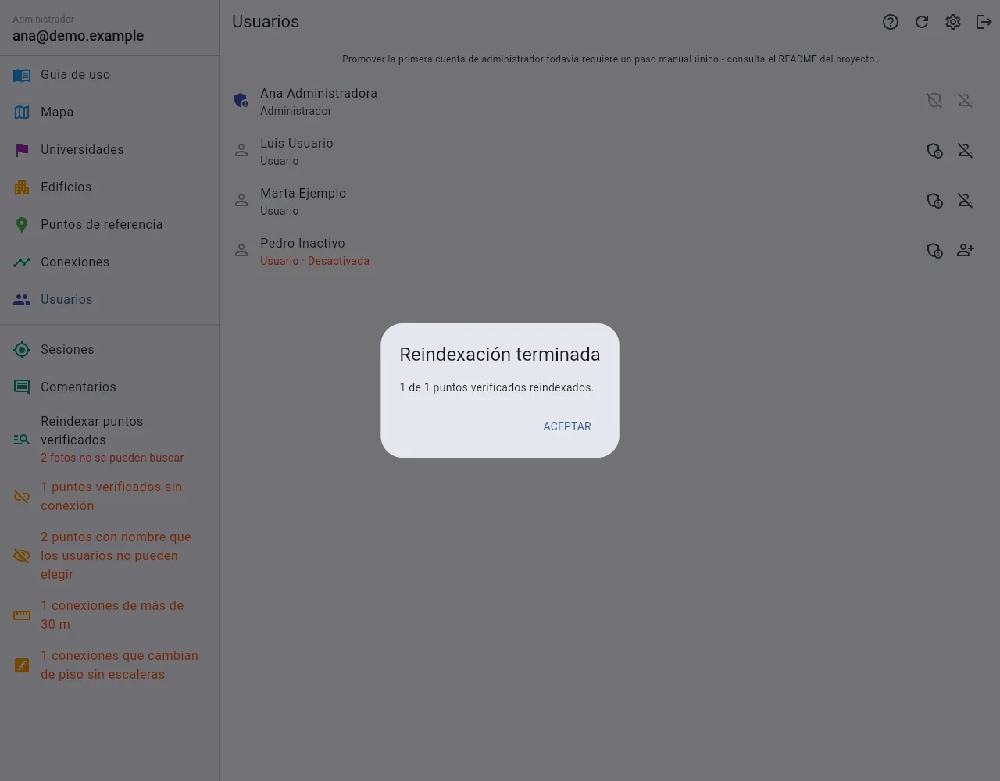

## 9. Usuarios

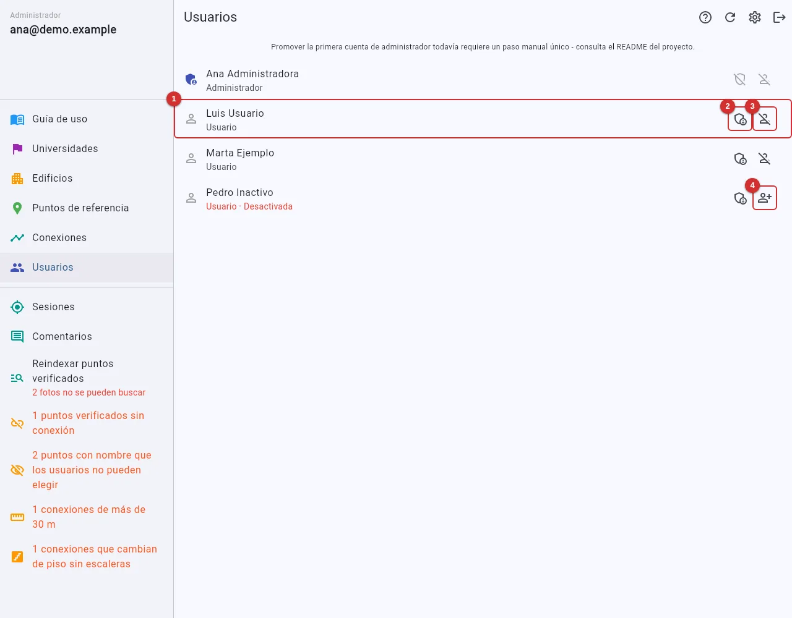

| # | Control | Qué hace |
|---|---|---|
| 1 | Fila del usuario | Su nombre y su rol. "Desactivada" en rojo si está bloqueada. |
| 2 | **Promover a administrador** (escudo) | Le da permisos de administrador, después de confirmar. En un administrador, este botón se los quita. |
| 3 | **Desactivar cuenta** | Bloquea la cuenta sin eliminarla: no puede usar la aplicación ni la web. |
| 4 | **Activar cuenta** | Desbloquea una cuenta desactivada. |

En tu propia fila estos botones están desactivados.

- **Cuentas sin perfil:** si un registro no terminó, la cuenta aparece en una tarjeta resaltada arriba, y su botón crea el perfil que falta.
- **El primer administrador** de una instalación se asigna a mano en la base de datos, como dice la nota de arriba de la lista.

**Versiones de la aplicación.** Funcionan la versión más nueva y la anterior. Quien tenga la anterior ve "Nueva versión disponible" al abrirla. Las más viejas solo muestran "Actualización necesaria" hasta que se instale el APK nuevo, que está en la página de versiones del proyecto en GitHub.

## 10. Sesiones

Una sesión es un viaje hecho con la aplicación. **Sesiones** lista a las personas, con cuántas sesiones tienen y cuántas están activas.

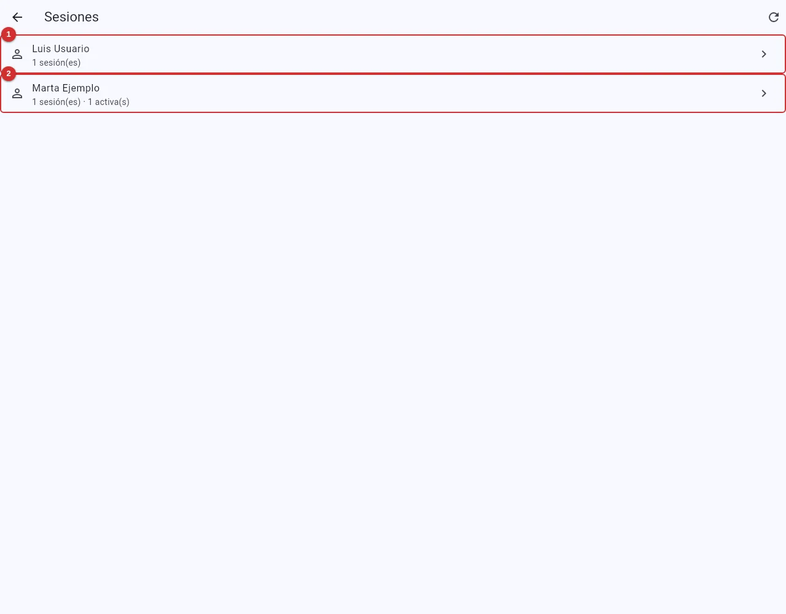

| # | Control | Qué hace |
|---|---|---|
| 1, 2 | Fila del usuario | Abre sus sesiones (abajo). |

La flecha de arriba a la derecha (**Actualizar**) las vuelve a cargar.

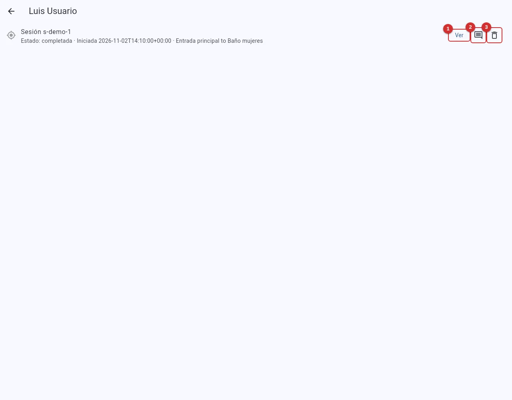

| # | Control | Qué hace |
|---|---|---|
| 1 | **Ver** | Abre el mapa de la sesión (abajo). Se actualiza solo si sigue activa, para seguir un viaje en vivo. |
| 2 | **Ver comentario** | Muestra lo que escribió el usuario al terminar, si escribió algo. |
| 3 | **Eliminar** (basura) | Elimina la sesión y sus registros. |

### El mapa de una sesión

La tarjeta de arriba resume qué tan lejos de la ruta estuvieron el GPS sin corregir y la posición corregida. La leyenda de abajo indica qué es cada cosa:
- **Línea gris azulada:** la ruta planeada. Si cambia de piso, los tramos de otros pisos se ven tenues, y aparecen los botones de piso.
- **Línea naranja punteada:** el GPS sin corregir.
- **Línea verde:** la posición corregida.
- **Puntos morados:** coincidencias de foto, con una línea delgada al punto reconocido. Una línea larga muestra de dónde se jaló la posición.
- **✗ roja:** una instrucción marcada como incorrecta durante una prueba.

Toca cualquiera para ver lo que se registró ahí: la posición, lo que dijo la aplicación, el rumbo y más.

## 11. Comentarios

Lo que escriben los usuarios al terminar un viaje, con su nombre, la fecha y cómo terminó el viaje. Solo se puede leer.

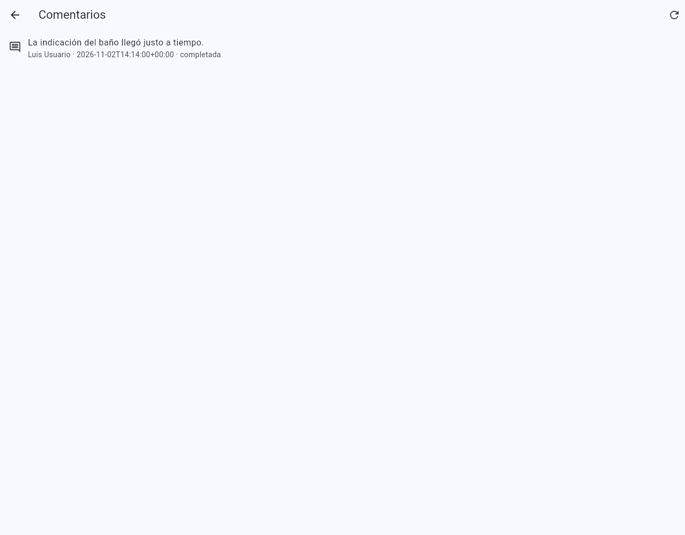

## 12. Configuración

Son tus preferencias; las de cada usuario son independientes.

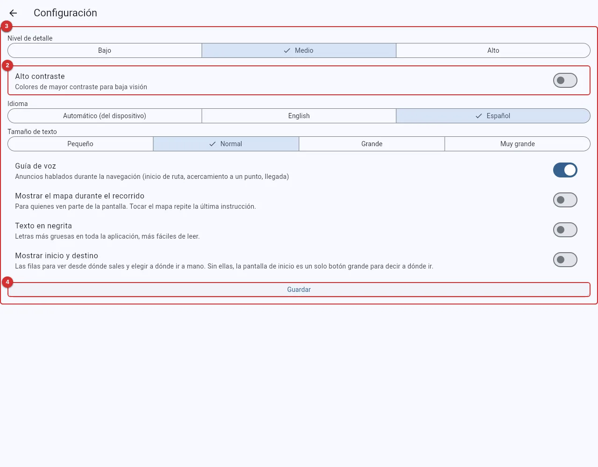

| # | Control | Qué hace |
|---|---|---|
| 1 | **Nivel de detalle** | Cuánto detalle se muestra: bajo, medio o alto. |
| 2 | **Alto contraste** | Colores de mayor contraste, para baja visión. |
| 3 | **Idioma** | Automático (el del dispositivo), English o Español. |
| 4 | **Guardar** | Guarda los cambios. |

También están **Tamaño de texto** (pequeño a muy grande) y **Guía de voz**, los anuncios hablados durante un viaje.

## 13. Solo en el teléfono

En una ventana angosta o en la aplicación del teléfono, el menú se abre con ☰. Todo lo demás de esta guía funciona igual.

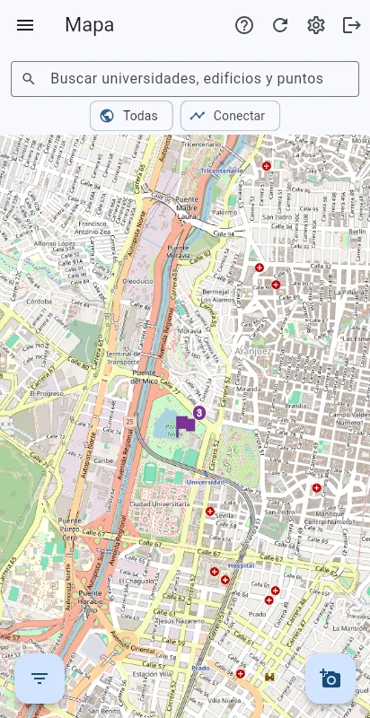

Dos cosas necesitan el teléfono, porque usan la cámara y los sensores. Esta guía no tiene imágenes de ellas.

### Tomar fotos con la cámara

1. Abre **Agregar foto** de un punto, o **Crear y agregar fotos** al crearlo.
2. Párate en el punto. La insignia **Orientación: N°** muestra hacia dónde apunta el teléfono, y se guarda con cada foto.
3. Toca **Tomar foto** en cada dirección. Cada foto se sube sola, y aparece debajo con su rumbo.
4. Toca el ícono de basura de una foto para eliminarla, y **Listo** (✓) al terminar.

### Probar como usuario

**Probar como usuario** (en el menú del teléfono) te deja hacer un viaje real con tu cuenta. Ves el mapa y las coordenadas, que un usuario normal no ve: él solo tiene **Repetir instrucción** y **Terminar navegación**.

- **✗ Instrucción incorrecta:** tócalo cada vez que la aplicación diga algo mal. Guarda lo que acababa de decir y dónde estabas.
- **Estoy en…:** para medir la precisión, recorre la ruta planeada exactamente y tócalo parado en cada punto que nombra (el inicio, cada esquina, el destino). Una pulsación larga deshace el último.
- Luego revisa el viaje en [Sesiones](#sessions).

**Cómo sostener el teléfono.** Vertical frente al pecho, con la cámara trasera hacia adelante. Explícaselo así a quien pruebe; el tutorial de la aplicación también lo dice.

## 14. Eliminar datos

Antes de eliminar, la aplicación dice cuánto más se elimina. Léelo con atención: **no se puede deshacer**.

| Eliminar | También elimina |
|---|---|
| **Una universidad** | Sus edificios, sus puntos, las fotos y las conexiones de esos puntos. |
| **Un edificio** | Sus puntos, sus fotos y sus conexiones. |
| **Un punto** | Sus fotos y sus conexiones. |
| **Una conexión** | Nada más. |

Las rutas guardadas que pasan por un punto eliminado se eliminan con él, y el historial de viajes se conserva. Para dejar de usar algo sin perder sus datos, **desactiva** la universidad o el edificio, o pon el punto en **Rechazado**.

## 15. Problemas frecuentes

| Problema | Causa probable | Qué hacer |
|---|---|---|
| Un lugar no aparece como destino | No está verificado, no tiene conexiones, o su tipo es intermedio. | Revisa los tres, y los [avisos del menú](#notices). |
| "No hay ruta" | Falta una conexión en el camino, o usa una de más de 30 m. | Conecta el tramo que falta con **Conectar en el mapa**. |
| "Tu punto de partida no está conectado" | Cerca del usuario solo hay puntos sueltos. | Conecta los puntos de esa zona. |
| "Edificio C" no da ruta | El edificio no tiene puntos verificados y conectados. | Verifica y conecta sus puntos, y marca sus puertas como **Entrada**. |
| No puedo conectar dos puntos | Están a más de 30 m, o en pisos distintos sin escaleras, ascensor o rampa. | Agrega puntos intermedios, o conecta por un punto de ese tipo. |
| No veo un punto en el mapa | Está en otro piso, o hay un filtro activo. | Usa ▲ ▼, apaga **Solo este piso** y quita los filtros. |
| **Crear y agregar fotos** está desactivado | Falta la posición, o elegir interior o exterior. | Usa **Elegir en el mapa** y elige uno de los dos. |
| El mapa se abre en el océano | La web no tiene GPS y es una universidad nueva. | Escribe unas coordenadas aproximadas primero. |
| La aplicación no reconoce un lugar | Sus fotos no están en la búsqueda. | Usa [Reindexar](#reindex). |
| "Actualización necesaria" | La aplicación es demasiado vieja. | Instala el APK más nuevo. |

## 16. Referencia rápida

### Tipos de lugar

Los tipos con ★ son **destinos**: necesitan nombre, y los usuarios los pueden elegir. Los demás son puntos intermedios.

| Categoría | Tipos |
|---|---|
| Caminos y conexiones | Pasillo, Camino exterior, Intersección, Escalera, Elevador, Rampa, Cruce peatonal, Patio |
| Entradas y desplazamiento | Entrada ★, Salida / portería ★, Vestíbulo ★, Estacionamiento ★, Parqueadero de bicicletas ★, Parada de autobús ★, Zona de espera / bancas ★ |
| Académico | Aula ★, Laboratorio ★, Biblioteca ★, Sala de cómputo ★, Zona de estudio ★, Auditorio ★, Oficina ★ |
| Comida, tiendas y servicios | Cafetería ★, Papelería ★, Centro de copias ★, Tienda ★, Cajero / banco ★, Baño ★, Bebedero ★ |
| Bienestar y deporte | Enfermería / servicio médico ★, Gimnasio / zona deportiva ★, Capilla ★ |
| Otro | Otro |

### Iluminación

| Opción | Significado |
|---|---|
| Sin definir | Sin información. |
| Brillante | Bien iluminado, por ejemplo con luz natural. |
| Moderada | Iluminación interior normal. |
| Tenue | Poco iluminado, por ejemplo una escalera interior. |

Mapas © colaboradores de [OpenStreetMap](https://www.openstreetmap.org/copyright).
