# Guía de uso para administradores

Cómo construir y cuidar el mapa con el que Eyes4U guía a las personas con discapacidad visual: primero los errores que rompen las rutas, luego el trabajo completo en el mapa, y luego cada pantalla en breve.

Las imágenes son de una **universidad de ejemplo con datos inventados**. Los números rojos corresponden a la tabla debajo de la imagen. Las del mapa están en tamaño de teléfono, como lo usarás en el campus; las demás, en un computador.

## 1. Errores que rompen las rutas

Todos pasaron en pruebas reales. Los **avisos** naranjas del menú detectan solos los cuatro primeros, y su enlace **Cómo arreglarlo** abre aquí la sección correspondiente.

### Un destino guardado con un tipo intermedio

Los usuarios solo pueden elegir destinos (★ en la [Referencia rápida](#reference)), así que un "Baño" guardado como Pasillo nunca les aparece.
**Cómo verlo:** el aviso **N puntos con nombre que los usuarios no pueden elegir**.
**Cómo arreglarlo:** abre el punto y cambia su **Tipo de lugar**. Deja los que sean a propósito ("Pasillo a los salones 202").

### Un punto verificado sin conexiones

Las rutas solo siguen conexiones, así que nadie puede llegar a él ni salir de él.
**Cómo verlo:** el aviso **N puntos verificados sin conexión**, o el filtro **Conexiones: No tiene**.
**Cómo arreglarlo:** conéctalo con sus vecinos en el [modo Conectar](#connect-on-map).

### Huecos de más de 30 m

Una conexión de más de 30 m se rechaza, y las viejas no se usan, así que a los usuarios se les dice que el lugar "todavía no está conectado a ningún camino".
**Cómo verlo:** ese mensaje al probar; el aviso **N conexiones de más de 30 m**; el filtro de Conexiones **Más de 15 m**.
**Cómo arreglarlo:** elimínala, agrega puntos intermedios **cada 6 a 8 m** por el camino real, y conéctalos en cadena.

### Un cambio de piso sin escalera, ascensor ni rampa

Los pisos solo pueden cambiar por un punto de tipo **Escalera**, **Elevador** o **Rampa**, para que la aplicación pueda decir "Toma el ascensor al piso 3".
**Cómo verlo:** el aviso **N conexiones que cambian de piso sin escaleras**.
**Cómo arreglarlo:** elimínala, crea un punto de escalera o elevador **en cada piso**, y conecta esos. Ver [Pisos](#floors).

### El mismo lugar dos veces, o en el piso equivocado

Los duplicados reparten las fotos; un punto en el piso equivocado se alcanza por la escalera equivocada.
**Cómo verlo:** la aplicación pregunta antes de guardar a menos de 3 m de otro punto; en el mapa los puntos se superponen, o uno aparece como ▲▼ donde esperabas un punto.
**Cómo arreglarlo:** agrega las fotos al punto que ya existe, elimina el duplicado y pon el **Piso** correcto ("Piso 1" es la planta baja).

### Puertas del edificio sin marcar como Entrada

Los usuarios pueden decir un edificio ("Edificio C"), y la ruta termina en su **Entrada** más cercana. Si no tiene ninguna, termina en cualquier punto conectado de su piso más bajo.
**Cómo verlo:** decir el edificio en **Probar como usuario** termina en un lugar raro.
**Cómo arreglarlo:** dale a cada puerta el tipo **Entrada** y un nombre, y conéctala.

### Dos grupos de puntos que nunca se juntan

Todos los puntos están conectados, pero los caminos de un edificio nunca llegan a los del siguiente.
**Cómo verlo:** "no está conectado" entre ellos al probar; en el mapa, un grupo de líneas del que no sale ninguna.
**Cómo arreglarlo:** captura el camino entre ellos y conéctalo por ambos extremos.

### Puntos sin fotos, o que no se pueden buscar

La aplicación reconoce un lugar solo por sus fotos.
**Cómo verlo:** verificar se rechaza; el menú dice "N fotos no se pueden buscar" en rojo.
**Cómo arreglarlo:** toma [de 4 a 8 fotos](#photos), una por dirección. Si están pero no se pueden buscar, usa [Reindexar](#reindex).

### Una posición aproximada

Un punto a varios metros del lugar real manda a la gente por donde no es.
**Cómo verlo:** en el mapa queda fuera de su pasillo, o sus líneas atraviesan paredes.
**Cómo arreglarlo:** [Muévelo](#points-map) apuntando con **la punta del pin**. **Usar mi ubicación** solo funciona con GPS de ±8 m o mejor.

## 2. Primeros pasos

La aplicación abre la vista de administrador cuando tu cuenta es de administrador. Las cuentas nuevas empiezan como usuarios normales: otro administrador las promueve en [Usuarios](#users). En una ventana angosta, el menú se abre con ☰.

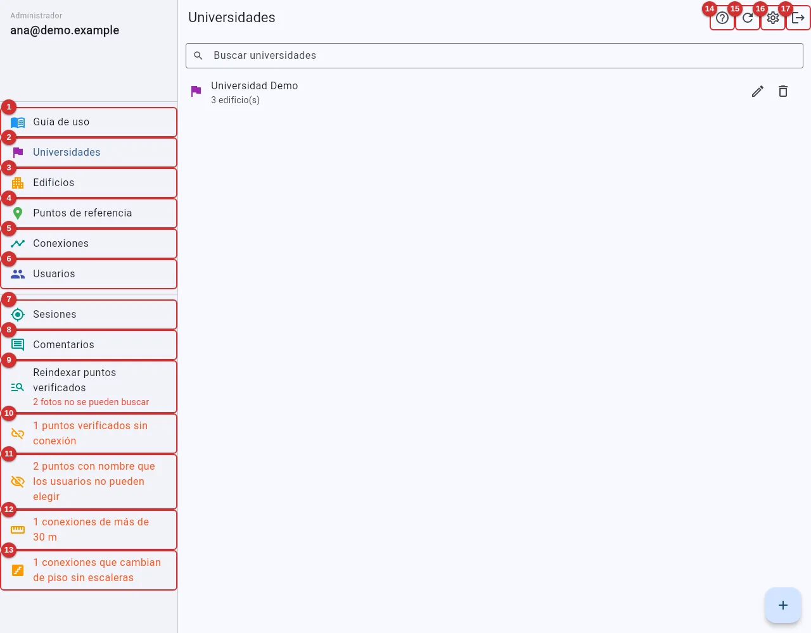

| # | Control | Qué hace |
|---|---|---|
| 1 | **Guía de uso** | Abre esta guía en otra pestaña. |
| 2 | **Mapa** | Donde abre la aplicación. Las entradas de abajo son listas de los mismos datos. |
| 3 | Avisos naranjas | Cosas por arreglar, solo cuando las hay. Ver [Revisar tu trabajo](#notices). |
| 4 | **Ayuda de esta página** (?) | Abre esta guía en la página donde estás. |
| 5 | **Actualizar** | Vuelve a cargar los datos. Los cambios de otros administradores también llegan solos en unos 30 s. |
| 6 | **Configuración** | Tu idioma, tamaño de letra y contraste. |
| 7 | **Cerrar sesión** | Cierra tu sesión. |

## 3. El trabajo completo, de principio a fin

1. Crea la **[universidad](#universities)** y sus **[edificios](#buildings)**, con sus pisos.
2. Abre el **[Mapa](#points-map)** y entra al edificio.
3. Crea los **[puntos](#point-form)** con el botón de la cámara: primero los lugares a donde va la gente, con un nombre claro; luego puntos intermedios cada 6 a 8 m por los caminos.
4. Agrega las **[fotos](#photos)**, de 4 a 8 por punto, y **[verifica](#verify)** cada punto.
5. **[Conecta](#connect-on-map)** los puntos en cadena por los caminos.
6. Resuelve los **[avisos](#notices)**, recorre una ruta con **[Probar como usuario](#phone-only)** y mira su **[sesión](#sessions)**.

**Ejemplo.** De la puerta de la Biblioteca al baño: crea "Universidad Demo" y "Biblioteca". En el mapa, crea "Entrada principal" (Entrada), "Baño mujeres" (Baño) y un Pasillo cada 7 m entre ellos. Agrega fotos, verifícalos y conéctalos en orden. "Baño mujeres" ya se puede elegir.

## 4. El mapa

El mapa muestra primero las universidades, sus edificios al acercarte, y los puntos y conexiones más cerca todavía.

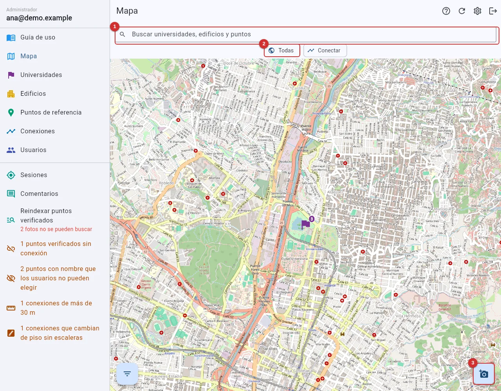

| # | Control | Qué hace |
|---|---|---|
| 1 | **Buscar** | Encuentra universidades, edificios y puntos, y lleva el mapa allí, en el piso correcto. |
| 2 | **Todas** › universidad › edificio | Dónde estás. Toca un nivel, o usa atrás, para subir. ⓘ abre sus detalles. |
| 3 | **Nuevo punto de referencia** | Abre [el formulario](#point-form), con el edificio donde estás. |

Toca una universidad para ver sus edificios, y un edificio para ver sus puntos.

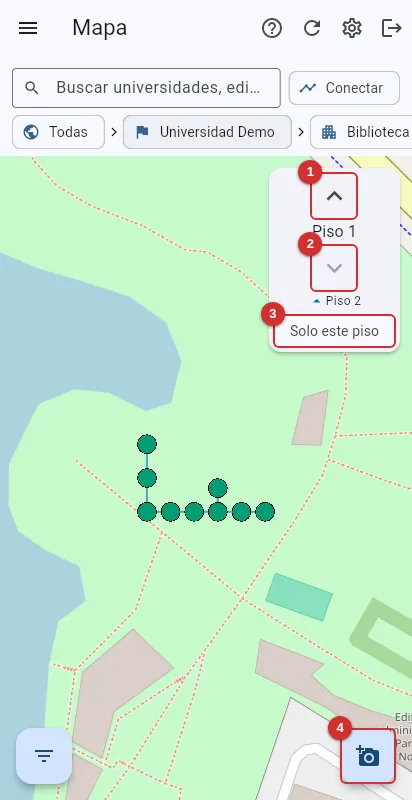

| # | Control | Qué hace |
|---|---|---|
| 1 | **Subir un piso** | Muestra el piso de arriba. |
| 2 | **Bajar un piso** | Muestra el piso de abajo. |
| 3 | **Solo este piso** | Oculta los pisos vecinos. |
| 4 | **Nuevo punto de referencia** | Abre [el formulario](#point-form). |

| Marca | Significado |
|---|---|
| Punto verde / gris claro | Punto verificado / pendiente |
| ✕ naranja | Punto rechazado |
| ▲ azul / ▼ morado | Un punto en el piso de arriba / abajo |
| Anillo negro | El punto seleccionado o que se está moviendo |
| Línea azul | Una conexión, punteada si cambia de piso |
| Bandera morada / edificio naranja | Una universidad / un edificio, con cuántos edificios o puntos tiene |

Los colores se distinguen también para administradores daltónicos, y la forma siempre ayuda. **Filtros** (abajo a la izquierda) acota los puntos por estado, tipo, piso, interior o exterior, iluminación, fotos y conexiones; su número es cuántos hay puestos. La lista de [Puntos de referencia](#anchor-points) usa los mismos.

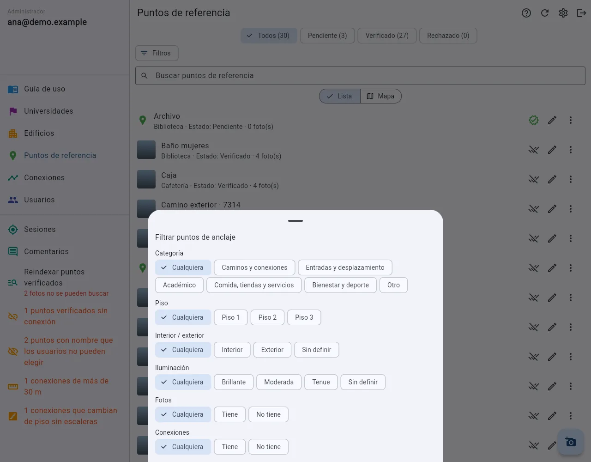

**Pisos.** Se ve un piso a la vez. Los puntos del piso de arriba se ven como ▲ y los de abajo como ▼, y las líneas solo si tocan el piso actual.

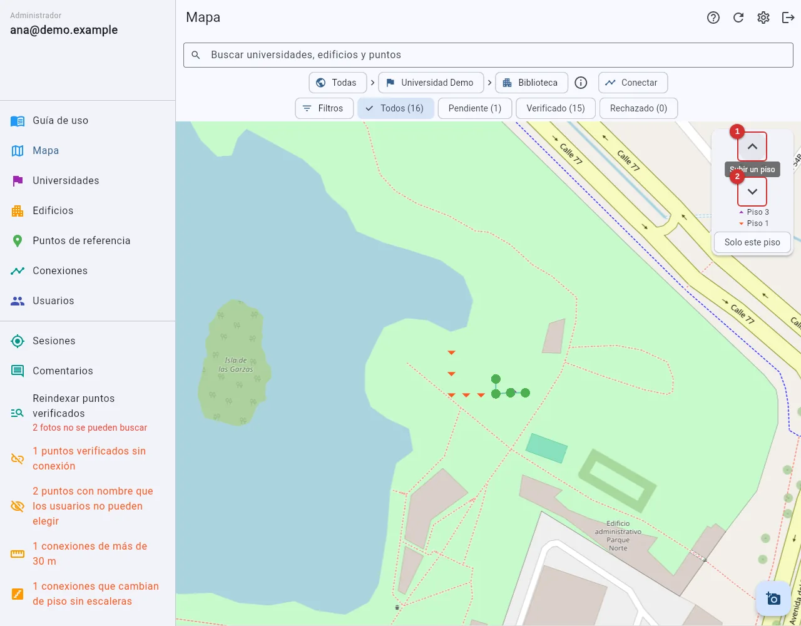

### Los detalles de un punto

Toca un punto: sus datos y acciones se abren al lado del mapa, o desde abajo en un teléfono.

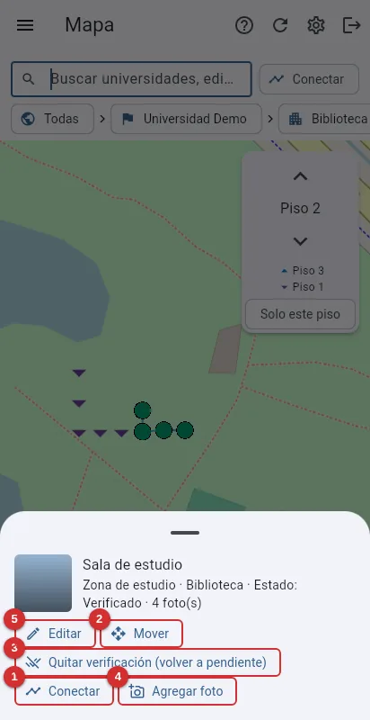

| # | Botón | Qué hace |
|---|---|---|
| 1 | **Conectar** | Empieza el [modo Conectar](#connect-on-map) desde aquí. |
| 2 | **Mover** | Toca el lugar nuevo (la punta del pin) y luego **Guardar nueva posición**. Se rechaza si una conexión pasaría de 30 m. |
| 3 | **Verificar** / **Quitar verificación** | Ver [Verificar](#verify). |
| 4 | **Agregar foto** | Abre [sus fotos](#photos). |
| 5 | **Editar** | Los campos [del formulario](#point-form), más su estado. |

### Modo Conectar

Una conexión significa que **una persona puede caminar en línea recta entre dos puntos**; las rutas solo siguen conexiones. Enciende **Conectar** y toca los puntos en orden por un camino. Cada toque conecta con el anterior, y así la cadena sigue por el pasillo.

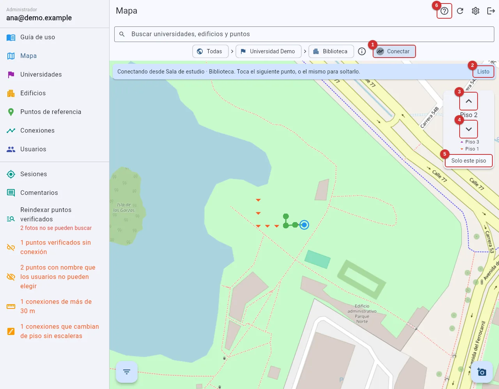

| # | Control | Qué hace |
|---|---|---|
| 1 | **Conectar** | Enciende y apaga el modo. |
| 2 | **Listo** | Sale del modo. Atrás también, después de soltar el punto. |
| 3 | **Ayuda de esta página** | Abre esta sección. |

- Toca otra vez el punto seleccionado para soltarlo. Una línea nueva se ve gris punteada mientras se guarda.
- Como mucho **30 m** en línea recta (aviso desde 15 m), y los pisos solo cambian por una escalera, un elevador o una rampa. Un toque rechazado no pierde tu lugar en la cadena.
- **Entre pisos:** con **Solo este piso** apagado, selecciona la escalera de este piso y luego su ▲ o ▼ en el otro; el mapa lo sigue. Conecta también el elevador: las rutas lo prefieren.

### Los detalles de una conexión

Toca una línea, en cualquiera de los dos modos.

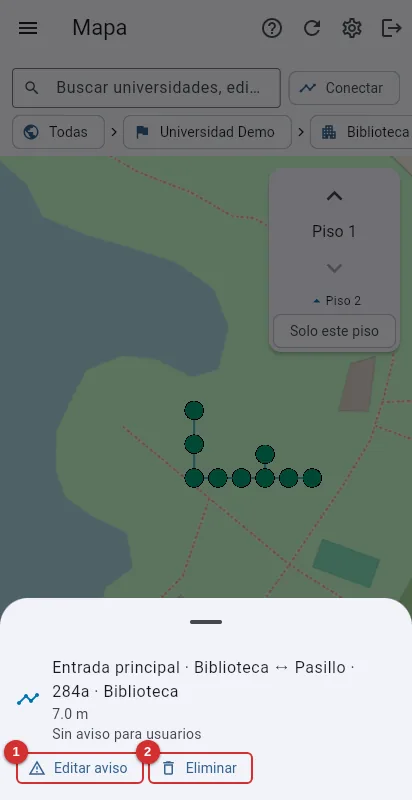

| # | Botón | Qué hace |
|---|---|---|
| 1 | **Editar aviso** | Lo que oyen los usuarios al empezar ese tramo: "Atención: tres escalones hacia abajo". La aplicación no ve obstáculos. |
| 2 | **Eliminar** | La elimina, después de confirmar. Las rutas que pasaban por ella se recalculan. |

Las escaleras, los elevadores y las rampas se anuncian solos cuando el punto tiene ese tipo.

## 5. Universidades y edificios

Una universidad es un campus; todo pertenece a una. La fila de una universidad abre sus edificios, y la de un edificio sus puntos.

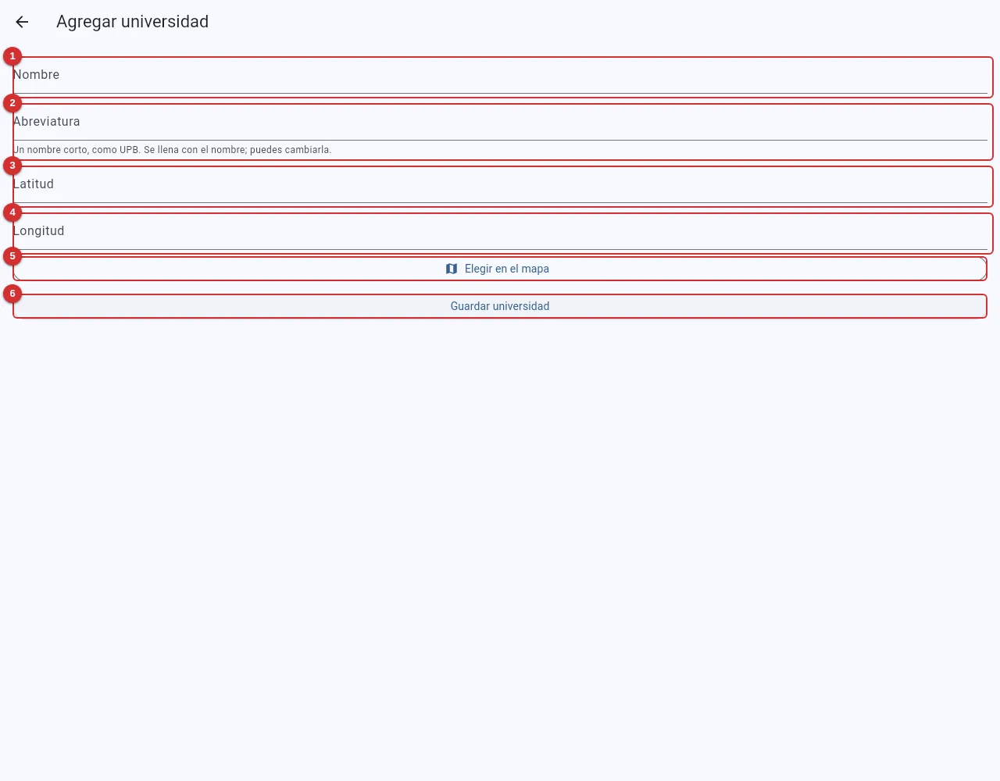

| # | Campo | Qué significa |
|---|---|---|
| 1 | **Nombre** | El que se muestra en toda la aplicación. |
| 2 | **Abreviatura** | Un nombre corto, como `UPB`. Se llena con las iniciales del nombre; puedes cambiarla. No se puede cambiar después. |
| 3 | **Latitud** | El centro aproximado del campus. |
| 4 | **Longitud** | Igual. |
| 5 | **Elegir en el mapa** | Llena los dos tocando un mapa. |
| 6 | **Guardar universidad** | La crea. |

> **En la web, escribe primero unas coordenadas aproximadas:** sin ellas, el mapa se abre en el océano, en 0,0.

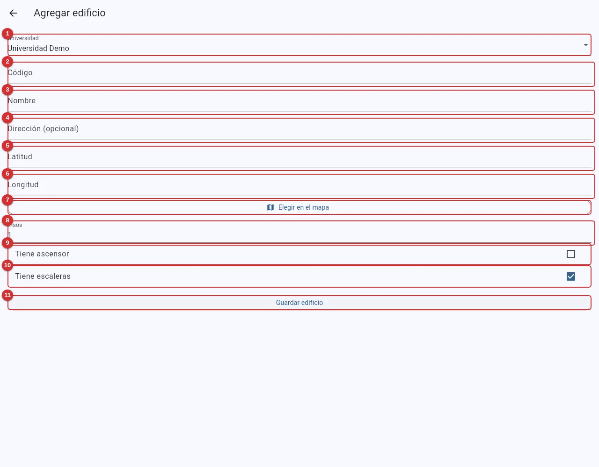

| # | Campo | Qué significa |
|---|---|---|
| 1 | **Universidad** | A cuál pertenece. |
| 2 | **Nombre** | El que usa la gente ("Edificio C", "Bloque 20"); los usuarios lo pueden decir, así que escríbelo como lo dicen. |
| 3 | **Latitud** | Su posición. Se rechazan puntos a más de 300 m. |
| 4 | **Longitud** | Igual. |
| 5 | **Elegir en el mapa** | Llena los dos, empezando en la universidad. |
| 6 | **Pisos** | Cuántos tiene; son las opciones de piso de sus puntos. |
| 7 | **Tiene ascensor** | Información de accesibilidad. |
| 8 | **Tiene escaleras** | Información de accesibilidad. |
| 9 | **Guardar edificio** | Lo crea. |

Al editar cualquiera de los dos aparece un interruptor para **desactivarlo**: deja de ofrecerse a los usuarios, y no se borra nada.

## 6. Puntos de referencia

Un punto de referencia es un lugar físico (una puerta, una intersección, el vestíbulo de un elevador) que la aplicación reconoce por sus fotos, y una parada de las rutas. Su **tipo de lugar** lo hace un **destino** (★: los usuarios lo eligen, así que necesita nombre) o un **punto intermedio** (solo une caminos).

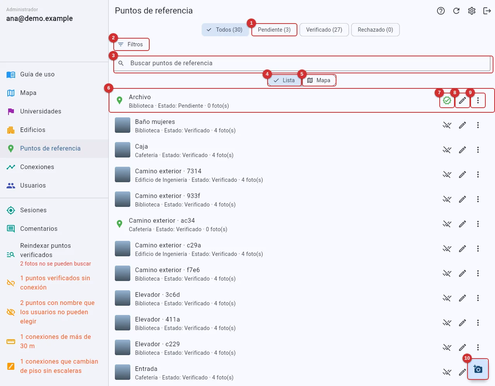

| # | Control | Qué hace |
|---|---|---|
| 1 | **Universidad** | Acota la lista. |
| 2 | **Edificio** | La acota a un edificio. |
| 3 | **Buscar puntos de referencia** | Por nombre. |
| 4 | Fila del punto | **Tocarla abre el mapa en modo Conectar** desde este punto. |
| 5 | **Verificar** | Lo verifica, o devuelve uno verificado a pendiente. |
| 6 | **Editar** (lápiz) | Su página de edición. |
| 7 | **Más acciones** (⋮) | **Agregar foto** y **Eliminar**. |
| 8 | **Filtros** | Como en [el mapa](#points-map). |
| 9 | **Nuevo punto de referencia** | Abre [el formulario](#point-form). |

### Crear un punto

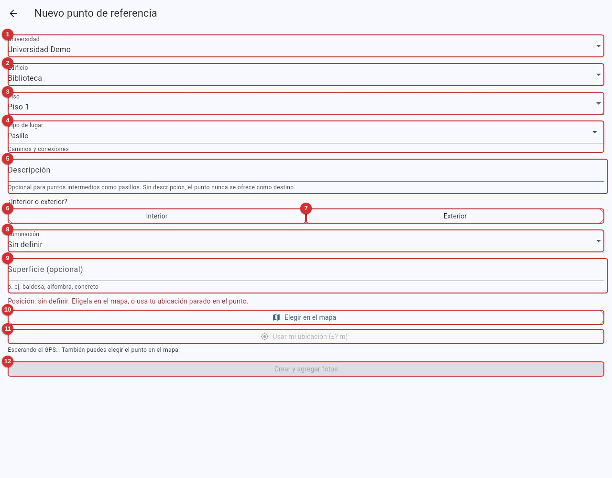

| # | Campo | Qué significa |
|---|---|---|
| 1 | **Universidad** | Acota los edificios. |
| 2 | **Edificio** | A cuál pertenece. |
| 3 | **Piso** | "Piso 1" es la planta baja. |
| 4 | **Tipo de lugar** | Se elige primero, por categoría, con buscador. Decide si el punto necesita nombre. |
| 5 | **Nombre** | Aparece al elegir el tipo. Lo que los usuarios eligen y oyen; obligatorio en los destinos. "Entrada sur", no "Punto 1", y **sin el edificio**, que se quita. |
| 6 | **Interior** | Bajo techo. Elige una de las dos cada vez. |
| 7 | **Exterior** | Al aire libre. |
| 8 | **Iluminación** | Opcional. Explica las fotos oscuras. |
| 9 | **Superficie (opcional)** | Baldosa, concreto… |
| 10 | **Elegir en el mapa** | Lo más preciso: apunta con la punta del pin. |
| 11 | **Usar mi ubicación** | El GPS del teléfono, parado en el punto, con ±8 m o mejor. |
| 12 | **Crear y agregar fotos** | Lo guarda y abre sus fotos. Necesita la posición. |

El formulario recuerda la universidad, el edificio, el tipo, el piso, la iluminación y la superficie de tu último punto. Pregunta antes de guardar a menos de 3 m de otro punto, o un nombre en un tipo intermedio.

### Fotos

La gente llega a un lugar por cualquier lado, así que toma **de 4 a 8 fotos parado en el punto**, una hacia cada lado. En el teléfono, **Tomar foto** guarda la orientación de la brújula. En la web, las subes:

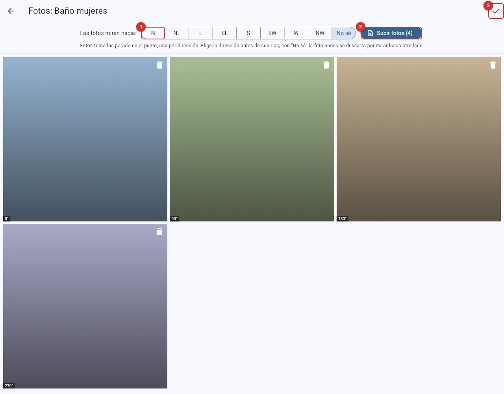

| # | Control | Qué hace |
|---|---|---|
| 1 | **Las fotos miran hacia** | Hacia dónde miran las próximas que subas; **No sé** si no estás seguro. |
| 2 | **Subir fotos (N)** | N es cuántas tiene el punto. |
| 3 | **Listo** (✓) | Vuelve. |

### Verificar

Los puntos **Pendientes** no existen para los usuarios y no se reconocen. Los **Verificados** entran a la búsqueda de fotos y a las rutas. Los **Rechazados** quedan a un lado sin borrarlos. Revisa antes que las fotos sean claras y muestren el lugar correcto. Un punto sin fotos no se puede verificar; uno sin conexiones sí, pero no sirve hasta [conectarlo](#pitfall-unconnected).

## 7. Conexiones

Se conecta en el [modo Conectar](#connect-on-map); esta lista es para revisarlas.

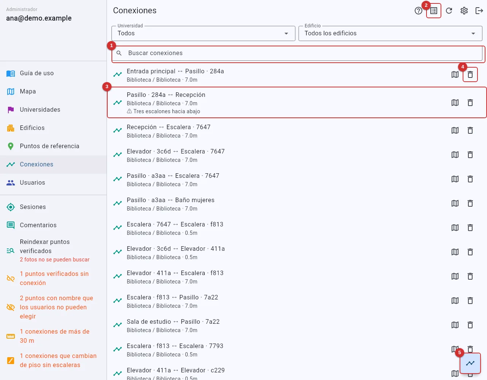

| # | Control | Qué hace |
|---|---|---|
| 1 | **Universidad** | Conexiones con un punto allí. |
| 2 | **Edificio** | Igual, para un edificio. |
| 3 | **Buscar conexiones** | Por el nombre de sus puntos. |
| 4 | **Agregar conexión (formulario)** | Los puntos A y B, una distancia escrita (si el camino se curva) y un aviso. |
| 5 | Fila de la conexión | ⚠ si tiene aviso. Tócala para editar el aviso; el botón del mapa la muestra. |
| 6 | **Eliminar** (basura) | La elimina, después de confirmar. |
| 7 | **Filtros** | Más de 15 m, con aviso, o que cambian de piso. |
| 8 | **Conectar en el mapa** | El mapa en modo Conectar. |

De una conexión solo se puede cambiar el aviso; para lo demás, elimínala y vuelve a conectar.

## 8. Revisar tu trabajo

**Avisos.** Desaparecen cuando todo está bien. Cada uno abre una lista: un elemento se abre en el mapa, y **Cómo arreglarlo** abre su sección de esta guía.

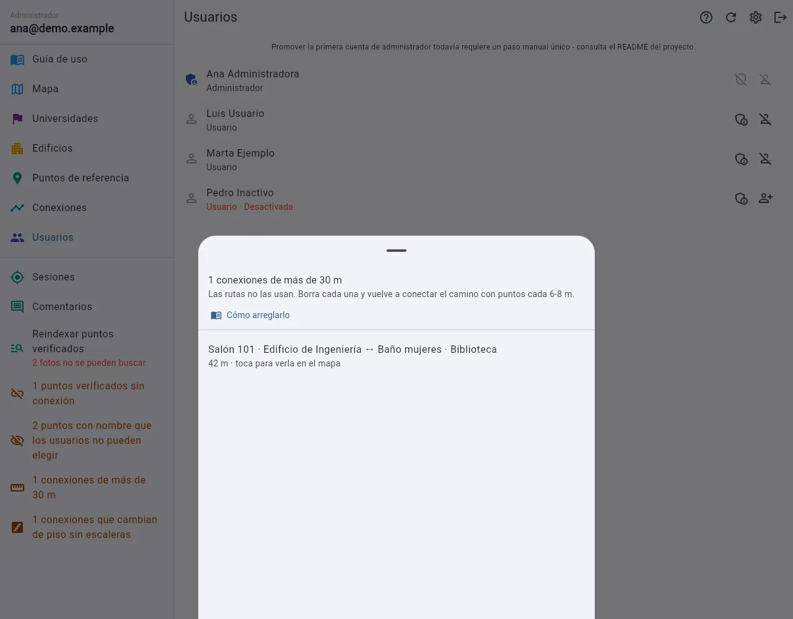

| Aviso | Ver |
|---|---|
| **N puntos verificados sin conexión** | [Sin conexiones](#pitfall-unconnected) |
| **N puntos con nombre que los usuarios no pueden elegir** | [Tipo intermedio](#pitfall-type) |
| **N conexiones de más de 30 m** | [Huecos de más de 30 m](#pitfall-gap) |
| **N conexiones que cambian de piso sin escaleras** | [Cambio de piso](#pitfall-floor) |

**Reindexar puntos verificados.** Cuando el menú diga "N fotos no se pueden buscar" en rojo, tócalo cuando el servidor esté bien. Envía lo que falta y lista lo que siga fallando.

**Probar como usuario** (solo en el teléfono) es un viaje real con tu cuenta. Toca **✗ Instrucción incorrecta** cada vez que la aplicación diga algo mal, y **Estoy en…** parado en cada punto que nombra la ruta, para medir la precisión. Sostén el teléfono derecho frente al pecho, con la cámara de atrás hacia adelante, como se les explica a los usuarios.

**Sesiones** lista los viajes por usuario. **Ver** abre el mapa de un viaje, en vivo mientras dura.

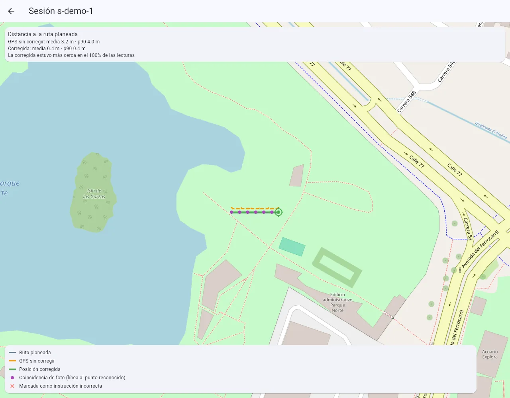

La tarjeta dice qué tan lejos de la ruta estuvieron la posición sin corregir y la corregida. La leyenda nombra cada línea y marca: ruta planeada, GPS sin corregir, posición corregida, coincidencias de fotos e instrucciones incorrectas. Toca cualquiera para ver lo registrado allí. **Comentarios** muestra lo que escribieron los usuarios después de un viaje.

## 9. Usuarios, configuración y borrado

**Usuarios.** **Promover a administrador** (o quitarlo) y **Desactivar cuenta**, que la bloquea sin borrarla; no en tu propia fila. Un registro sin terminar aparece en una tarjeta arriba con un botón para repararlo. El primer administrador se pone en la base de datos.

**Versiones de la aplicación.** Funcionan la más nueva y la anterior; las más viejas muestran "Actualización necesaria" hasta instalar el APK nuevo, de la página de versiones del proyecto en GitHub.

**Configuración** es tuya: idioma, tamaño de letra, letra en negrita, alto contraste y guía por voz.

**Borrar** no se puede deshacer; la aplicación dice antes qué se va con ello. Una universidad se lleva sus edificios, un edificio sus puntos, y un punto sus fotos, conexiones y rutas guardadas; el historial de viajes se conserva. Para dejar de usar algo sin perderlo, **desactiva** la universidad o el edificio, o pon el punto en **Rechazado**.

**En una ventana angosta** el menú se abre con ☰; lo demás funciona igual.

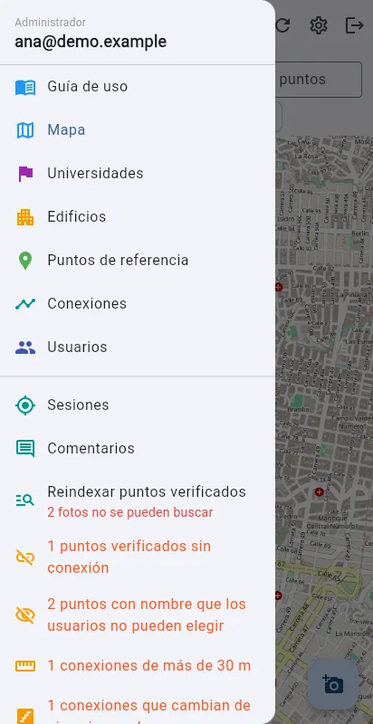

## 10. Referencia rápida

### Tipos de lugar

★ marca los **destinos**: necesitan nombre, y los usuarios los pueden elegir.

| Categoría | Tipos |
|---|---|
| Caminos y conexiones | Pasillo, Camino exterior, Intersección, Escalera, Elevador, Rampa, Cruce peatonal, Patio |
| Entradas y desplazamiento | Entrada ★, Salida / portería ★, Vestíbulo ★, Estacionamiento ★, Parqueadero de bicicletas ★, Parada de autobús ★, Zona de espera / bancas ★ |
| Académico | Aula ★, Laboratorio ★, Biblioteca ★, Sala de cómputo ★, Zona de estudio ★, Auditorio ★, Oficina ★ |
| Comida, tiendas y servicios | Cafetería ★, Papelería ★, Centro de copias ★, Tienda ★, Cajero / banco ★, Baño ★, Bebedero ★ |
| Bienestar y deporte | Enfermería / servicio médico ★, Gimnasio / zona deportiva ★, Capilla ★ |
| Otro | Otro |

**Iluminación:** brillante (luz del día), moderada (luz normal de interior), tenue (una escalera interior).

### Otros problemas

| Problema | Qué hacer |
|---|---|
| Un punto no aparece en el mapa | Otro piso o un filtro: usa ▲ ▼, apaga **Solo este piso**, quita los filtros. |
| **Crear y agregar fotos** está desactivado | Pon la posición y elige interior o exterior. |
| El mapa se abre en el océano | Escribe coordenadas aproximadas para la universidad. |
| "Tu punto de partida no está conectado" | Conecta los puntos alrededor del usuario. |
| "Actualización necesaria" | Instala el APK más nuevo. |

Mapas © colaboradores de [OpenStreetMap](https://www.openstreetmap.org/copyright).
