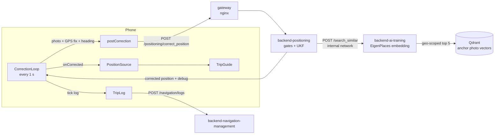

# The position correction pipeline

How a trip turns raw GPS (5–20 m off) into a corrected position: one camera photo and one GPS fix per tick, matched against the anchor-point photos and fused with a Kalman filter. This is the map of the code. Measurements, field-test findings and tuning history are in `docs/TUNING.md`.

## Overview

- **Phone:** a trip runs two loops. The correction loop takes a photo every second and sends it. The guidance loop (`TripGuide`, every 0.5 s) reads where the user is from `PositionSource`, which uses the latest correction.
- **backend-positioning** keeps one filter per trip in memory. It asks backend-ai-training for photo matches near the GPS fix, accepts at most one, and fuses it with the GPS fix.
- **backend-ai-training** turns the photo into a 2048-number vector and asks Qdrant for the most similar anchor photos within 60 m.
- **Nothing in this path blocks the trip.** Any failure gives a GPS-only answer, or a GPS-only log tick.

## One tick, step by step

### 1. The app takes a photo — `CorrectionLoop` (`application/lib/user/correction_loop.dart`)

- **Rhythm:**
  - `_tick` starts every second, measured from the start of the last tick (`nextTickDelay`), so a slow answer doesn't stretch the rhythm.
  - After an answer with `server_busy`, no photo is sent for 5 s (`photoPauseWhenBusy`), and those ticks are 3 s apart (`pausedTickPeriod`), both in `lib/services/test_walk.dart`.
- **No session, no fix, no camera:** the tick only logs the raw GPS (`logRaw`).
- **`_correct`:**
  1. Reads the heading at the moment of the photo (`heading()`, which is the screen's `_sentHeading`).
  2. Takes the photo (camera `ResolutionPreset.medium`, `lib/services/camera_helper.dart`).
  3. Checks for a covered lens: `isFrameBlocked` (`lib/services/image_utils.dart`) downsizes the photo to 32×32 and counts it as blocked when the mean brightness is < 15 or its spread is < 8. Three blocked ticks in a row are announced once. A blocked tick logs raw GPS and sends nothing.
  4. Sends the photo with `postCorrection`.
  5. Hands the answer to the screen (`onCorrected` → `_applyCorrection` → `PositionSource.correct`), and buzzes once per newly matched anchor (`onNewMatch`).
  6. Posts the tick's log without waiting for it (step 7).
- **Any exception** (timeout 8 s, HTTP error, camera error) logs raw GPS with `failure` set to `api_<status>` or the error type.

### 2. The request — `postCorrection` (`application/lib/services/correction_request.dart`)

A multipart `POST /positioning/correct_position` with these fields:

| Field | Value |
|---|---|
| `photo` | the JPEG |
| `session_id` | the navigation session id (the start check uses a throwaway `start-check-…` key) |
| `latitude`, `longitude`, `accuracy` | the raw GPS fix (`geolocator`, best accuracy, one fix per second) |
| `heading` | the direction the camera faces, **magnetic** degrees (see Heading); omitted when unknown |
| `gps_time` | the fix's own timestamp (UTC ISO) |
| `gps_speed` | the same fix's speed in m/s (apps from 0.6.2) |
| `store_frame` | `true` only on an admin's test walk |

The gateway (`gateway/nginx.conf`) limits `/positioning/` to 5 requests/s per user (burst 10) and 15 MB per upload, then proxies to `positioning:80`.

### 3. The server receives it — `correct_position` (`backend-positioning/app/main.py`)

1. Checks the bearer token (`get_caller_id`, cached 60 s) and the app version (426 for one that's too old).
2. Keys the filter `"{caller_id}:{session_id}"`, keeping at most 5 live filters per caller (`limit_owner`). It takes that session's lock and holds it until the answer, so two requests for one trip never interleave.
3. Calls `_search_similar` (step 4).
4. With `store_frame`, checks the caller is an admin and uploads the frame to the `navigation-frames` bucket after answering.
5. Runs `SessionStore.correct` (step 5) and adds the timing to `debug` (`upload_ms`, `auth_ms`, `search_ms`, `search_timing`, `total_ms`).

### 4. Finding similar photos — `_search_similar` → `search_similar` (`backend-ai-training/app/main.py`)

- **Positioning's side (`_search_similar`):**
  - It sends the photo, the raw GPS fix, `radius_meters` = 60 and `limit` = 5.
  - It tries the extra model machines first (`AI_TRAINING_URLS`, `app/model_machines.py`), then this server's own `AI_TRAINING_URL`.
  - Budget: 2 s per try and 2.5 s in total.
  - A 503 moves on to the next machine. A machine that fails to connect within 0.3 s is skipped for 30 s.
  - A timeout isn't retried. A failed connection to its own model is retried once.
  - Out of options, it returns no candidates and `server_busy: true`.
- **ai-training's side (`search_similar`):**
  1. **Wait for the model:** `ModelGate.search` (`app/model_gate.py`) lets at most 2 photos (`MODEL_SLOTS`) use the model at once. A photo waits at most 0.8 s, or not at all when 8 are already waiting, and otherwise gets a 503.
  2. **Embed:** `extract_embedding` (`app/embedding.py`) decodes the photo and resizes it to a short side of 384, keeping its shape. It normalizes the colours as ImageNet does and runs **EigenPlaces** (a ResNet50 trained for place recognition, pretrained only). The output is a 2048-number vector.
  3. **Search:** Qdrant `query_points` on the `anchor_point_photos_eigenplaces` collection, cosine similarity, filtered by `GeoRadius` (60 m around the raw fix) and limited to the top 5 photos.
- **Answer:** for each photo `anchor_point_id`, `photo_id`, `latitude`, `longitude`, `building_id`, `score` (cosine, uncalibrated), `heading` (the direction the anchor photo was taken), plus `timing_ms` (`embed`, `qdrant`).

The vectors come from `POST /index_anchor`, called when an admin verifies a point. Each anchor photo is one Qdrant point: its id is the photo's id, and its payload holds the anchor's id, position, building and the photo's heading. A move or a new photo re-indexes it, and un-verifying or deleting removes it.

### 5. Choosing a match and fusing — `SessionStore.correct` (`backend-positioning/app/session_store.py`)

In this order:

1. **Start or restart the filter:**
   - **First call:** a new filter at this fix (`make_filter`), as uncertain as the fix's accuracy.
   - **More than 30 s since the last call** (`MAX_DT_SECONDS`): a new filter at this fix, with no extrapolation through the gap.
   - Positions are metres east/north of the session's first fix (`latlng_to_local`).
2. **Predict:** move the state forward by the time since the last call (`kalman.predict`).
   - When the user is standing still, it applies `stationary_update` before predicting, which says the velocity is ≈ 0 (σ 0.3 m/s). "Still" means `gps_speed` under `POSITIONING_STATIONARY_SPEED_MPS` (0.3 m/s), on a new fix or a repeated one (`stationary_reason`). Without a speed (apps 0.6.1 and older, or iOS's −1), a repeated `gps_time` still means still, as before. `debug.stationary_reason` says which rule fired (`speed` or `repeated_fix`).
3. **GPS update:** a new fix is fused with σ = its accuracy (`gps_update`). A repeated fix is not fused again.
4. **Candidates:** `best_per_anchor` (`app/matching.py`) keeps each anchor's best photo, best score first. They're tried in order until one passes every gate:

   | # | Gate | Fails as | Default |
   |---|---|---|---|
   | 1 | score ≥ min score | `low_score` | 0.25 |
   | 2 | distance from the fix ≤ max(20 m, 2.5 × GPS accuracy) | `too_far` | 20 m, 2.5 |
   | 3 | anchor photo's heading within 60° of the phone's (skipped if either is unknown) | `heading_mismatch` | 60° |
   | 4 | Mahalanobis² of the anchor against the current estimate (judged with the base σ 3 m) ≤ 9.21 (99%) | `mahalanobis` | 9.21 |

5. **Visual update:** the first candidate that passes is fused as a measurement of the position at the anchor, with σ = 3 m + 0.3 × its distance from the fix (`visual_sigma`), so a far match pulls gently. If that would still move the estimate more than `POSITIONING_MAX_MATCH_STEP_M` (1.5 m) in this one tick, σ is raised until the move is exactly that (`sigma_for_step`, #338), and the verdict carries `step_capped_sigma_m`. A real correction then arrives over a few ticks instead of as one jump. `/correct_position_once` (a single photo) doesn't cap. The candidates after it are marked `not_needed`.
6. **Answer:** the filter's position back in lat/lng, `correction_error` = √(σx² + σy²) of the position, the applied anchor's id and its score clamped to 0–1. If no candidate passed, the answer is the filter's GPS-only estimate.

### 6. The answer — `CorrectPositionResponse` (`backend-positioning/app/models.py`)

| Field | Meaning |
|---|---|
| `corrected_lat`, `corrected_long` | the filter's position |
| `correction_error` | metres, the filter's own 1-σ estimate |
| `anchor_match_id` | the anchor fused this tick, or null |
| `confidence_score` | that match's score, 0–1, or null |
| `raw_image_url` | the stored frame (admin test walks), else null |
| `server_busy` | the photo went unsearched for lack of capacity |
| `debug` | `dt_s`, `reinit`, `gps_fused`, `stationary`, `stationary_reason`, `gps_speed`, `gps_accuracy_m`, `compass`, `velocity`, `gps_bias`, `correction_error_m`, `score_margin`, timings, and `candidates`: each with `anchor_id`, `photo_id`, `score`, `distance_m`, `photo_heading`, `heading_diff`, `sigma_m`, `innovation_m`, `mahalanobis2`, `verdict` |

The fields match `navigation_logs`' columns, so the app forwards them unchanged.

### 7. The app uses it — `PositionSource` (`application/lib/user/position_source.dart`)

- **`correct(raw, corrected, error)`** stores the **offset** between the raw fix that was sent and the corrected position, in metres east/north.
- **`live(raw)`** is the newest raw fix moved by that offset, for 20 s after the correction (`freshFor`).
  - **Why an offset:** an answer arrives seconds after its photo, and showing the old corrected position put it 5–11 s behind the user.
  - **Why it holds:** the offset is mostly GPS's own slow error, so it stays valid well past the next tick.
- **`current(raw)`** is what guidance uses: `live` while it's fresh, then raw GPS, reached over 2 s (`blendOver`) instead of a jump.
- **`TripGuide`** (`lib/user/trip_guide.dart`) reads `current` for reaching corners, arrival, drift and the stall check. The admin's map shows `corrected` as a green marker.
- **The tick log:** `TripLog.post` (`lib/user/trip_log.dart`) sends `POST /navigation/logs` with the raw and corrected fields and `debug`. That `debug` holds the server's `debug` as `correction`, plus the screen's own snapshot: heading and its source, the guidance state, `position_source`, the cues said, events, and `timing` (`capture`, `correct`). A refused post puts its cues and events back for the next tick.

## The filter in short (`backend-positioning/app/kalman.py`)

| | |
|---|---|
| Type | Unscented Kalman filter (`filterpy`), 6 states, 2-D measurements |
| State | `[x, y, vx, vy, bx, by]`: position (m), velocity (m/s), GPS offset (m) |
| Frame | metres east/north of the session's first fix (flat-earth approximation, fine at campus scale) |
| Motion (`_fx`) | constant velocity; the GPS offset decays as e^(−dt/120 s) |
| Process noise | per second: position 0.5, velocity 0.3, offset 2σ²/τ (keeps it near σ = 4 m), all × dt |
| GPS measures (`_hx_gps`) | position + offset |
| A photo match measures (`_hx`) | position only |
| Standing still (`_hv`) | velocity = 0, σ 0.3 m/s |
| Start | at the first fix, position σ = its accuracy, velocity σ 2 m/s, offset σ 4 m |

- **Why the GPS offset is part of the state:** walking a known path, the GPS stayed 3–5 m to one side for a whole straight. Treated as random noise, every fix pulled the estimate back to that side right after a match had fixed it. As a state, a match corrects the offset, and that correction persists.
- **Why a UKF, though every model is linear:** it gives the same result as a plain Kalman filter today. It was chosen so a nonlinear IMU update can be added later.
- **The score never sets the noise:** cosine similarity isn't calibrated (it can even be negative), so it only gates. How hard a match pulls comes from its distance.
- **Sigma points are regenerated before every update** (`_resync_sigma_points`), with no process noise added. Two updates in a row on old sigma points gave a broken covariance.

## Heading

- **Guidance's heading:** `HeadingTracker` (`application/lib/services/heading_tracker.dart`) combines the gyroscope (how far the user turns), the GPS course while walking a steady straight (absolute direction), and the compass (starting direction, then a weak pull). It works in degrees from true north. `reliable()` says when guidance may trust it.
- **What's sent with a photo:** the tracked heading converted back to **magnetic** degrees (declination `MAGNETIC_DECLINATION`, default −7.5°), because anchor photos store the compass heading of the phone that took them. Without a trusted heading, nothing is sent and gate 3 is skipped.
- **The server** only uses the heading to gate; it never enters the filter.

## When something fails

| Cause | What happens | Where it shows |
|---|---|---|
| No camera, or not ready | tick logs raw GPS | log has no `correction` |
| Lens covered (3 ticks) | said once; ticks log raw GPS | `failure: camera_blocked` |
| Request fails or takes > 8 s | tick logs raw GPS | `failure: api_<code>` or the error type |
| Model full (503) or search > 2–2.5 s | GPS-only answer, `server_busy`; app pauses photos 5 s | `debug.correction.server_busy`, `failure: server_busy` |
| No candidate passes the gates | GPS-only answer | each candidate's `verdict` |
| Positioning restarted | filters lost; next call starts a new one | `debug.correction.dt_s` 0 |
| > 30 s between calls | filter restarts at the fix | `reinit: true` |
| No correction for 20 s | guidance blends back to raw GPS over 2 s | `position_source` in the tick's debug |

## Debugging a walk

1. **Look at it:** the admin's session view (`session_tracking_screen.dart`) shows the raw and corrected trails and each tick's details.
2. **Read the ticks:** `navigation_logs` rows. Start with `debug.correction.candidates[].verdict` (why each match was used or refused), `gps_bias`, `correction_error_m` and the timings.
3. **Export and replay:** on the server, `backend-positioning/scripts/export_session.py` dumps a session with its route and anchors. Then `scripts/replay.py` reruns it through the real `SessionStore` with different settings and scores the result against the route and, on test walks, the admin's checkpoints. A test walk ("Test as user") also keeps every frame.
4. **Compare photo models:** `backend-ai-training/scripts/benchmark_models.py` runs on the anchor photos, and on the frames stored by test walks.

`docs/TUNING.md` describes each step and what earlier walks found.

## Tuning knobs

All are environment variables read at startup (`.env` of each service).

**backend-positioning** (`MatchConfig.from_env`, `app/matching.py`):

| Variable | Default | What |
|---|---|---|
| `POSITIONING_MIN_MATCH_SCORE` | 0.25 | gate 1 (use 0.75 with `effnet`) |
| `POSITIONING_MAX_MATCH_DISTANCE_M` | 20 | gate 2, base distance |
| `POSITIONING_MATCH_ACCURACY_FACTOR` | 2.5 | gate 2, × GPS accuracy |
| `POSITIONING_HEADING_GATE_DEG` | 60 | gate 3 |
| `POSITIONING_MAHALANOBIS_GATE` | 9.21 | gate 4 |
| `POSITIONING_VISUAL_BASE_SIGMA_M` | 3 | match noise, base |
| `POSITIONING_VISUAL_SIGMA_PER_M` | 0.3 | match noise, per metre from the fix |
| `POSITIONING_SEARCH_RADIUS_M` | 60 | search radius |
| `POSITIONING_SEARCH_LIMIT` | 5 | photos asked for |
| `POSITIONING_GPS_BIAS_SIGMA_M` | 4 | GPS offset size (0 turns it off) |
| `POSITIONING_GPS_BIAS_TAU_S` | 120 | how slowly the offset changes |
| `POSITIONING_GPS_SIGMA_FACTOR` | 1 | × reported GPS accuracy |
| `POSITIONING_STATIONARY_SPEED_MPS` | 0.3 | below this GPS speed the user counts as still (0: the old repeated-fix rule) |
| `POSITIONING_MAX_MATCH_STEP_M` | 1.5 | the most one match may move the estimate in one tick (0: no cap) |
| `AI_TRAINING_URL` | `http://ai-training:80` | this server's model |
| `AI_TRAINING_URLS` | unset | extra model machines, comma-separated |

Fixed in code: search timeout 2 s per try, 2.5 s in total (`app/main.py`); `MAX_DT_SECONDS` 30, `SESSION_TTL_SECONDS` 15 min, `MAX_SESSIONS_PER_OWNER` 5 (`app/session_store.py`).

**backend-ai-training:**

| Variable | Default | What |
|---|---|---|
| `EMBEDDING_MODEL` | `eigenplaces` | or `effnet`; each has its own collection, so switching needs "Re-index verified points" |
| `MODEL_SLOTS` | 2 | photos through the model at once |
| `MODEL_THREADS` | 1 | torch threads per photo |
| `MODEL_SEARCH_WAIT_SECONDS` | 0.8 | longest a photo waits for a slot |
| `MODEL_INDEX_WAIT_SECONDS` | 30 | longest indexing waits |

**App** (needs a build): tick 1 s, busy pause 5 s / 3 s ticks (`lib/services/test_walk.dart`); request timeout 8 s (`_kTickRequestTimeout`); correction hold 20 s, blend 2 s (`PositionSource`); covered lens below mean 15 / spread 8, after 3 ticks (`image_utils.dart`, `CorrectionLoop.blockedAfter`); `MAGNETIC_DECLINATION` in the app's `.env`.

## Known limits and open questions

- **GPS and photos only:** the phone's gyroscope and accelerometer feed the heading, not the filter (#120).
- **No floors in the photo index:** two similar-looking anchors on different floors can't be told apart.
- **Filters live in memory:** one positioning container only, and a restart loses every trip's filter.
- **Latency:** the embedding takes ~0.3–0.5 s of CPU per photo, and a tick's answer arrives seconds after its photo (#122). `PositionSource`'s offset is how the app copes.
- **The model is pretrained only,** not fine-tuned on campus photos (#17).
- **The start check and the step cap:** the start check's 6 photos go through the session endpoint, so each moves the start at most 1.5 m (#338), about 9 m in all. A start whose GPS is 20 m off takes longer to correct than before. Worth watching in the next phone test.
